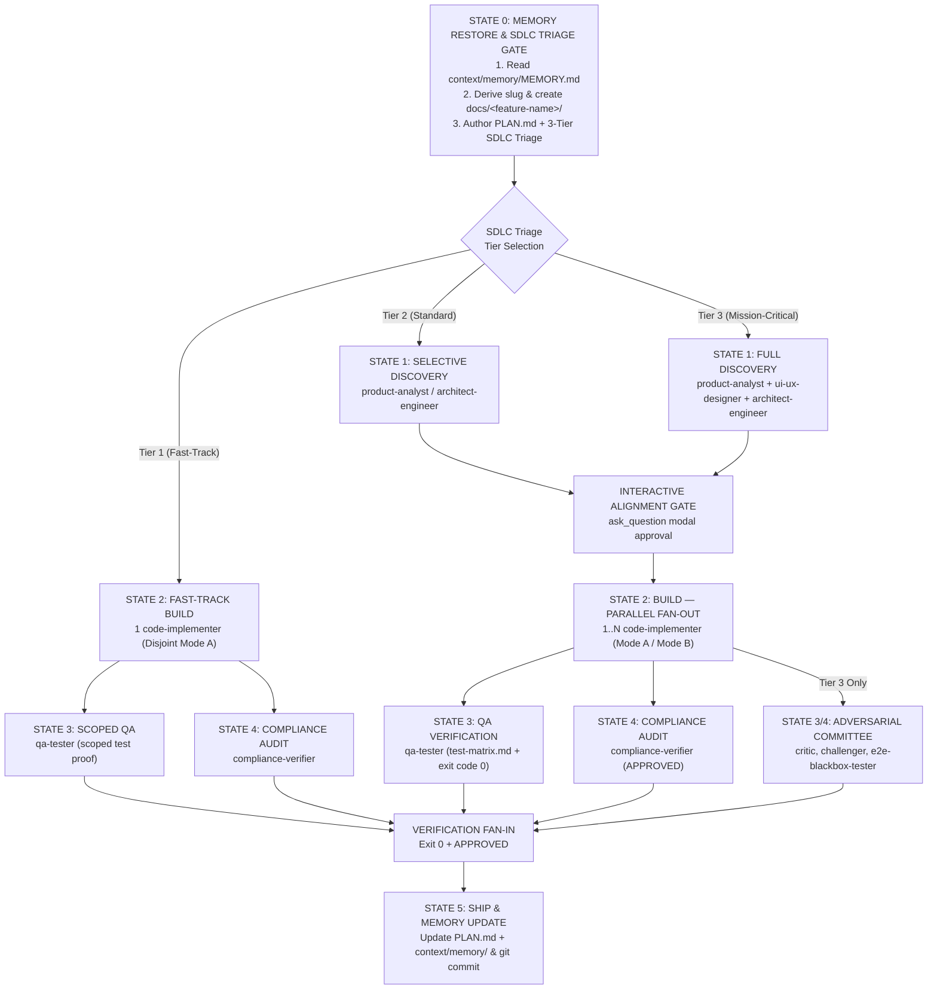

# AGENTS.md - Universal AI Coding Agent Constitution & Instructions

> **Target Audience**: All AI Coding Agents operating within this repository, including Google Antigravity, Anthropic Claude Code, Cursor, Codex, Gemini CLI, and related autonomous coding engines.
>
> **Authority**: This document serves as the supreme operational constitution and governance framework. All agents must comply with the rules, boundaries, and lifecycles defined herein without exception.

---

## 1. Inviolable Core Principles

### 1.1. Plan-First Mandatory Gate
* **No Unplanned Code Changes**: Before any application code modification, refactoring, or implementation begins, an up-to-date `PLAN.md` file **MUST** be authored or updated and committed/saved to disk in the repository root.
* **Granular Task Breakdown**: The plan must detail exact tracks, phases, actionable verification criteria, and affected components.
* **Lifecycle Synchronization**: As milestones progress, agents must keep `PLAN.md` strictly synchronized with the true system state.

### 1.2. Orchestrator Role Boundary
* **Technical Director & Coordinator**: Orchestrator agents (e.g., `senior-dev-orchestrator`, `flutter-feature-orchestrator`) are coordinators and systems directors.
* **Strict Non-Execution Constraint**: Orchestrators are **STRICTLY PROHIBITED** from directly editing application code, libraries, or tests (`src/`, `lib/`, `tests/`, etc.).
* **Tool Permissions**: File editing and writing tools (`write_to_file`, `replace_file_content`, `Write`, `Edit`) in an orchestrator session are reserved **exclusively** for governance, planning, design artifacts, and cross-AI LLM Wiki memory: `PLAN.md`, architectural decision records (`ADR-*.md`), `.agents/` rules, markdown documentation in `docs/`, and `context/memory/`.
* **Mandatory Delegation**: All product requirements analysis, system architecture design, code generation, feature construction, bug fixes, refactoring, test execution, and compliance audits **MUST** be delegated to specialized worker subagents (`product-analyst`, `ui-ux-designer`, `architect-engineer`, `code-implementer`, `flutter-implementer`, `qa-tester`, `compliance-verifier`).

### 1.3. Graph Engineering State Machine (DAG)
All multi-agent execution flows follow a deterministic, adaptive Directed Acyclic Graph (DAG) state machine with parallel fan-out/fan-in, dynamic SDLC tier routing, and cross-AI LLM Wiki persistence:



#### 1.3.1. Dynamic 3-Tier Adaptive SDLC State Machine
Execution workflows scale dynamically according to task scope, surface area, and risk. In State 0, the orchestrator classifies every incoming prompt into one of three SDLC tiers:

| Dimension / Phase | Tier 1: Fast-Track (Low Complexity) | Tier 2: Standard (Medium Complexity) | Tier 3: Mission-Critical (Complex) |
| :--- | :--- | :--- | :--- |
| **Scope & Triggers** | Single-file bugfixes, docs, chores, typos, localized refactoring without public contract changes | 2–4 files/modules, new API endpoints, single UI view/widget, database schema changes | Full end-to-end features, payment/auth flows, architectural refactoring, breaking public APIs, major releases |
| **Discovery (State 1)** | **SKIPPED**: Zero discovery overhead; no PRD, design.md, or architecture.md authored | **SELECTIVE**: Targeted discovery via `product-analyst`, `ui-ux-designer`, or `architect-engineer` | **FULL**: Comprehensive discovery via `product-analyst` (`prd.md`), `ui-ux-designer` (`design.md`), and `architect-engineer` (`architecture.md` / ADRs) |
| **Interactive Alignment (State 1.5)** | **SKIPPED**: Auto-proceeds to implementation | **MANDATORY**: Interactive modal (`ask_question`) presenting PRD/design/architecture summary for user approval | **MANDATORY**: Strict interactive modal (`ask_question`) requiring explicit user sign-off |
| **Build Mode (State 2)** | 1 `code-implementer` in Mode A (Disjoint Files) | 1..N `code-implementer` in parallel under Mode A (Disjoint Files) | 1..N `code-implementer` in parallel under Mode A or Mode B (Git Worktree Isolation) |
| **QA Verification (State 3)** | Scoped test execution (only affected test file run) | Full test suite execution + standardized QA Test Matrix (`docs/<feature-name>/test-matrix.md`) | Full test suite execution + standardized QA Test Matrix (`docs/<feature-name>/test-matrix.md`) across test pyramid |
| **Verification & Committee (State 4)** | Scoped `qa-tester` test proof + `compliance-verifier` audit (bypasses adversarial committee) | Parallel `qa-tester` (`exit code 0`) and `compliance-verifier` (`APPROVED`) | **Adversarial Verification Committee**: `qa-tester`, `critic`, `challenger`, `e2e-blackbox-tester`, `compliance-verifier` |
| **Token & Latency Impact** | **70–85% token & latency savings** | Balanced overhead with rigorous quality verification | Maximum depth, empirical verification, and zero regression tolerance |

#### State Transition Definitions:
1. **STATE 0 — MEMORY RESTORE & SDLC TRIAGE GATE (Mandatory)**:
   - **Feature Directory Creation**: Detect incoming feature requests and derive the `<feature-name>` slug (e.g. `user-auth`, `order-checkout`). Ensure `docs/<feature-name>/` directory is created (creating `docs/` if not present) where discovery artifacts (`prd.md`, `design.md`, `architecture.md`, `adr-*.md`, `test-matrix.md`) will be stored. If the workspace already has `docs/specifications/` or legacy docs, instruct specialists to inspect and synchronize them.
   - **LLM Wiki Memory Read (`context-restore`)**: Check if `context/memory/MEMORY.md` exists; if so, read it silently (~500 tokens) to restore cross-AI handoff state (left by Claude Code or Antigravity). Read linked topic pages (`context/memory/architecture.md`, `context/memory/conventions.md`, `context/memory/log/YYYY-MM-DD.md`) only on demand.
   - **Mandatory 3-Tier SDLC Triage & Capability-Gated Dispatch (`PLAN.md`)**: Author/update a concise `PLAN.md` (`<= 50 lines` per feature) classifying the task into Tier 1 (Fast-Track), Tier 2 (Standard), or Tier 3 (Mission-Critical) with an explicit `Invoke / SKIP` table. Never over-invoke specialists blindly—evaluate each subagent by capability and risk:
     * **`product-analyst`**: **INVOKE ONLY IF** business scope, user stories, or acceptance criteria are ambiguous/missing. **SKIP** if the prompt already defines clear scope/stories, or for bugfixes, refactors, chores, docs, and technical CLIs. Produces concise `docs/<feature-name>/prd.md` (`<= 70 lines`: Objective, Scope, User Stories `US-XX`, Acceptance Criteria `AC-XX`).
     * **`ui-ux-designer`**: **INVOKE ONLY IF** UI screens/components are created/modified AND root `DESIGN.md` is missing or new visual patterns are introduced. **SKIP** for backend/APIs, data pipelines, CLIs, or minor UI tweaks covered by `DESIGN.md`. Maintains root `DESIGN.md` (`<= 110 lines`, official Google 2-layer YAML + 8-section spec) and optional `docs/<feature-name>/design.md` feature delta (`<= 35 lines`).
     * **`architect-engineer`**: **INVOKE ONLY IF** introducing structural decisions (new DB schema, cross-service API contracts, new core dependency, architectural pattern shift). **SKIP** when following established repository architecture. Produces concise MADR `docs/<feature-name>/adr-NNN-*.md` (`<= 55 lines`: Context, Options, Decision & Justification, Trade-offs) and optional `docs/<feature-name>/architecture.md` (`<= 70 lines`).
   - **Target-Project `AGENTS.md` Bootstrap**: When operating in a target project lacking a root `AGENTS.md` (or when stack/commands change), ensure a concise root `AGENTS.md` (`<= 90 lines`) is generated/maintained linking build/test commands, `DESIGN.md`, and `context/memory/MEMORY.md`.
2. **STATE 1 — UPFRONT DISCOVERY EXECUTION (Sequential or Parallel Fan-Out)**:
   - **Tier 1**: **SKIPPED**. Proceeds directly to State 2.
   - **Tier 2**: Executes selective discovery based on triage (`product-analyst`, `ui-ux-designer`, and/or `architect-engineer`).
   - **Tier 3**: Executes full comprehensive discovery. Stores outputs in `docs/<feature-name>/`: `prd.md`, `design.md`, and `architecture.md` / `adr-*.md`. Synchronizes existing `docs/specifications/` if present.
   - Supports **Parallel Discovery Fan-Out** when scopes are independent, or sequential execution (`product-analyst` -> `ui-ux-designer` -> `architect-engineer`) when architecture depends on product scope and UI system disambiguation. Update `PLAN.md` with specifications, `design.md`, ADRs and **Parallel Execution Tracks**.
2.5. **INTERACTIVE USER ALIGNMENT GATE (State 1 -> State 2 Transition)**:
   - **Tier 1 (Fast-Track / Low Complexity)**: **SKIPPED**. Auto-proceeds to State 2 without interruption.
   - **Tier 2 (Standard) & Tier 3 (Mission-Critical)**: The Orchestrator MUST PAUSE and query the user using `ask_question` (interactive GUI dialog modal) presenting a structured summary of:
     * Product Scope (`docs/<feature-name>/prd.md`)
     * UI/UX Design decisions & components (`docs/<feature-name>/design.md`)
     * Architectural decisions & ADRs (`docs/<feature-name>/architecture.md`)
     * Prompt Question: *"Do you approve the product scope, UI design, and architectural decisions before proceeding to code implementation?"*
     * Wait for explicit user confirmation before delegating to `code-implementer` or `flutter-implementer`.
3. **STATE 2 — BUILD: PARALLEL FAN-OUT & WORKSPACE ISOLATION (Mandatory)**:
   - **Reinforced Parallel Collision Prevention Analysis**:
     * **Collision Analysis**: Orchestrator must analyze and verify that parallel tracks never share files under Mode A (`Owned Files` strictly non-overlapping).
     * **Mode B Trigger**: If two tracks must modify shared files (e.g., `package.json`, shared routers, DI containers, `settings.py`, `main.dart`), orchestrator must enforce Mode B (Git Worktree Isolation) or split them into sequential phases.
     * **Scoped Test Execution Isolation**: Each parallel implementer must only run its assigned test file (e.g. `pytest tests/unit/test_feature_a.py`), NOT the full test suite in tight loops, to avoid CPU contention, redundant testing, and major execution delays. Full test suite execution is reserved for State 3 Fan-In by `qa-tester`.
   - Dispatch `code-implementer` (or `flutter-implementer`) subagents:
     * **Tier 1**: Exactly 1 `code-implementer` dispatched under Mode A (Disjoint Files).
     * **Tier 2 & 3**: 1 to N `code-implementer` subagents in parallel:
       - **Mode A — Disjoint File Partitioning (`Workspace: 'inherit'`) [DEFAULT]**: Used when parallel tracks modify non-overlapping files/directories. Each subagent receives an explicit `Owned Files` list and is forbidden from editing outside its partition. Zero `git merge` overhead upon Fan-In.
       - **Mode B — Git Worktree Isolation (`Workspace: 'share'` / `Workspace: 'branch'` in Antigravity, or `git worktree` via `loop-engineering` in Claude Code)**: Used when parallel instances must modify shared files or execute conflicting build processes. Merged cleanly upon Fan-In before final QA.
4. **STATE 3 & 4 — QA VERIFICATION & COMPLIANCE AUDIT (Mandatory)**:
   - **Tier 1**: Dispatch `qa-tester` to execute the scoped test runner verifying the fix, followed by `compliance-verifier` check. Adversarial committee is skipped.
   - **Tier 2**: Dispatch `qa-tester` to execute the full test suite (`exit code 0` empirical proof) and generate `docs/<feature-name>/test-matrix.md`, while `compliance-verifier` audits static analysis and security yielding `APPROVED`.
   - **Tier 3**: Capability-gated **Adversarial Verification Committee** (all reports strictly `<= 50 lines`, zero boilerplate):
     * `qa-tester`: Actionable `docs/<feature-name>/test-matrix.md` (`<= 80 lines`: Objective, Steps, Expected Result per `TC-XX`) across unit/integration/E2E tiers + empirical terminal proof (`exit code 0`).
     * `critic` *(invoke only if diff `>= 150 LOC` or multi-module refactor)*: Code smell analysis, SOLID invariant review, maintainability audit.
     * `challenger` *(invoke only for high-risk logic: auth, payments, concurrency, untrusted input, destructive mutations)*: Boundary conditions, race probes, negative verification.
     * `e2e-blackbox-tester` *(invoke ONLY if a runnable web UI exists)*: Pure `run_command` Playwright browser execution (`375/768/1280/1920px` `.png` screenshots in `docs/<feature-name>/evidence/` + console/network audit). Strictly **Fail-Honest**: if no live web server or Chromium binary runs, MUST report `BLOCKED` or `SKIPPED` (never hallucinate `PASSED`) and the orchestrator must surface this to the user.
     * `compliance-verifier`: Static analysis, OWASP security audit, physical `.png` evidence check for E2E reports, and architectural invariant audit yielding `APPROVED`.
   - If either test fails or compliance returns `REJECTED`, loop back to `code-implementer` (strictly capped at **max 3 self-correction iterations** before escalating to the user).
5. **STATE 5 — SHIP & LLM WIKI MEMORY UPDATE (Mandatory)**:
   - Mark all tasks completed in `PLAN.md`.
   - Persist the completed milestone into `context/memory/` (via `context-capture`): (1) update `context/memory/MEMORY.md` in-place (<= 80-100 lines), (2) update `context/memory/architecture.md` or `conventions.md` in-place if architecture/conventions changed, and (3) append a concise 5-8 line milestone block (`## [HH:MM | Host: Claude Code / Antigravity] <Task>`) to `context/memory/log/YYYY-MM-DD.md`. Never write checkpoints on intermediate turns or simple Q&A prompts.
   - Finalize git staging and commit using Conventional Commits.

### 1.4. Test-Driven Development (TDD)
* **Red-Green-Refactor Cycle**:
  1. **Red**: Write a failing test capturing the requirement or defect before writing production code. Confirm expected failure.
  2. **Green**: Implement the minimal, clean solution necessary to turn the test green.
  3. **Refactor**: Clean up and optimize while ensuring all tests continue to pass.
* **Tests are Empirical Proof**: Never claim a task is completed, fixed, or verified without actual test output showing `exit code 0`.
* **Arrange-Act-Assert (AAA)**: Tests must follow explicit Arrange, Act, Assert structure with isolated mocks at network/database/external API boundaries.
* **Zero Assertion Tampering**: Never delete assertions, alter tests to mask bugs, relax threshold rules, or return hardcoded stub values to fake passing test suites.

### 1.5. Anti-Lazy Code Policy
* **Zero Tolerance for Placeholders**: Absolute prohibition against AI shortcuts, lazy stubs, partial implementations, or omitted logic:
  - ❌ `// TODO: Implement later`
  - ❌ `# ... rest of existing code ...`
  - ❌ `pass  # placeholder`
  - ❌ Empty catch/except blocks swallowing exceptions (`except Exception: pass`).
* **Production Completeness**: Every file modified or created must contain full, production-ready code with exhaustive error handling, input validation, type annotations, and clean logging.
* **Keep Existing Intact**: Do not overwrite or delete existing working code, comments, or docstrings unless explicitly tasked with refactoring them.

### 1.6. Git Hygiene & Branch Safety
* **Branch Protection & Auto-Branching**: **NEVER** develop, commit, or push directly to `main`, `master`, or `develop`. When an orchestrator receives a task while on a protected base branch, it MUST automatically provision a dedicated feature branch using Conventional naming (`feat/<descriptive-slug>`, `fix/<slug>`) and switch to it (`git checkout -b <type>/<slug>`).
* **Proactive Scope Drift Detection**: When already working on a feature branch, if the user requests an orthogonal or unrelated functionality, the orchestrator MUST detect this Scope Drift and proactively ask the user (using interactive GUI modals via `ask_question`) whether to create a new dedicated branch (`feat/<new-slug>`) or continue on the current branch.
* **Conventional Commits**: Every commit message must strictly follow the Conventional Commits specification:
  - Format: `<type>(<optional-scope>): <description>`
  - Types: `feat:`, `fix:`, `refactor:`, `test:`, `docs:`, `chore:`, `perf:`, `build:`, `ci:`.
  - Imperative mood, lowercase description, no trailing period.
* **Merge Conflicts**: Never leave conflict markers (`<<<<<<<`, `=======`, `>>>>>>>`) or unresolved merge states (`UU`, `AA`) in any branch.
* **Atomic Commits**: Stage files selectively (`git add <file>`); never run blanket `git add .` on dirty workspaces.

---

## 2. Dual Ecosystem Architecture

This repository is built as an open multi-agent framework supporting two premier AI agent platforms simultaneously: **Google Antigravity** and **Anthropic Claude Code**.

```
repository-root/
├── plugins/
│   ├── antigravity/                  # Antigravity Plugin Ecosystem
│   │   ├── docs-and-quality/
│   │   ├── git-workflow/
│   │   ├── multi-agent-ops/
│   │   ├── python-backend/
│   │   ├── senior-data-engineer/
│   │   ├── senior-dev/
│   │   ├── senior-dev-flutter/
│   │   ├── shared-context/
│   │   └── sql-query-optimizer/
│   └── claude/                       # Claude Code Plugin Ecosystem
│       ├── docs-and-quality/
│       ├── git-workflow/
│       ├── multi-agent-ops/
│       ├── python-backend/
│       ├── senior-data-engineer/
│       ├── senior-dev/
│       ├── senior-dev-flutter/
│       ├── shared-context/
│       └── sql-query-optimizer/
├── skills/                           # Canonical Skills Catalog (35 Skills)
├── .agents/                          # Shared Agent Rules & Workflows
│   ├── rules/                        # Living repo context & loop engineering
│   └── workflows/                    # Operational task workflows
└── scripts/                          # Synchronization & validation automation
```

### 2.1. Tool Boundaries & Strict Isolation
Each ecosystem uses its native tool definitions. Tools **MUST NOT** bleed across ecosystem boundaries.

| Attribute | Google Antigravity Ecosystem (`plugins/antigravity/`) | Anthropic Claude Code Ecosystem (`plugins/claude/`) |
| :--- | :--- | :--- |
| **Native Execution Tools** | `run_command`, `call_mcp_tool` | `Bash` |
| **File Operation Tools** | `write_to_file`, `replace_file_content`, `view_file` | `Read`, `Write`, `Edit`, `Glob`, `Grep` |
| **Agent Delegation** | `invoke_subagent`, `manage_subagents`, `send_message` | `Agent` |
| **Plugin Manifest** | `plugin.json` (root of plugin) | `.claude-plugin/plugin.json` |
| **Lifecycle Hooks** | `hooks.json` supporting stdin/stdout JSON protocol | `hooks.json` supporting Claude Hook event payloads |
| **Tool Bleed Policy** | Zero Claude tools (`Bash`, `Agent`) inside Antigravity agent definitions | Zero Antigravity tools (`run_command`, `invoke_subagent`) inside Claude agent frontmatters |

### 2.2. Dual Host Hook Compatibility
Hook scripts in `hooks/*.js` are engineered to serve both hosts seamlessly:
* Detect Antigravity execution via tool naming conventions (`run_command`, `write_to_file`) and stdout `{ "decision": "allow" | "deny" }`.
* Detect Claude Code execution via `CLAUDE_PLUGIN_ROOT` or tool naming (`Bash`, `Write`) and structured `{ "hookSpecificOutput": { "permissionDecision": "allow" | "deny" | "ask" } }` responses.

---

## 3. Specialized Subagent Matrix & Roles

| Agent Name | Category | Primary Focus & Domain | Toolset Class |
| :--- | :--- | :--- | :--- |
| `senior-dev-orchestrator` | Orchestrator | Technical direction, task decomposition, pipeline management | Orchestrator Tools (`PLAN.md`, docs only) |
| `flutter-feature-orchestrator` | Orchestrator | Flutter mobile/web pipeline coordination, architecture reviews | Orchestrator Tools (`PLAN.md`, docs only) |
| `product-analyst` | Discovery | Requirements gathering, edge-case identification, PRD drafting | Worker Tools |
| `ui-ux-designer` | Discovery | UI/UX design systems, responsive wireframes, design.md authoring | Worker Tools |
| `architect-engineer` | Discovery | High-level system design, database schemas, ADR authoring | Worker Tools |
| `flutter-architect` | Discovery | Flutter state management, widget hierarchy, layer boundaries | Worker Tools |
| `code-implementer` | Implementation | Production code authoring, bug fixes, refactoring in Python/Node/SQL | Full Worker Tools |
| `flutter-implementer` | Implementation | Flutter widgets, BLoC/Riverpod, Dart models, platform channels | Full Worker Tools |
| `qa-tester` | Verification | TDD execution, unit/integration/E2E tests, test-matrix.md proof | Full Worker Tools |
| `critic` | Verification (Adversarial) | Code smell detection, SOLID invariant review, maintainability audit | Read-Only Audit Tools |
| `challenger` | Verification (Adversarial) | Boundary probe, failure mode injection, edge-case challenge | Full Worker Tools |
| `e2e-blackbox-tester` | Verification (Adversarial) | Blackbox user journeys, failure injection, resilience verification | Full Worker Tools |
| `flutter-reviewer` | Verification | Flutter code quality, widget rebuild profiling, linting | Full Worker Tools |
| `compliance-verifier` | Audit | Architectural invariant verification, safety audit, final signoff | Read-Only Audit Tools |
| `senior-data-engineer` | Specialist | GCP Lakehouse, BigQuery, Datastream, CDC/SCD pipelines | Worker Tools + MCP |
| `sql-query-optimizer` | Specialist | SQL execution plans, index recommendations, query tuning | Worker Tools |
| `context-keeper` | Operations | Capturing and restoring cross-session architectural context | Worker Tools |
| `flutter-release-engineer` | Operations | Store bundles, signing configs, CI/CD pipeline deployment | Worker Tools |

---

## 4. Essential Runbooks & Tooling Commands

### 4.1. Python Test Suite Execution
Execute the test suite to verify plugins, skills, and governance contracts:
```bash
# Run all unit, integration, and structural tests
pytest tests/

# Run fast unit tests only
pytest tests/unit/

# Run structural consistency tests
pytest tests/structure/

# Run with verbose output and failure stop
pytest -v -x tests/
```

### 4.2. Hook Syntax & Safety Validation
Verify syntax and integrity of all Node.js lifecycle hooks across both plugin ecosystems:
```bash
# Check syntax for all hook scripts in Antigravity plugins
for hook in plugins/antigravity/*/hooks/*.js; do
  node --check "$hook" || exit 1
done

# Check syntax for all hook scripts in Claude Code plugins
for hook in plugins/claude/*/hooks/*.js; do
  node --check "$hook" || exit 1
done
```

### 4.3. JSON Manifest & Configuration Validation
Verify validity of all JSON configs, manifests, and hooks:
```bash
# Validate all JSON files across plugins and repository configs
node -e '
const fs = require("fs");
const files = [
  ".claude-plugin/marketplace.json",
  ...require("child_process").execSync("find plugins -name \"*.json\"").toString().trim().split("\n")
];
for (const file of files) {
  if (!file) continue;
  try {
    JSON.parse(fs.readFileSync(file, "utf8"));
  } catch (err) {
    console.error(`Invalid JSON in ${file}:`, err.message);
    process.exit(1);
  }
}
console.log("All JSON configurations are valid!");
'
```

### 4.4. Skill Synchronization Automation
Synchronize canonical skills from `/skills` into each plugin's bundled copy:
```bash
python3 scripts/sync_plugin_skills.py
```

### 4.5. Claude Code Plugin & Agent Synchronization
Synchronize agents, hooks, and manifests between Antigravity and Claude Code ecosystems:
```bash
python3 scripts/sync_agents.py
```

---

## 5. Summary Compliance Rule for All Agents

> **Any AI agent modifying code without an active `PLAN.md`, any orchestrator attempting direct file edits on `src/` or `lib/`, or any implementation without test proof (`exit code 0`) is in direct violation of repository governance and must immediately halt and delegate.**
