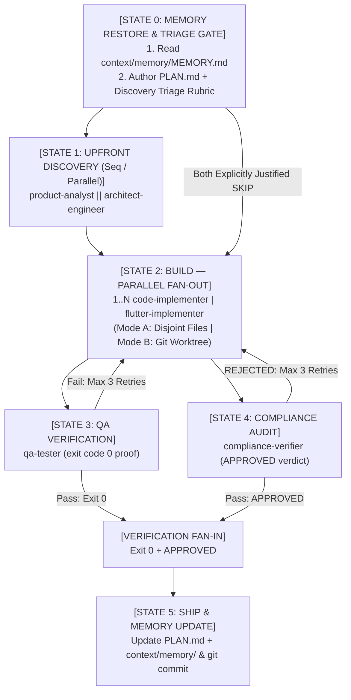

# AGENTS.md - Universal AI Coding Agent Constitution & Instructions

> **Target Audience**: All AI Coding Agents operating within this repository, including Google Antigravity, Anthropic Claude Code, Cursor, Codex, Gemini CLI, and related autonomous coding engines.
>
> **Authority**: This document serves as the supreme operational constitution and governance framework. All agents must comply with the rules, boundaries, and lifecycles defined herein without exception.

---

## 1. Inviolable Core Principles

### 1.1. Plan-First Mandatory Gate
* **No Unplanned Code Changes**: Before any application code modification, refactoring, or implementation begins, an up-to-date `PLAN.md` file **MUST** be authored or updated and committed/saved to disk in the repository root.
* **Granular Task Breakdown**: The plan must detail exact tracks, phases, actionable verification criteria, and affected components.
* **Lifecycle Synchronization**: As milestones progress, agents must keep `PLAN.md` strictly synchronized with the true system state.

### 1.2. Orchestrator Role Boundary
* **Technical Director & Coordinator**: Orchestrator agents (e.g., `senior-dev-orchestrator`, `flutter-feature-orchestrator`) are coordinators and systems directors.
* **Strict Non-Execution Constraint**: Orchestrators are **STRICTLY PROHIBITED** from directly editing application code, libraries, or tests (`src/`, `lib/`, `tests/`, etc.).
* **Tool Permissions**: File editing and writing tools (`write_to_file`, `replace_file_content`, `Write`, `Edit`) in an orchestrator session are reserved **exclusively** for governance, planning, design artifacts, and cross-AI LLM Wiki memory: `PLAN.md`, architectural decision records (`ADR-*.md`), `.agents/` rules, markdown documentation in `docs/`, and `context/memory/`.
* **Mandatory Delegation**: All product requirements analysis, system architecture design, code generation, feature construction, bug fixes, refactoring, test execution, and compliance audits **MUST** be delegated to specialized worker subagents (`product-analyst`, `architect-engineer`, `code-implementer`, `flutter-implementer`, `qa-tester`, `compliance-verifier`).

### 1.3. Graph Engineering State Machine (DAG)
All multi-agent execution flows follow a deterministic 6-state Directed Acyclic Graph (DAG) state machine with parallel fan-out/fan-in and cross-AI LLM Wiki persistence:



#### State Transition Definitions:
1. **STATE 0 — MEMORY RESTORE & DISCOVERY TRIAGE GATE (Mandatory)**:
   - **LLM Wiki Memory Read (`context-restore`)**: Check if `context/memory/MEMORY.md` exists; if so, read it silently (~500 tokens) to restore cross-AI handoff state (left by Claude Code or Antigravity). Read linked topic pages (`context/memory/architecture.md`, `context/memory/conventions.md`, `context/memory/log/YYYY-MM-DD.md`) only on demand.
   - **Mandatory Discovery & Architecture Triage (`PLAN.md`)**: Author/update `PLAN.md` including a `## Discovery & Architecture Triage` table evaluating both discovery specialists before writing implementation tasks:
     * **`product-analyst`**: **MUST INVOKE** if the request is a new user-facing feature/workflow, has unstated edge cases/permissions/validation rules, or is an open-ended business prompt. *Only skip* for pure technical bugfixes with known root causes, internal refactors with zero behavior change, or when a complete PRD already exists.
     * **`architect-engineer`**: **MUST INVOKE** if the task creates or modifies **>= 2 files/modules**, changes database schemas/migrations/API contracts, introduces a new design pattern or external dependency, or crosses architectural layers. *Only skip* for single-file localized fixes where the architecture is already established.
2. **STATE 1 — UPFRONT DISCOVERY EXECUTION (Sequential or Parallel Fan-Out)**:
   - When triggered by the Triage Gate, invoke `product-analyst` and/or `architect-engineer` **before** delegating to `code-implementer`.
   - Supports **Parallel Discovery Fan-Out** (`product-analyst` || `architect-engineer`, or 2+ `architect-engineer` instances across distinct subsystems) when scopes are independent, or sequential execution (`product-analyst` -> `architect-engineer`) when architecture depends on product scope disambiguation. Update `PLAN.md` with specifications/ADRs and **Parallel Execution Tracks**.
3. **STATE 2 — BUILD: PARALLEL FAN-OUT & WORKSPACE ISOLATION (Mandatory)**:
   - Dispatch **1 to N `code-implementer` (or `flutter-implementer`) subagents in parallel**:
     * **Mode A — Disjoint File Partitioning (`Workspace: 'inherit'`) [DEFAULT]**: Used when parallel tracks modify non-overlapping files/directories. Each subagent receives an explicit `Owned Files` list and is forbidden from editing outside its partition. Zero `git merge` overhead upon Fan-In.
     * **Mode B — Git Worktree Isolation (`Workspace: 'share'` / `Workspace: 'branch'` in Antigravity, or `git worktree` via `loop-engineering` in Claude Code)**: Used when parallel instances must modify shared files (e.g., `package.json`, shared routers, DI containers) or execute conflicting build processes. Merged cleanly upon Fan-In before final QA.
4. **STATE 3 & 4 — QA VERIFICATION & COMPLIANCE AUDIT: PARALLEL FAN-OUT (Mandatory)**:
   - Dispatch `qa-tester` (`exit code 0` empirical test proof across `pytest`, `flutter test`, `node --check`) and `compliance-verifier` (read-only static analysis, OWASP security, and architectural invariant audit yielding `APPROVED` verdict) **in parallel** (including multiple `qa-tester` instances across disjoint test suites).
   - If either `qa-tester` fails or `compliance-verifier` returns `REJECTED`, loop back to `code-implementer` (strictly capped at **max 3 self-correction iterations** before escalating to the user).
5. **STATE 5 — SHIP & LLM WIKI MEMORY UPDATE (Mandatory)**:
   - Mark all tasks completed in `PLAN.md`.
   - Persist the completed milestone into `context/memory/` (via `context-capture`): (1) update `context/memory/MEMORY.md` in-place (<= 80-100 lines), (2) update `context/memory/architecture.md` or `conventions.md` in-place if architecture/conventions changed, and (3) append a concise 5-8 line milestone block (`## [HH:MM | Host: Claude Code / Antigravity] <Task>`) to `context/memory/log/YYYY-MM-DD.md`. Never write checkpoints on intermediate turns or simple Q&A prompts.
   - Finalize git staging and commit using Conventional Commits.

### 1.4. Test-Driven Development (TDD)
* **Red-Green-Refactor Cycle**:
  1. **Red**: Write a failing test capturing the requirement or defect before writing production code. Confirm expected failure.
  2. **Green**: Implement the minimal, clean solution necessary to turn the test green.
  3. **Refactor**: Clean up and optimize while ensuring all tests continue to pass.
* **Tests are Empirical Proof**: Never claim a task is completed, fixed, or verified without actual test output showing `exit code 0`.
* **Arrange-Act-Assert (AAA)**: Tests must follow explicit Arrange, Act, Assert structure with isolated mocks at network/database/external API boundaries.
* **Zero Assertion Tampering**: Never delete assertions, alter tests to mask bugs, relax threshold rules, or return hardcoded stub values to fake passing test suites.

### 1.5. Anti-Lazy Code Policy
* **Zero Tolerance for Placeholders**: Absolute prohibition against AI shortcuts, lazy stubs, partial implementations, or omitted logic:
  - ❌ `// TODO: Implement later`
  - ❌ `# ... rest of existing code ...`
  - ❌ `pass  # placeholder`
  - ❌ Empty catch/except blocks swallowing exceptions (`except Exception: pass`).
* **Production Completeness**: Every file modified or created must contain full, production-ready code with exhaustive error handling, input validation, type annotations, and clean logging.
* **Keep Existing Intact**: Do not overwrite or delete existing working code, comments, or docstrings unless explicitly tasked with refactoring them.

### 1.6. Git Hygiene & Branch Safety
* **Branch Protection**: **NEVER** commit or push directly to `main`, `master`, or `develop`. All development occurs in dedicated feature or bugfix branches (`feature/*`, `bugfix/*`).
* **Conventional Commits**: Every commit message must strictly follow the Conventional Commits specification:
  - Format: `<type>(<optional-scope>): <description>`
  - Types: `feat:`, `fix:`, `refactor:`, `test:`, `docs:`, `chore:`, `perf:`, `build:`, `ci:`.
  - Imperative mood, lowercase description, no trailing period.
* **Merge Conflicts**: Never leave conflict markers (`<<<<<<<`, `=======`, `>>>>>>>`) or unresolved merge states (`UU`, `AA`) in any branch.
* **Atomic Commits**: Stage files selectively (`git add <file>`); never run blanket `git add .` on dirty workspaces.

---

## 2. Dual Ecosystem Architecture

This repository is built as an open multi-agent framework supporting two premier AI agent platforms simultaneously: **Google Antigravity** and **Anthropic Claude Code**.

```
repository-root/
├── plugins/
│   ├── antigravity/                  # Antigravity Plugin Ecosystem
│   │   ├── docs-and-quality/
│   │   ├── git-workflow/
│   │   ├── multi-agent-ops/
│   │   ├── python-backend/
│   │   ├── senior-data-engineer/
│   │   ├── senior-dev/
│   │   ├── senior-dev-flutter/
│   │   ├── shared-context/
│   │   └── sql-query-optimizer/
│   └── claude/                       # Claude Code Plugin Ecosystem
│       ├── docs-and-quality/
│       ├── git-workflow/
│       ├── multi-agent-ops/
│       ├── python-backend/
│       ├── senior-data-engineer/
│       ├── senior-dev/
│       ├── senior-dev-flutter/
│       ├── shared-context/
│       └── sql-query-optimizer/
├── skills/                           # Canonical Skills Catalog (35 Skills)
├── .agents/                          # Shared Agent Rules & Workflows
│   ├── rules/                        # Living repo context & loop engineering
│   └── workflows/                    # Operational task workflows
└── scripts/                          # Synchronization & validation automation
```

### 2.1. Tool Boundaries & Strict Isolation
Each ecosystem uses its native tool definitions. Tools **MUST NOT** bleed across ecosystem boundaries.

| Attribute | Google Antigravity Ecosystem (`plugins/antigravity/`) | Anthropic Claude Code Ecosystem (`plugins/claude/`) |
| :--- | :--- | :--- |
| **Native Execution Tools** | `run_command`, `call_mcp_tool` | `Bash` |
| **File Operation Tools** | `write_to_file`, `replace_file_content`, `view_file` | `Read`, `Write`, `Edit`, `Glob`, `Grep` |
| **Agent Delegation** | `invoke_subagent`, `manage_subagents`, `send_message` | `Agent` |
| **Plugin Manifest** | `plugin.json` (root of plugin) | `.claude-plugin/plugin.json` |
| **Lifecycle Hooks** | `hooks.json` supporting stdin/stdout JSON protocol | `hooks.json` supporting Claude Hook event payloads |
| **Tool Bleed Policy** | Zero Claude tools (`Bash`, `Agent`) inside Antigravity agent definitions | Zero Antigravity tools (`run_command`, `invoke_subagent`) inside Claude agent frontmatters |

### 2.2. Dual Host Hook Compatibility
Hook scripts in `hooks/*.js` are engineered to serve both hosts seamlessly:
* Detect Antigravity execution via tool naming conventions (`run_command`, `write_to_file`) and stdout `{ "decision": "allow" | "deny" }`.
* Detect Claude Code execution via `CLAUDE_PLUGIN_ROOT` or tool naming (`Bash`, `Write`) and structured `{ "hookSpecificOutput": { "permissionDecision": "allow" | "deny" | "ask" } }` responses.

---

## 3. Specialized Subagent Matrix & Roles

| Agent Name | Category | Primary Focus & Domain | Toolset Class |
| :--- | :--- | :--- | :--- |
| `senior-dev-orchestrator` | Orchestrator | Technical direction, task decomposition, pipeline management | Orchestrator Tools (`PLAN.md`, docs only) |
| `flutter-feature-orchestrator` | Orchestrator | Flutter mobile/web pipeline coordination, architecture reviews | Orchestrator Tools (`PLAN.md`, docs only) |
| `product-analyst` | Discovery | Requirements gathering, edge-case identification, PRD drafting | Worker Tools |
| `architect-engineer` | Discovery | High-level system design, database schemas, ADR authoring | Worker Tools |
| `flutter-architect` | Discovery | Flutter state management, widget hierarchy, layer boundaries | Worker Tools |
| `code-implementer` | Implementation | Production code authoring, bug fixes, refactoring in Python/Node/SQL | Full Worker Tools |
| `flutter-implementer` | Implementation | Flutter widgets, BLoC/Riverpod, Dart models, platform channels | Full Worker Tools |
| `qa-tester` | Verification | TDD execution, unit tests, integration tests, empirical proof | Full Worker Tools |
| `flutter-reviewer` | Verification | Flutter code quality, widget rebuild profiling, linting | Full Worker Tools |
| `compliance-verifier` | Audit | Architectural invariant verification, safety audit, final signoff | Read-Only Audit Tools |
| `senior-data-engineer` | Specialist | GCP Lakehouse, BigQuery, Datastream, CDC/SCD pipelines | Worker Tools + MCP |
| `sql-query-optimizer` | Specialist | SQL execution plans, index recommendations, query tuning | Worker Tools |
| `context-keeper` | Operations | Capturing and restoring cross-session architectural context | Worker Tools |
| `flutter-release-engineer` | Operations | Store bundles, signing configs, CI/CD pipeline deployment | Worker Tools |

---

## 4. Essential Runbooks & Tooling Commands

### 4.1. Python Test Suite Execution
Execute the test suite to verify plugins, skills, and governance contracts:
```bash
# Run all unit, integration, and structural tests
pytest tests/

# Run fast unit tests only
pytest tests/unit/

# Run structural consistency tests
pytest tests/structure/

# Run with verbose output and failure stop
pytest -v -x tests/
```

### 4.2. Hook Syntax & Safety Validation
Verify syntax and integrity of all Node.js lifecycle hooks across both plugin ecosystems:
```bash
# Check syntax for all hook scripts in Antigravity plugins
for hook in plugins/antigravity/*/hooks/*.js; do
  node --check "$hook" || exit 1
done

# Check syntax for all hook scripts in Claude Code plugins
for hook in plugins/claude/*/hooks/*.js; do
  node --check "$hook" || exit 1
done
```

### 4.3. JSON Manifest & Configuration Validation
Verify validity of all JSON configs, manifests, and hooks:
```bash
# Validate all JSON files across plugins and repository configs
node -e '
const fs = require("fs");
const files = [
  ".claude-plugin/marketplace.json",
  ...require("child_process").execSync("find plugins -name \"*.json\"").toString().trim().split("\n")
];
for (const file of files) {
  if (!file) continue;
  try {
    JSON.parse(fs.readFileSync(file, "utf8"));
  } catch (err) {
    console.error(`Invalid JSON in ${file}:`, err.message);
    process.exit(1);
  }
}
console.log("All JSON configurations are valid!");
'
```

### 4.4. Skill Synchronization Automation
Synchronize canonical skills from `/skills` into each plugin's bundled copy:
```bash
python3 scripts/sync_plugin_skills.py
```

### 4.5. Claude Code Plugin & Agent Synchronization
Synchronize agents, hooks, and manifests between Antigravity and Claude Code ecosystems:
```bash
python3 scripts/sync_agents.py
```

---

## 5. Summary Compliance Rule for All Agents

> **Any AI agent modifying code without an active `PLAN.md`, any orchestrator attempting direct file edits on `src/` or `lib/`, or any implementation without test proof (`exit code 0`) is in direct violation of repository governance and must immediately halt and delegate.**
