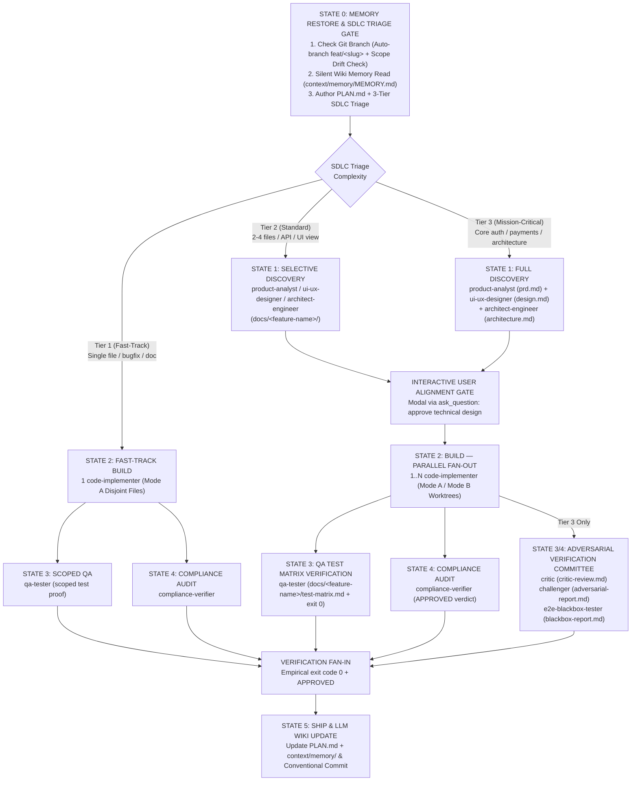

# Expert AI Developer Skills

[](https://github.com/jggomez/expert-ai-developer-skills)
[](tests/)
[](plugins/)
[](#4-the-9-plugin-ecosystem)
[](skills/README.md)
[](plugins/README.md)
[](LICENSE)

**Expert AI Developer Skills** is an open-source, production-grade multi-agent engineering framework engineered for **Google Antigravity (AGY)** and **Anthropic Claude Code**. It transforms autonomous coding engines from naive prompt-followers into a coordinated software engineering team governed by deterministic Directed Acyclic Graphs (DAG), 3-tier dynamic SDLC routing, cross-AI persistent memory, and adversarial verification committees.

---

## 1. Why Expert AI Developer Skills?

Traditional AI coding assistants struggle with four critical production challenges:

| The Production Failure | How AI Assistants Fail | The Expert AI Developer Skills Solution |
| :--- | :--- | :--- |
| **Context Amnesia** | LLMs lose architectural decisions and preferences across restarts, repeating past mistakes. | **Cross-AI LLM Wiki Memory (`context/memory/`)**: Ultra-compact, zero-amnesia working memory (~500 tokens) shared seamlessly between Claude Code and Google Antigravity. |
| **Token & Latency Bloat** | Simple one-line bugfixes or typo corrections trigger massive, expensive multi-agent discovery pipelines. | **Dynamic 3-Tier Adaptive SDLC**: Intelligently routes tasks into Fast-Track (Tier 1), Standard (Tier 2), or Mission-Critical (Tier 3), achieving **70–85% token and latency savings** on localized tasks. |
| **Concurrency Collisions** | Dispatching parallel subagents results in overlapping edits, merge conflicts, and redundant test bottlenecks. | **Collision Prevention & Workspace Isolation**: Enforces Mode A (Strict Disjoint File Partitioning) and Mode B (Git Worktree Isolation) with isolated scoped test loops. |
| **Hallucinated Triumphs** | Agents declare tasks complete based on assumptions without empirical proof, masking regressions. | **Adversarial Verification Committee**: Every release candidate must pass independent checks by `qa-tester`, `critic`, `challenger`, `e2e-blackbox-tester`, and `compliance-verifier` (`exit code 0`). |

---

## 2. Core Architecture: The Graph Engineering State Machine

All tasks executed across domain orchestrator plugins (`senior-dev`, `senior-dev-flutter`, `python-backend`, `senior-data-engineer`) follow a deterministic, adaptive 6-state DAG:



---

## 3. Quickstart: Get Started in 30 Seconds

Choose the installation channel that fits your workflow:

````carousel
<!-- slide -->
### Option 1: Install in Google Antigravity (AGY)
Install turnkey engineering plugins directly using the Antigravity CLI:
```bash
# Install the Lead Orchestrator and Full SDLC Subagents
agy plugin install ./plugins/antigravity/senior-dev

# Or install all 9 core plugins in one loop
for p in senior-dev senior-dev-flutter python-backend senior-data-engineer sql-query-optimizer shared-context git-workflow docs-and-quality multi-agent-ops; do
  agy plugin install "./plugins/antigravity/$p"
done
```
<!-- slide -->
### Option 2: Install in Anthropic Claude Code
Install directly from the repository marketplace or local checkout:
```bash
# 1. Register the repository marketplace
/plugin marketplace add jggomez/expert-ai-developer-skills

# 2. Install any plugin
/plugin install senior-dev
/plugin install senior-dev-flutter
/plugin install python-backend
/plugin install senior-data-engineer
/plugin install sql-query-optimizer
```
<!-- slide -->
### Option 3: Install Standalone Skills (Vercel Standard)
Install individual skills via Vercel's official `skills` CLI into any repository:
```bash
# List all 39 canonical skills available
npx skills add jggomez/expert-ai-developer-skills --list

# Install a specific skill (e.g. python-expert) in the active project (.agents/skills)
npx skills add jggomez/expert-ai-developer-skills --skill python-expert

# Install all skills in the project
npx skills add jggomez/expert-ai-developer-skills
```
<!-- slide -->
### Option 4: Token & Cost Observability (`agent-meter`)
Track token usage, USD cost, and subagent latencies across Claude Code and Antigravity:
```bash
# Install the standalone observability CLI (requires uv)
uv tool install "git+https://github.com/jggomez/expert-ai-developer-skills#subdirectory=tools/agent-meter"

# Run setup ($0 DuckDB local by default, or connect to BigQuery + Looker Studio)
agent-meter setup --local

# Inspect metrics
agent-meter last            # Session summary (+ today / month-to-date)
agent-meter tasks --last 5  # Subagent cost, calls, parallelism & retries
agent-meter report --open   # Open offline HTML interactive report
```
````

---

## 4. The 9-Plugin Ecosystem

Each plugin is self-contained with specialized subagents, deterministic lifecycle safety hooks, MCP servers, and skills:

| Plugin | Primary Focus & Domain | Agents | Bundled Skills | Native MCP Servers | Documentation |
| :--- | :--- | :---: | :---: | :--- | :--- |
| **`senior-dev`** | Full SDLC lead orchestrator, discovery specialists, TDD implementers, QA test matrix, and adversarial verification. | 10 | 15 | Cloud Run, Firebase | [Guide](plugins/antigravity/senior-dev/README.md) |
| **`senior-dev-flutter`** | Senior Flutter & Dart layer on top of official Flutter packs: 60/120fps profiling, Riverpod/Bloc ADRs, release matrices. | 5 | 10 | Dart MCP | [Guide](plugins/antigravity/senior-dev-flutter/README.md) |
| **`python-backend`** | Production Python backend: FastAPI/Django vertical slices, zero-downtime Alembic migrations, CI/CD gates. | 1 | 14 | Cloud Run, Firebase | [Guide](plugins/antigravity/python-backend/README.md) |
| **`senior-data-engineer`** | Google Cloud Lakehouse architecture, Datastream CDC, BigQuery SCD Type 2 modeling, data contracts, and dry-run cost controls. | 1 | 4 | BigQuery, Cloud SQL, GCS | [Guide](plugins/antigravity/senior-data-engineer/README.md) |
| **`sql-query-optimizer`** | SQL performance diagnosis from real execution plans, BigQuery slot/skew tuning, dialect-aware rewrites. | 1 | 4 | BigQuery, Cloud SQL | [Guide](plugins/antigravity/sql-query-optimizer/README.md) |
| **`shared-context`** | Cross-AI LLM Wiki memory (`context/memory/`): zero-amnesia working memory shared between Claude and Antigravity. | 1 | 2 | Shared Context MCP | [Guide](plugins/antigravity/shared-context/README.md) |
| **`git-workflow`** | Git branch protection (blocks direct commits to `main`/`develop`), auto-branching, scope drift detection, Conventional Commits. | 0 | 2 | — | [Guide](plugins/antigravity/git-workflow/README.md) |
| **`docs-and-quality`** | Technical documentation standards (Diátaxis), Mermaid diagrams, Karpathy clean-code guidelines, Anti-Lazy code policy. | 0 | 3 | — | [Guide](plugins/antigravity/docs-and-quality/README.md) |
| **`multi-agent-ops`** | 3-Tier SDLC DAG execution, parallel fan-out (Mode A: Disjoint Files vs Mode B: Worktrees), finite 3-loop self-correction. | 0 | 2 | — | [Guide](plugins/antigravity/multi-agent-ops/README.md) |
| **`agent-metrics`** *(optional)* | Opt-in hook wrapper + skill for [`agent-meter`](tools/agent-meter/README.md): automatic session and task token/cost summaries. | 0 | 1 | — | [Guide](plugins/antigravity/agent-metrics/README.md) |

---

## 5. Key Engineering Innovations

### 5.1. Dynamic 3-Tier Adaptive SDLC
Workflows dynamically scale according to task scope, surface area, and risk:

| Dimension / Phase | Tier 1: Fast-Track (Low Complexity) | Tier 2: Standard (Medium Complexity) | Tier 3: Mission-Critical (Complex) |
| :--- | :--- | :--- | :--- |
| **Scope & Triggers** | Single-file bugfixes, docs, chores, typos, localized refactoring (< 2 files). | 2–4 files/modules, new API endpoints, single UI view/widget, database migrations. | Greenfield features, payment/auth flows, breaking public APIs, core lakehouse pipelines. |
| **Discovery (State 1)** | **SKIPPED**: Zero discovery overhead; no PRD, design.md, or architecture.md authored. | **SELECTIVE**: Targeted discovery via `product-analyst`, `ui-ux-designer`, or `architect-engineer`. | **FULL**: Comprehensive discovery via `product-analyst` (`prd.md`), `ui-ux-designer` (`design.md`), and `architect-engineer` (`architecture.md` / ADRs). |
| **Interactive Alignment (State 1.5)** | **SKIPPED**: Auto-proceeds to implementation. | **MANDATORY**: Interactive modal (`ask_question`) presenting technical summary for user approval. | **MANDATORY**: Strict interactive modal (`ask_question`) requiring explicit user sign-off. |
| **Build Mode (State 2)** | 1 `code-implementer` in Mode A (Disjoint Files). | 1..N `code-implementer` in parallel under Mode A (Disjoint Files). | 1..N `code-implementer` in parallel under Mode A or Mode B (Git Worktree Isolation). |
| **QA Verification (State 3)** | Scoped test execution (only affected test file run). | Full test suite execution + standardized QA Test Matrix (`docs/<feature-name>/test-matrix.md`). | Full test suite execution + standardized QA Test Matrix (`docs/<feature-name>/test-matrix.md`) across test pyramid. |
| **Verification & Committee (State 4)** | Scoped test proof + `compliance-verifier` check (bypasses adversarial committee). | Parallel `qa-tester` (`exit code 0`) and `compliance-verifier` (`APPROVED`). | **Adversarial Verification Committee**: `qa-tester`, `critic`, `challenger`, `e2e-blackbox-tester`, `compliance-verifier`. |
| **Token & Latency Impact** | **70–85% token & latency savings** | Balanced overhead with rigorous quality verification | Maximum depth, empirical verification, and zero regression tolerance |

### 5.2. Adversarial Verification Committee
For Tier 3 mission-critical tasks, candidate changes must survive rigorous stress testing before code can ship:

* **[`qa-tester`](plugins/antigravity/senior-dev/agents/qa-tester.md)**: Authors a formal test planning artifact in `docs/<feature-name>/test-matrix.md` mapping user stories to unit, integration, and component tests before running test suites (`exit code 0`).
* **[`critic`](plugins/antigravity/senior-dev/agents/critic.md)**: Independent Senior Architect evaluating code smells, cyclomatic complexity, SOLID/DRY adherence, and maintainability (`docs/<feature-name>/critic-review.md`).
* **[`challenger`](plugins/antigravity/senior-dev/agents/challenger.md)**: Adversarial Quality Engineer probing boundary conditions, failure paths, race conditions, memory leaks, and worst-case inputs (`docs/<feature-name>/adversarial-report.md`).
* **[`e2e-blackbox-tester`](plugins/antigravity/senior-dev/agents/e2e-blackbox-tester.md)**: Blackbox journey tester operating without internal assumptions via headless browsers or Playwright (`docs/<feature-name>/blackbox-report.md`).
* **[`compliance-verifier`](plugins/antigravity/senior-dev/agents/compliance-verifier.md)**: Technical Compliance Officer auditing security (OWASP Top 10), static analysis, and architectural invariants, issuing an explicit `APPROVED` or `REJECTED` verdict.

### 5.3. Automated Git Branch Governance & Scope Drift Protocol
- **Protected Branch Guard**: Never develops or commits directly on `main`, `master`, `develop`, or `dev`. Orchestrators inspect the branch at State 0 and automatically provision a dedicated branch (`git checkout -b feat/<slug>`).
- **Proactive Scope Drift Detection**: If the user requests unrelated or orthogonal features while working on an active feature branch, the orchestrator detects the domain pivot and queries the user via interactive modal (`ask_question`) recommending a new branch.

### 5.4. Feature Artifacts Centralization (`docs/<feature-name>/`)
All specifications and verification outputs are neatly housed in a feature-scoped directory:
- `docs/<feature-name>/prd.md` — Product scope and acceptance criteria.
- `docs/<feature-name>/design.md` — UI/UX design tokens, layout, and component specifications.
- `docs/<feature-name>/architecture.md` / `adr-*.md` — System architecture and decision records.
- `docs/<feature-name>/test-matrix.md` — Standardized QA test matrix with positive, boundary, and negative scenarios.
- `docs/<feature-name>/critic-review.md` & `adversarial-report.md` — Adversarial audit reports.

---

## 6. Canonical Skills Catalog (39 Skills)

Every skill follows the open [Agent Skills Standard (`agentskills.io`)](https://agentskills.io) with progressive disclosure instructions, checklists, and deterministic CLI scripts:

```
skills/
├── Architecture & Discovery
│   ├── senior-architect-engineering/  # Clean Architecture, Hexagonal, SOLID, ADR authoring
│   ├── product-analyst/               # Requirements gathering, edge cases & PRD generation
│   ├── ui-ux-designer/                # Design systems, design.md, tokens & WCAG accessibility
│   └── design-spec-expert/            # API schemas, OpenAPI & contracts
├── Quality, Testing & Adversarial
│   ├── test-driven-development/       # Red-Green-Refactor cycles & AAA testing
│   ├── qa-tester/                     # Standardized test-matrix.md & E2E traceability
│   ├── code-critic/                   # Code smell detection, cyclomatic complexity & DRY/SOLID
│   ├── adversarial-challenger/        # Fuzzing, boundary probing & failure path injection
│   ├── blackbox-tester/               # Browser-driven blackbox user journeys via MCP
│   ├── code-smells-expert/            # Fowler/Beck code smell classification & diagnosis
│   └── compliance-verifier/           # Release readiness, security gates & NFR audits
├── Mobile & Flutter Engineering
│   ├── flutter-senior-orchestration/  # Flutter DAG state machine & mobile pipeline coordination
│   ├── flutter-architecture-decisions/# BLoC, Riverpod & Provider state management ADRs
│   ├── flutter-performance-profiling/ # DevTools 60/120fps frame budgets & leak audits
│   ├── flutter-test-strategy/         # Widget, Golden, integration & Mocktail test suites
│   └── flutter-release-engineering/   # Flavors, code signing & store bundle matrix
├── Backend & Data Engineering
│   ├── python-expert/                 # PEP 8, typing (mypy), generator optimizations, slots
│   ├── database-migration-expert/     # Zero-downtime expand-contract Alembic/Django migrations
│   ├── gcp-data-engineering/          # Medallion Lakehouse, Datastream CDC & Dataform ELT
│   ├── cdc-scd-patterns/              # SCD Type 1/2 modeling & late-arriving event handling
│   ├── bigquery-query-optimization/   # Slot, shuffle, skew & partition pruning optimization
│   └── sql-query-optimization/        # Real-plan diagnosis & dialect-aware query rewrites
└── Operations, Memory & Governance
    ├── loop-engineering/              # Dynamic 3-tier SDLC state machine & parallel fan-out
    ├── context-restore/               # Silent LLM Wiki restore (~500 tokens)
    ├── context-capture/               # Zero-amnesia State 5 memory updates (context/memory/)
    └── commit-expert/                 # Conventional Commits formatting & validation
```

> **Explore the full 39-skill catalog with detailed usage manuals**: [`skills/README.md`](skills/README.md)

---

## 7. Developer Runbooks & Verification

Verify the entire repository, plugins, and governance contracts locally:

```bash
# 1. Run the full pytest test suite (153 unit, integration, and structural tests)
pytest tests/

# 2. Validate syntax of all 34 Node.js lifecycle hooks across both plugin ecosystems
for hook in plugins/antigravity/*/hooks/*.js plugins/claude/*/hooks/*.js; do
  node --check "$hook" || exit 1
done

# 3. Synchronize canonical skills and agents across Antigravity and Claude Code plugins
python3 scripts/sync_plugin_skills.py
python3 scripts/sync_agents.py
```

---

## 8. License

This project is licensed under the [Apache License, Version 2.0](LICENSE).
