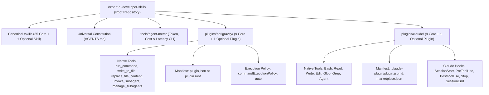
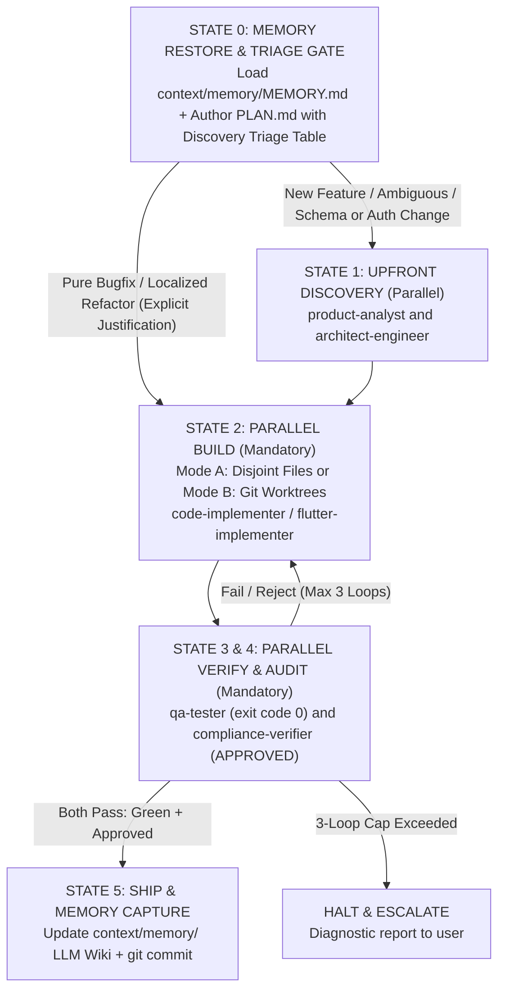

# Expert AI Developer Skills

[](https://github.com/jggomez/expert-ai-developer-skills)
[](plugins)
[](skills/README.md)
[](AGENTS.md)
[](LICENSE)

Production-grade engineering customizations, autonomous subagents, deterministic lifecycle hooks, and modular skills for **Google Antigravity (AGY)** and **Anthropic Claude Code**.

This repository organizes software engineering best practices into **dual-ecosystem installable plugins**, **35 canonical skills** (+ optional `agent-metrics`), **a universal agent constitution**, **deterministic lifecycle hooks**, **11 rule profiles**, **16 operational workflows**, and **token/cost/latency observability (`agent-meter`)**.

---

## 1. Dual Ecosystem Architecture

The repository natively supports two premier AI coding ecosystems side-by-side with zero cross-environment contamination:



### Ecosystem Comparison & Tool Mapping

| Dimension | Google Antigravity (`plugins/antigravity/`) | Anthropic Claude Code (`plugins/claude/`) |
| :--- | :--- | :--- |
| **Plugin Manifest** | `plugin.json` (at plugin root) | `.claude-plugin/plugin.json` |
| **Marketplace Manifest**| Local path installation via `agy plugin install` | `.claude-plugin/marketplace.json` |
| **Command Execution** | `run_command` (`commandExecutionPolicy: auto`) | `Bash` |
| **File Reading** | `view_file` | `Read` |
| **File Creation** | `write_to_file` | `Write` |
| **File Editing** | `replace_file_content` | `Edit` |
| **File Search** | Grep / directory tools | `Glob`, `Grep` |
| **Subagent Delegation**| `invoke_subagent(name="...", prompt="...")` | `Agent(agent="...", prompt="...")` |
| **Agent Coordination**| `manage_subagents`, `send_message` | `Agent` session orchestration |
| **Hook Schema** | Named hook groups: `{"PreToolUse": [...], "Stop": [...]}` | Host object: `{"hooks": {"PreToolUse": [...], "Stop": [...]}}` |

---

## 2. Universal Constitution: `AGENTS.md`

All agents in this repository operate under the supreme governance of the **Universal AI Coding Agent Constitution** located at [`AGENTS.md`](AGENTS.md).

To guarantee uniform discovery across development tools and AI runners, host-specific configuration files are maintained as symlinks to `AGENTS.md`:
* **`CLAUDE.md`** &rarr; symlink to `AGENTS.md` (read automatically by Anthropic Claude Code)
* **`AGENT.md`** &rarr; symlink to `AGENTS.md` (read by Antigravity / Cursor / IDE assistants)

### Inviolable Invariants

1. **Plan-First Mandatory Gate**:
   * No application code modifications may occur without an up-to-date `PLAN.md` file authored and saved to disk.
2. **Orchestrator Role Boundaries**:
   * Lead Orchestrators (`senior-dev-orchestrator`, `flutter-feature-orchestrator`) are **strictly prohibited from directly writing application source code**.
   * File editing tools (`write_to_file`, `replace_file_content`, `Write`, `Edit`) in orchestrator sessions are reserved exclusively for `PLAN.md`, ADRs (`ADR-*.md`), documentation (`docs/`), `.agents/`, and persistent project memory (`context/memory/`).
   * All implementation code **MUST** be delegated to `code-implementer` or `flutter-implementer`.
3. **Strict Test-Driven Development (TDD)**:
   * Red-Green-Refactor cycle: failing test first, minimal production code, refactor to clean code.
   * Tests are empirical proof: a task is complete only with verified terminal output showing `exit code 0`.
4. **Anti-Lazy Code Policy**:
   * Zero tolerance for placeholders (`TODO: implement later`, `# ... rest of code`, `pass # placeholder`, `/* unimplemented */`).
   * Every edit must provide 100% complete, working code. Deterministically enforced by `anti-lazy-code-gate.js`.
5. **Self-Correction Protocol (3-Loop Cap)**:
   * Auto-remediation is strictly capped at a maximum of 3 cycles. If a defect persists after 3 cycles, agents must halt and escalate to the user with a diagnostic report.

---

## 3. Graph Engineering State Machine (DAG)

Multi-agent coordination follows a deterministic 6-State Directed Acyclic Graph (DAG) state machine with a **Mandatory Discovery Triage Gate** and **Parallel Fan-Out / Fan-In**:



### Multi-Agent Topologies Taxonomy
1. **Manager-Worker Topology (Mode A & Mode B Parallelism)**: Orchestrator coordinates high-level objectives and delegates atomic tasks to concurrent workers using **Mode A: Disjoint File Partitioning** (`Workspace: "inherit"` on non-overlapping file sets) or **Mode B: Git Worktree Isolation** (dedicated branches/worktrees when tracks touch shared files).
2. **Sequential Pipeline with Parallel Fan-Out/Fan-In (DAG)**: Deterministic progression through State 0 (Memory Restore + Triage Gate in `PLAN.md`) &rarr; State 1 (Upfront Discovery) &rarr; State 2 (Parallel Build) &rarr; State 3 & 4 (Concurrent QA & Compliance Audit) &rarr; State 5 (Memory Capture & Ship) with bounded failure loops.
3. **Review Committee**: Parallel specialist evaluations where `qa-tester` and `compliance-verifier` (or domain specialists across Security, Quality, Performance, Architecture) evaluate diffs concurrently and fan-in before completion.

---

## 4. Deterministic Lifecycle Hooks

Plugins enforce safety and quality invariants via deterministic Node.js lifecycle hooks executing on host tool events:

```
plugins/
├── antigravity/<plugin>/hooks/
│   ├── gitflow-branch-gate.js     # Blocks commits to main/develop, validates branch prefixes
│   ├── orchestrator-role-gate.js  # Restricts orchestrator writes to PLAN.md, ADRs, docs/, context/memory/
│   ├── anti-lazy-code-gate.js     # Scans diffs for TODOs, pass stubs, and incomplete placeholders
│   ├── stop-gate.js               # Enforces test pass (exit code 0) before session completion
│   ├── pre-tool-gate.js           # Enforces workspace path boundaries and safe command flags
│   └── context-*.js               # Cross-AI LLM Wiki (context/memory/) restore and stop-flush hooks
└── claude/<plugin>/hooks/
    ├── (Identical deterministic gate scripts tailored for Claude Code hooks.json events)
```

### Active Hook Gates
* **Gitflow Branch Protection Gate** (`gitflow-branch-gate.js`): Prevents destructive direct commits or pushes to protected branches (`main`, `master`, `develop`, `release/*`). Requires semantic branch naming (`feat/*`, `fix/*`, `chore/*`).
* **Orchestrator Role Gate** (`orchestrator-role-gate.js`): Prevents orchestrators from editing production source code while whitelisting `PLAN.md`, `ADR-*.md`, `docs/`, `.agents/`, and `context/memory/`.
* **Anti-Lazy Code Stop Gate** (`anti-lazy-code-gate.js`): Inspects git diffs before session termination. Exits with code 2 if placeholder comments (`TODO: implement later`, `# ... rest of code`) are detected.
* **Test Verification Stop Gate** (`stop-gate.js` / `verify_tests.py`): Blocks session termination if automated test suites are failing.
* **Cross-AI LLM Wiki & Shared Context Keeper** (`session-start-context.js`, `stop-flush.js`, `context_common.py`, `context_snapshot.py`, `context_list.py`): Maintains a persistent 2-tier Markdown Wiki in `context/memory/` (`MEMORY.md`, `architecture.md`, `conventions.md`, `log/YYYY-MM-DD.md`) alongside archive snapshots in `context/sessions/`, preserving architectural decisions across sessions and between Antigravity and Claude Code.

---

## 5. Plugins, Skills & `agent-meter` Observability

The [`skills/`](skills/README.md) directory contains 35 core modular skills (plus the optional `agent-metrics` skill) compliant with the [Open Agent Skills Standard (`agentskills.io`)](https://agentskills.io). Each skill includes a platform-neutral `SKILL.md`, reference documentation, and deterministic Python automation scripts.

### 5.1 Distributed Plugins & Bundled Skills

Both plugin ecosystems bundle physical copies of the skills they require to remain fully self-contained:

| Plugin Name | Skills | Bundled Skills | Guides |
| :--- | :---: | :--- | :--- |
| **`senior-dev`** | 11 | `senior-dev-orchestrator`, `product-analyst`, `senior-architect-engineering`, `code-implementer`, `code-smells-expert`, `refactoring-code-expert`, `qa-tester`, `compliance-verifier`, `context-capture`, `context-restore`, `loop-engineering` | [AGY](plugins/antigravity/senior-dev/README.md) · [Claude](plugins/claude/senior-dev/README.md) |
| **`senior-dev-flutter`** | 10 | `flutter-senior-orchestration`, `flutter-architecture-decisions`, `flutter-review-checklist`, `flutter-test-strategy`, `flutter-performance-profiling`, `flutter-release-engineering`, `flutter-upgrade-migration`, `context-capture`, `context-restore`, `loop-engineering` | [AGY](plugins/antigravity/senior-dev-flutter/README.md) · [Claude](plugins/claude/senior-dev-flutter/README.md) |
| **`python-backend`** | 14 | `python-expert`, `test-driven-development`, `pull-request-expert`, `code-smells-expert`, `refactoring-code-expert`, `security-audit`, `performance-scalability`, `database-migration-expert`, `senior-architect-engineering`, `design-spec-expert`, `build-and-ci-gates`, `context-capture`, `context-restore`, `loop-engineering` | [AGY](plugins/antigravity/python-backend/README.md) · [Claude](plugins/claude/python-backend/README.md) |
| **`senior-data-engineer`** | 4 | `gcp-data-engineering`, `cdc-scd-patterns`, `context-capture`, `context-restore` | [AGY](plugins/antigravity/senior-data-engineer/README.md) · [Claude](plugins/claude/senior-data-engineer/README.md) |
| **`sql-query-optimizer`** | 4 | `bigquery-query-optimization`, `sql-query-optimization`, `context-capture`, `context-restore` | [AGY](plugins/antigravity/sql-query-optimizer/README.md) · [Claude](plugins/claude/sql-query-optimizer/README.md) |
| **`shared-context`** | 2 | `context-capture`, `context-restore` | [AGY](plugins/antigravity/shared-context/README.md) · [Claude](plugins/claude/shared-context/README.md) |
| **`git-workflow`** | 2 | `commit-expert`, `pull-request-expert` | [AGY](plugins/antigravity/git-workflow/README.md) · [Claude](plugins/claude/git-workflow/README.md) |
| **`docs-and-quality`** | 3 | `documentation-expert`, `testing-expert`, `guidelines-karpathy` | [AGY](plugins/antigravity/docs-and-quality/README.md) · [Claude](plugins/claude/docs-and-quality/README.md) |
| **`multi-agent-ops`** | 2 | `loop-engineering`, `repo-research` | [AGY](plugins/antigravity/multi-agent-ops/README.md) · [Claude](plugins/claude/multi-agent-ops/README.md) |
| **`agent-metrics`** *(optional add-on)* | 1 | `agent-metrics` | [AGY](plugins/antigravity/agent-metrics/README.md) · [Claude](plugins/claude/agent-metrics/README.md) |

### 5.2 Optional Add-on: `agent-meter` (Token, Cost & Latency Metrics)

**`agent-meter`** ([`tools/agent-meter/`](tools/agent-meter/README.md)) is a local-first, $0 observability CLI and optional `agent-metrics` plugin that tracks token usage, API-equivalent USD cost, cache efficiency, and latency across **Claude Code** and **Antigravity** (CLI, IDE, and app) per project, client, task, and subagent.

* **User Guides**: [English Guide (`tools/agent-meter/README.md`)](tools/agent-meter/README.md) · [Guía en Español (`tools/agent-meter/README.es.md`)](tools/agent-meter/README.es.md) · [Design Overview (`docs/agent-metrics/README.md`)](docs/agent-metrics/README.md)
* **Quick Start**:
  ```bash
  uv tool install "git+https://github.com/jggomez/expert-ai-developer-skills#subdirectory=tools/agent-meter"
  agent-meter setup --local
  agent-meter last            # Last session summary
  agent-meter tasks --last 5  # Last 5 tasks with subagent breakdown
  agent-meter report --open   # Offline interactive HTML report
  ```
* No other plugin depends on `agent-meter`; it works standalone or with the optional `agent-metrics` plugin.

### 5.3 Installing Skills, Rules & Sidecars Directly
* **Skills via `npx skills`**:
  ```bash
  npx skills add jggomez/expert-ai-developer-skills --list
  npx skills add jggomez/expert-ai-developer-skills --skill python-expert
  ```
  See the full catalog in [`skills/README.md`](skills/README.md).
* **Rules & Sidecars**: See [`rules/README.md`](rules/README.md) (11 RFC 2119 rule profiles) and [`sidecars/README.md`](sidecars/README.md) (background cron/daemon configurations).

---

## 6. Operational Workflows (16 Playbooks)

Operational playbooks in [`workflows/`](workflows/README.md) and [`.agents/workflows/`](.agents/workflows/) guide complex development sequences:

### The 9 Core Slash Commands
* **`/spec`** ([`spec-workflow.md`](workflows/spec-workflow.md)): Clarify user goals, define NFRs, draft PRD.
* **`/plan`** ([`plan-workflow.md`](workflows/plan-workflow.md)): Author `PLAN.md`, decompose into atomic tasks, record ADRs.
* **`/build`** ([`build-workflow.md`](workflows/build-workflow.md)): Incremental TDD implementation via `code-implementer`.
* **`/test`** ([`test-workflow.md`](workflows/test-workflow.md)): Empirical testing and verification evidence (`exit code 0`).
* **`/constraints`** ([`constraints-workflow.md`](workflows/constraints-workflow.md)): Set NFR budgets, linter rules, security gates.
* **`/review`** ([`review-workflow.md`](workflows/review-workflow.md)): Machine-first code review and smell audit.
* **`/perf`** ([`perf-workflow.md`](workflows/perf-workflow.md)): Performance benchmarking, flamegraphs, latency tuning.
* **`/code-simplify`** ([`code-simplify-workflow.md`](workflows/code-simplify-workflow.md)): Clarity over cleverness, dead code pruning.
* **`/ship`** ([`ship-workflow.md`](workflows/ship-workflow.md)): Conventional commit, release packaging, PR submission.

### Specialized Engineering Playbooks
* [`feature-development-workflow.md`](workflows/feature-development-workflow.md): Complete end-to-end SDLC lifecycle playbook.
* [`test-execution-workflow.md`](workflows/test-execution-workflow.md): Test discovery, targeted execution, coverage auditing.
* [`secure-code-review-workflow.md`](workflows/secure-code-review-workflow.md): OWASP top 10 auditing, SAST analysis, secret scanning.
* [`pull-request-workflow.md`](workflows/pull-request-workflow.md): Pre-PR self-audit, diff inspection, PR description templating.
* [`commit-workflow.md`](workflows/commit-workflow.md): Selective git staging, Conventional Commits formatting, hook safety.
* [`code-smell-review-workflow.md`](workflows/code-smell-review-workflow.md): AST smell detection, cyclomatic complexity reduction.
* [`grill-me-alignment-workflow.md`](workflows/grill-me-alignment-workflow.md): Google `/grill-me` interactive design interview playbook.

---

## 7. Developer Runbooks

### 7.1 Run Full Test Suite
Verify repository structural integrity, schema compliance, hook contracts, and unit tests:
```bash
pytest tests/
```

### 7.2 Validate Lifecycle Hook Syntax
Ensure all JavaScript lifecycle hook scripts pass Node.js syntax checks without errors:
```bash
for hook in plugins/antigravity/*/hooks/*.js plugins/claude/*/hooks/*.js; do
  node --check "$hook" || exit 1
done
```

### 7.3 Synchronize Canonical Skills & Agents into All Plugins
After updating any canonical skill in `/skills/` or agent definition in `plugins/antigravity/`, synchronize across both ecosystems:
```bash
python3 scripts/sync_plugin_skills.py
python3 scripts/sync_agents.py
```

### 7.4 Plugin Installation Commands

#### In Google Antigravity:
```bash
# Install a specific plugin
agy plugin install ./plugins/antigravity/senior-dev

# Install all plugins in one pass
for p in ./plugins/antigravity/*; do agy plugin install "$p"; done
```

#### In Anthropic Claude Code:
```bash
# Add repository marketplace
/plugin marketplace add jggomez/expert-ai-developer-skills

# Install plugins
/plugin install senior-dev
/plugin install senior-dev-flutter

# Or install from local directory:
claude plugin install plugins/claude/senior-dev
```

---

## 8. License

This repository is open-sourced under the [Apache License, Version 2.0](LICENSE).
