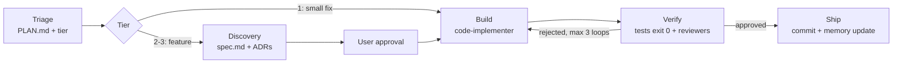

# Expert AI Developer Skills

> Plugins, subagents and skills that make AI coding agents work like a senior engineering team: plan first, test-driven, verified with evidence.

[](LICENSE)
[](docs/claude-code-installation.md)
[](plugins/README.md)
[](skills/README.md)

Expert AI Developer Skills ships the same engineering workflow for two hosts, **Claude Code** and **Google Antigravity**. An orchestrator agent triages each task by risk, delegates to specialist subagents (product, design, architecture, implementation, QA, review), and only ships when tests pass and reviewers approve. Lifecycle hooks enforce the rules, so they do not depend on the model remembering them.

## Contents

- [Features](#features)
- [Quick start](#quick-start)
- [Plugins](#plugins)
- [How it works](#how-it-works)
- [Repository layout](#repository-layout)
- [Documentation](#documentation)
- [Development](#development)
- [Contributing](#contributing)
- [License](#license)

## Features

- **Risk-based workflow.** Tasks are triaged into three tiers: small fixes skip discovery and review committees; risky changes get full discovery, user sign-off and adversarial review.
- **Specialist subagents.** Orchestrators delegate to product analyst, UI/UX designer, architect, implementer, QA tester, critic, challenger, E2E black-box tester and compliance verifier.
- **Enforced guardrails.** Hooks block code edits without a `PLAN.md`, block commits to protected branches, and run the test suite before a turn can end.
- **Honest verification.** The E2E tester drives a real browser through the Playwright MCP server; in Claude Code a hook rejects a `PASSED` verdict that has no screenshots on disk.
- **Shared memory.** A `context/memory/` directory lets Claude Code and Antigravity sessions hand work to each other.
- **Portable skills.** 39 skills follow the open [Agent Skills](https://agentskills.io) format and install on their own in any project.

## Quick start

### Claude Code

```bash
claude plugin marketplace add jggomez/expert-ai-developer-skills
claude plugin install senior-dev@expert-ai-developer-skills
```

Dependencies install automatically: `senior-dev-flutter` and `python-backend` pull in `senior-dev`. Run an orchestrator as the main session:

```bash
claude --agent senior-dev:senior-dev-orchestrator
```

Scopes, updates and team setup: [docs/claude-code-installation.md](docs/claude-code-installation.md).

### Google Antigravity

```bash
git clone https://github.com/jggomez/expert-ai-developer-skills.git
cd expert-ai-developer-skills
agy plugin install ./plugins/antigravity/senior-dev
```

See [plugins/README.md](plugins/README.md) to install the full suite.

### Standalone skills

Install individual skills into any repository with the [`skills`](https://github.com/vercel-labs/skills) CLI:

```bash
npx skills add jggomez/expert-ai-developer-skills --list
npx skills add jggomez/expert-ai-developer-skills --skill python-expert
```

### Optional: token and cost metrics

[`agent-meter`](tools/agent-meter/README.md) is a separate CLI that reports tokens, cost and latency per session, task and subagent for both hosts:

```bash
uv tool install "git+https://github.com/jggomez/expert-ai-developer-skills#subdirectory=tools/agent-meter"
agent-meter setup --local
```

## Plugins

| Plugin | What it does | MCP servers | Docs |
| :--- | :--- | :--- | :--- |
| `senior-dev` | SDLC orchestrator and the specialist subagents shared by the other orchestrators. | Cloud Run, Firebase, Playwright (Claude Code) | [Claude](plugins/claude/senior-dev/README.md) · [Antigravity](plugins/antigravity/senior-dev/README.md) |
| `senior-dev-flutter` | Flutter and Dart layer on top of the official Flutter/Dart skill packs: architecture decisions, profiling, release engineering. | Dart | [Claude](plugins/claude/senior-dev-flutter/README.md) · [Antigravity](plugins/antigravity/senior-dev-flutter/README.md) |
| `python-backend` | FastAPI/Django backends, zero-downtime migrations, CI/CD gates. | Cloud Run, Firebase | [Claude](plugins/claude/python-backend/README.md) · [Antigravity](plugins/antigravity/python-backend/README.md) |
| `senior-data-engineer` | Google Cloud lakehouse: Datastream CDC, Dataform, BigQuery SCD modeling, cost controls. | BigQuery, Datastream, Dataform, Pub/Sub | [Claude](plugins/claude/senior-data-engineer/README.md) · [Antigravity](plugins/antigravity/senior-data-engineer/README.md) |
| `sql-query-optimizer` | Diagnoses slow queries from real execution plans and rewrites them. | BigQuery, Cloud SQL | [Claude](plugins/claude/sql-query-optimizer/README.md) · [Antigravity](plugins/antigravity/sql-query-optimizer/README.md) |
| `shared-context` | Working memory shared across AI sessions and hosts. | shared-context | [Claude](plugins/claude/shared-context/README.md) · [Antigravity](plugins/antigravity/shared-context/README.md) |
| `git-workflow` | Branch protection, scope-drift checks, Conventional Commits. | — | [Claude](plugins/claude/git-workflow/README.md) · [Antigravity](plugins/antigravity/git-workflow/README.md) |
| `docs-and-quality` | Documentation standards, TDD, anti-placeholder code gate. | — | [Claude](plugins/claude/docs-and-quality/README.md) · [Antigravity](plugins/antigravity/docs-and-quality/README.md) |
| `multi-agent-ops` | Loop engineering for parallel agents and repository research. | — | [Claude](plugins/claude/multi-agent-ops/README.md) · [Antigravity](plugins/antigravity/multi-agent-ops/README.md) |
| `agent-metrics` *(optional)* | Hooks that record sessions for `agent-meter`. | — | [Claude](plugins/claude/agent-metrics/README.md) · [Antigravity](plugins/antigravity/agent-metrics/README.md) |

## How it works



Every task starts with a `PLAN.md`. Discovery writes a single `docs/<feature-name>/spec.md`; implementers work on disjoint files or separate git worktrees; reviewers return verdicts instead of writing report files. Full description: [docs/architecture.md](docs/architecture.md). Operating rules for agents: [AGENTS.md](AGENTS.md).

## Repository layout

```text
.
├── plugins/
│   ├── claude/          # Claude Code plugins (generated from the Antigravity sources)
│   └── antigravity/     # Google Antigravity plugins (source of truth for agents)
├── skills/              # Canonical skills, copied into each plugin
├── scripts/             # Sync and validation scripts
├── tools/agent-meter/   # Optional metrics CLI (standalone Python package)
├── rules/ workflows/    # Reusable agent rules and task workflows
├── docs/                # Installation, architecture and feature docs
└── tests/               # Structure, unit and behavioral tests
```

## Documentation

| Topic | Link |
| :--- | :--- |
| Install and update Claude Code plugins | [docs/claude-code-installation.md](docs/claude-code-installation.md) |
| Plugin catalog for both hosts | [plugins/README.md](plugins/README.md) |
| Architecture of the multi-agent workflow | [docs/architecture.md](docs/architecture.md) |
| Skills catalog | [skills/README.md](skills/README.md) |
| Agent operating rules | [AGENTS.md](AGENTS.md) |
| Test suite | [tests/README.md](tests/README.md) |
| Metrics CLI | [tools/agent-meter/README.md](tools/agent-meter/README.md) |

## Development

Requirements: Python 3 with `pytest` and `pyyaml`, Node.js (hooks), and the `claude` CLI for manifest validation.

```bash
# Regenerate the Claude Code plugins after editing skills/ or plugins/antigravity/
python3 scripts/sync_plugin_skills.py
python3 scripts/sync_agents.py

# Validate
pytest tests/
claude plugin validate .
```

Edit canonical sources only: `skills/` and `plugins/antigravity/`. Agents, skills and manifests under `plugins/claude/` are generated; each Claude plugin's `README.md`, `hooks.json` and Claude-specific hooks are maintained by hand.

## Contributing

Contributions are welcome. Read [CONTRIBUTING.md](CONTRIBUTING.md) for the workflow, commit conventions and checks a pull request must pass.

## License

[Apache License 2.0](LICENSE).
