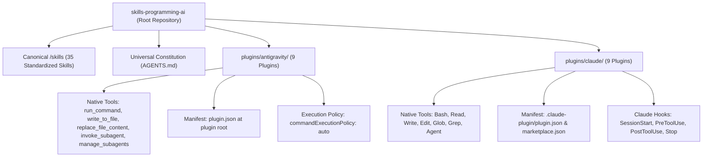

# Expert AI Developer Skills

[](git@github.com:jggomez/expert-ai-developer-skills.git)
[](plugins)
[](skills)
[](AGENTS.md)
[](LICENSE)

Production-grade engineering customizations, autonomous subagents, deterministic lifecycle hooks, and modular skills for **Google Antigravity (AGY)** and **Anthropic Claude Code**.

This repository organizes software engineering best practices into **dual-ecosystem installable plugins**, **35 canonical skills**, **a universal agent constitution**, **deterministic lifecycle hooks**, and **16 operational workflows**.

---

## 1. Dual Ecosystem Architecture

The repository natively supports two premier AI coding ecosystems side-by-side with zero cross-environment contamination:



### Ecosystem Comparison & Tool Mapping

| Dimension | Google Antigravity (`plugins/antigravity/`) | Anthropic Claude Code (`plugins/claude/`) |
| :--- | :--- | :--- |
| **Plugin Manifest** | `plugin.json` (at plugin root) | `.claude-plugin/plugin.json` |
| **Marketplace Manifest**| Local path installation via `agy plugin install` | `.claude-plugin/marketplace.json` |
| **Command Execution** | `run_command` (`commandExecutionPolicy: auto`) | `Bash` |
| **File Reading** | `view_file` | `Read` |
| **File Creation** | `write_to_file` | `Write` |
| **File Editing** | `replace_file_content` | `Edit` |
| **File Search** | Grep / directory tools | `Glob`, `Grep` |
| **Subagent Delegation**| `invoke_subagent(name="...", prompt="...")` | `Agent(agent="...", prompt="...")` |
| **Agent Coordination**| `manage_subagents`, `send_message` | `Agent` session orchestration |
| **Hook Schema** | Named hook groups: `{"PreToolUse": [...], "Stop": [...]}` | Host object: `{"hooks": {"PreToolUse": [...], "Stop": [...]}}` |

---

## 2. Universal Constitution: `AGENTS.md`

All agents in this repository operate under the supreme governance of the **Universal AI Coding Agent Constitution** located at [`AGENTS.md`](AGENTS.md).

To guarantee uniform discovery across development tools and AI runners, host-specific configuration files are maintained as symlinks to `AGENTS.md`:
* **`CLAUDE.md`** &rarr; symlink to `AGENTS.md` (read automatically by Anthropic Claude Code)
* **`AGENT.md`** &rarr; symlink to `AGENTS.md` (read by Antigravity / Cursor / IDE assistants)

### Inviolable Invariants

1. **Plan-First Mandatory Gate**:
   * No application code modifications may occur without an up-to-date `PLAN.md` file authored and saved to disk.
2. **Orchestrator Role Boundaries**:
   * Lead Orchestrators (`senior-dev-orchestrator`, `flutter-feature-orchestrator`) are **strictly prohibited from directly writing application source code**.
   * File editing tools (`write_to_file`, `replace_file_content`, `Write`, `Edit`) in orchestrator sessions are reserved exclusively for `PLAN.md`, ADRs, and documentation.
   * All implementation code **MUST** be delegated to `code-implementer` or `flutter-implementer`.
3. **Strict Test-Driven Development (TDD)**:
   * Red-Green-Refactor cycle: failing test first, minimal production code, refactor to clean code.
   * Tests are empirical proof: a task is complete only with verified terminal output showing `exit code 0`.
4. **Anti-Lazy Code Policy**:
   * Zero tolerance for placeholders (`TODO: implement later`, `# ... rest of code`, `pass # placeholder`, `/* unimplemented */`).
   * Every edit must provide 100% complete, working code. Deterministically enforced by `anti-lazy-code-gate.js`.
5. **Self-Correction Protocol (3-Loop Cap)**:
   * Auto-remediation is strictly capped at a maximum of 3 cycles. If a defect persists after 3 cycles, agents must halt and escalate to the user with a diagnostic report.

---

## 3. Graph Engineering State Machine (DAG)

Multi-agent coordination follows a deterministic Directed Acyclic Graph (DAG) state machine:

```mermaid
flowchart TD
    GATE["[PLAN FIRST GATE]<br/>PLAN.md created/updated"] --> DISCOVERY["[DISCOVERY (Optional)]<br/>product-analyst | architect-engineer"]
    DISCOVERY --> BUILD["[BUILD (Mandatory)]<br/>code-implementer | flutter-implementer"]
    GATE --> BUILD
    BUILD --> TEST["[TEST (Mandatory)]<br/>qa-tester (exit code 0 proof)"]
    TEST -->|Fail: Red State (Loop <= 3)| BUILD
    TEST -->|Pass: Green State| AUDIT["[AUDIT (Mandatory)]<br/>compliance-verifier (APPROVED verdict)"]
    AUDIT -->|Reject: Gap Found (Loop <= 3)| BUILD
    AUDIT -->|Pass: Approved| SHIP["[SHIP]<br/>git commit & finish"]
    TEST -->|Loop > 3: Cap Exceeded| ESCALATE["[HALT & ESCALATE]<br/>Diagnostic report to user"]
    AUDIT -->|Loop > 3: Cap Exceeded| ESCALATE
```

### Multi-Agent Topologies Taxonomy
1. **Manager-Worker Topology**: Orchestrator coordinates high-level objectives and delegates atomic tasks to isolated workers operating in dedicated branches or git worktrees.
2. **Sequential Pipeline (DAG)**: Deterministic progression through Plan &rarr; Build &rarr; Test &rarr; Audit &rarr; Ship with bounded failure loops.
3. **Review Committee**: Parallel specialist evaluations where multiple agents evaluate diffs concurrently across distinct concerns (Security, Quality, Performance, Architecture).

---

## 4. Deterministic Lifecycle Hooks

Plugins enforce safety and quality invariants via deterministic Node.js lifecycle hooks executing on host tool events:

```
plugins/
├── antigravity/<plugin>/hooks/
│   ├── gitflow-branch-gate.js     # Blocks commits to main/develop, validates branch prefixes
│   ├── anti-lazy-code-gate.js     # Scans diffs for TODOs, pass stubs, and incomplete placeholders
│   ├── stop-gate.js               # Enforces test pass (exit code 0) before session completion
│   ├── pre-tool-gate.js           # Enforces workspace path boundaries and safe command flags
│   └── context-*.js               # Cross-agent memory capture and restoration
└── claude/<plugin>/hooks/
    ├── (Identical deterministic gate scripts tailored for Claude Code hooks.json events)
```

### Active Hook Gates
* **Gitflow Branch Protection Gate** (`gitflow-branch-gate.js`): Prevents destructive direct commits or pushes to protected branches (`main`, `master`, `develop`, `release/*`). Requires semantic branch naming (`feat/*`, `fix/*`, `chore/*`).
* **Anti-Lazy Code Stop Gate** (`anti-lazy-code-gate.js`): Inspects git diffs before session termination. Exits with code 2 if placeholder comments (`TODO: implement later`, `# ... rest of code`) are detected.
* **Test Verification Stop Gate** (`stop-gate.js` / `verify_tests.py`): Blocks session termination if automated test suites are failing.
* **Shared Context Keeper** (`context_common.py`, `context_snapshot.py`, `context_list.py`): Preserves decisions, architectural choices, and hand-off state across sessions and between Antigravity and Claude Code.

---

## 5. 35 Canonical Skills Catalog

The [`skills/`](skills/README.md) directory contains 35 modular skills compliant with the [Open Agent Skills Standard (`agentskills.io`)](https://agentskills.io). Each skill includes a platform-neutral `SKILL.md`, reference documentation, and deterministic Python automation scripts.

### 9 Distributed Plugins & Bundled Skills

Both plugin ecosystems bundle physical copies of the skills they require to remain fully self-contained:

| Plugin Name | Bundled Skills Count | Bundled Skills |
| :--- | :---: | :--- |
| **`senior-dev`** | 8 | `senior-dev-orchestrator`, `product-analyst`, `senior-architect-engineering`, `code-implementer`, `code-smells-expert`, `refactoring-code-expert`, `qa-tester`, `compliance-verifier` |
| **`senior-dev-flutter`** | 7 | `flutter-senior-orchestration`, `flutter-architecture-decisions`, `flutter-review-checklist`, `flutter-test-strategy`, `flutter-performance-profiling`, `flutter-release-engineering`, `flutter-upgrade-migration` |
| **`python-backend`** | 11 | `python-expert`, `test-driven-development`, `pull-request-expert`, `code-smells-expert`, `refactoring-code-expert`, `security-audit`, `performance-scalability`, `database-migration-expert`, `senior-architect-engineering`, `design-spec-expert`, `build-and-ci-gates` |
| **`senior-data-engineer`** | 2 | `gcp-data-engineering`, `cdc-scd-patterns` |
| **`sql-query-optimizer`** | 2 | `bigquery-query-optimization`, `sql-query-optimization` |
| **`shared-context`** | 2 | `context-capture`, `context-restore` |
| **`git-workflow`** | 2 | `commit-expert`, `pull-request-expert` |
| **`docs-and-quality`** | 3 | `documentation-expert`, `testing-expert`, `guidelines-karpathy` |
| **`multi-agent-ops`** | 2 | `loop-engineering`, `repo-research` |

---

## 6. Operational Workflows (16 Playbooks)

Operational playbooks in [`workflows/`](workflows/README.md) and [`.agents/workflows/`](.agents/workflows/) guide complex development sequences:

### The 9 Core Slash Commands
* **`/spec`** ([`spec-workflow.md`](workflows/spec-workflow.md)): Clarify user goals, define NFRs, draft PRD.
* **`/plan`** ([`plan-workflow.md`](workflows/plan-workflow.md)): Author `PLAN.md`, decompose into atomic tasks, record ADRs.
* **`/build`** ([`build-workflow.md`](workflows/build-workflow.md)): Incremental TDD implementation via `code-implementer`.
* **`/test`** ([`test-workflow.md`](workflows/test-workflow.md)): Empirical testing and verification evidence (`exit code 0`).
* **`/constraints`** ([`constraints-workflow.md`](workflows/constraints-workflow.md)): Set NFR budgets, linter rules, security gates.
* **`/review`** ([`review-workflow.md`](workflows/review-workflow.md)): Machine-first code review and smell audit.
* **`/perf`** ([`perf-workflow.md`](workflows/perf-workflow.md)): Performance benchmarking, flamegraphs, latency tuning.
* **`/code-simplify`** ([`code-simplify-workflow.md`](workflows/code-simplify-workflow.md)): Clarity over cleverness, dead code pruning.
* **`/ship`** ([`ship-workflow.md`](workflows/ship-workflow.md)): Conventional commit, release packaging, PR submission.

### Specialized Engineering Playbooks
* **`feature-development-workflow.md`**: Complete end-to-end SDLC lifecycle playbook.
* **`test-execution-workflow.md`**: Test discovery, targeted execution, coverage auditing.
* **`secure-code-review-workflow.md`**: OWASP top 10 auditing, SAST analysis, secret scanning.
* **`pull-request-workflow.md`**: Pre-PR self-audit, diff inspection, PR description templating.
* **`commit-workflow.md`**: Selective git staging, Conventional Commits formatting, hook safety.
* **`code-smell-review-workflow.md`**: AST smell detection, cyclomatic complexity reduction.
* **`grill-me-alignment-workflow.md`**: Google `/grill-me` interactive design interview playbook.

---

## 7. Developer Runbooks

### 7.1 Run Full Test Suite
Verify repository structural integrity, schema compliance, hook contracts, and unit tests:
```bash
pytest tests/structure/ tests/unit/
```

### 7.2 Validate Lifecycle Hook Syntax
Ensure all JavaScript lifecycle hook scripts pass Node.js syntax checks without errors:
```bash
node --check plugins/antigravity/*/hooks/*.js plugins/claude/*/hooks/*.js
```

### 7.3 Synchronize Canonical Skills into All Plugins
After updating any canonical skill in `/skills/`, synchronize the changes into both `plugins/antigravity/` and `plugins/claude/` (with automated tool sanitization):
```bash
python3 scripts/sync_plugin_skills.py
```

### 7.4 Plugin Installation Commands

#### In Google Antigravity:
```bash
# Install a specific plugin
agy plugin install ./plugins/antigravity/senior-dev

# Install all plugins in one pass
for p in ./plugins/antigravity/*; do agy plugin install "$p"; done
```

#### In Anthropic Claude Code:
```bash
# Add repository marketplace
/plugin marketplace add jggomez/expert-ai-developer-skills

# Install plugins
/plugin install senior-dev
/plugin install senior-dev-flutter

# Or install from local directory:
claude plugin install plugins/claude/senior-dev
```

---

## 8. License

This repository is open-sourced under the [Apache License, Version 2.0](LICENSE).
