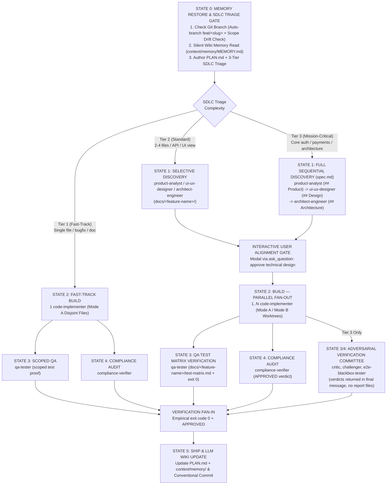

# Architecture: the multi-agent SDLC

> Host note: the alignment gate uses `ask_question` in Antigravity and `AskUserQuestion` in Claude Code; Mode B worktrees use `Workspace` settings in Antigravity and `isolation: "worktree"` in Claude Code.

This document describes how the orchestrator plugins (`senior-dev`, `senior-dev-flutter`, `python-backend`, `senior-data-engineer`) run a task end to end. For installation see the [root README](../README.md); the operating rules agents follow are in [AGENTS.md](../AGENTS.md).

## Problems it addresses

Traditional AI coding assistants struggle with four critical production challenges:

| The Production Failure | How AI Assistants Fail | The Expert AI Developer Skills Solution |
| :--- | :--- | :--- |
| **Context Amnesia** | LLMs lose architectural decisions and preferences across restarts, repeating past mistakes. | **Cross-AI LLM Wiki Memory (`context/memory/`)**: A compact working memory (about 500 tokens to load) shared between Claude Code and Google Antigravity sessions. |
| **Token & Latency Bloat** | Simple one-line bugfixes or typo corrections trigger massive, expensive multi-agent discovery pipelines. | **Dynamic 3-Tier Adaptive SDLC**: Intelligently routes tasks into Fast-Track (Tier 1), Standard (Tier 2), or Mission-Critical (Tier 3), achieving **70–85% token and latency savings** on localized tasks. |
| **Concurrency Collisions** | Dispatching parallel subagents results in overlapping edits, merge conflicts, and redundant test bottlenecks. | **Collision Prevention & Workspace Isolation**: Enforces Mode A (Strict Disjoint File Partitioning) and Mode B (Git Worktree Isolation) with isolated scoped test loops. |
| **Hallucinated Triumphs** | Agents declare tasks complete based on assumptions without empirical proof, masking regressions. | **Adversarial Verification Committee**: Every release candidate must pass independent checks by `qa-tester`, `critic`, `challenger`, `e2e-blackbox-tester`, and `compliance-verifier` (`exit code 0`). |

## State machine

All tasks executed across domain orchestrator plugins (`senior-dev`, `senior-dev-flutter`, `python-backend`, `senior-data-engineer`) follow a deterministic, adaptive 6-state DAG:

## Key mechanisms

### Dynamic 3-Tier Adaptive SDLC
Workflows dynamically scale according to task scope, surface area, and risk:

| Dimension / Phase | Tier 1: Fast-Track (Low Complexity) | Tier 2: Standard (Medium Complexity) | Tier 3: Mission-Critical (Complex) |
| :--- | :--- | :--- | :--- |
| **Scope & Triggers** | Single-file bugfixes, docs, chores, typos, localized refactoring (< 2 files). | 2–4 files/modules, new API endpoints, single UI view/widget, database migrations. | Greenfield features, payment/auth flows, breaking public APIs, core lakehouse pipelines. |
| **Discovery (State 1)** | **SKIPPED**: Zero discovery overhead; no `spec.md` authored. | **SELECTIVE**: Targeted sequential discovery via `product-analyst`, `ui-ux-designer`, or `architect-engineer` (their sections of `spec.md`). | **FULL**: Sequential discovery filling `docs/<feature-name>/spec.md` (`## Product`, `## Design`, `## Architecture`) + ADRs. |
| **Interactive Alignment (State 1.5)** | **SKIPPED**: Auto-proceeds to implementation. | **MANDATORY**: Interactive modal (`ask_question`) presenting technical summary for user approval. | **MANDATORY**: Strict interactive modal (`ask_question`) requiring explicit user sign-off. |
| **Build Mode (State 2)** | 1 `code-implementer` in Mode A (Disjoint Files). | 1..N `code-implementer` in parallel under Mode A (Disjoint Files). | 1..N `code-implementer` in parallel under Mode A or Mode B (Git Worktree Isolation). |
| **QA Verification (State 3)** | Scoped test execution (only affected test file run). | Full test suite execution + standardized QA Test Matrix (`docs/<feature-name>/test-matrix.md`). | Full test suite execution + standardized QA Test Matrix (`docs/<feature-name>/test-matrix.md`) across test pyramid. |
| **Verification & Committee (State 4)** | Scoped test proof + `compliance-verifier` check (bypasses adversarial committee). | Parallel `qa-tester` (`exit code 0`) and `compliance-verifier` (`APPROVED`). | **Adversarial Verification Committee**: `qa-tester`, `critic`, `challenger`, `e2e-blackbox-tester`, `compliance-verifier`. |
| **Token & Latency Impact** | **70–85% token & latency savings** | Balanced overhead with rigorous quality verification | Maximum depth, empirical verification, and zero regression tolerance |

### Adversarial Verification Committee
For Tier 3 mission-critical tasks, candidate changes must survive rigorous stress testing before code can ship:

* **[`qa-tester`](../plugins/antigravity/senior-dev/agents/qa-tester.md)**: Authors a formal test planning artifact in `docs/<feature-name>/test-matrix.md` mapping user stories to unit, integration, and component tests before running test suites (`exit code 0`).
* **[`critic`](../plugins/antigravity/senior-dev/agents/critic.md)**: Independent Senior Architect evaluating code smells, cyclomatic complexity, SOLID/DRY adherence, and maintainability (verdict returned in final message, `<= 50 lines`).
* **[`challenger`](../plugins/antigravity/senior-dev/agents/challenger.md)**: Adversarial Quality Engineer probing boundary conditions, failure paths, race conditions, memory leaks, and worst-case inputs (verdict returned in final message, `<= 50 lines`).
* **[`e2e-blackbox-tester`](../plugins/antigravity/senior-dev/agents/e2e-blackbox-tester.md)**: Blackbox journey tester operating without internal assumptions via headless browsers or Playwright (verdict returned in final message; `.png` evidence in `docs/<feature-name>/evidence/`).
* **[`compliance-verifier`](../plugins/antigravity/senior-dev/agents/compliance-verifier.md)**: Technical Compliance Officer auditing security (OWASP Top 10), static analysis, and architectural invariants, issuing an explicit `APPROVED` or `REJECTED` verdict.

### Automated Git Branch Governance & Scope Drift Protocol
- **Protected Branch Guard**: Never develops or commits directly on `main`, `master`, `develop`, or `dev`. Orchestrators inspect the branch at State 0 and automatically provision a dedicated branch (`git checkout -b feat/<slug>`).
- **Proactive Scope Drift Detection**: If the user requests unrelated or orthogonal features while working on an active feature branch, the orchestrator detects the domain pivot and queries the user via interactive modal (`ask_question`) recommending a new branch.

### Feature Artifacts Centralization (`docs/<feature-name>/`)
All specifications and verification outputs are neatly housed in a feature-scoped directory:
- `docs/<feature-name>/spec.md` — Single discovery file with fixed sections `## Product` (`product-analyst`, `<= 50` lines), `## Design` (`ui-ux-designer`, `<= 30` lines), `## Architecture` (`architect-engineer` / `flutter-architect`, `<= 50` lines); specialists run sequentially and edit only their own section.
- `docs/<feature-name>/adr-NNN-*.md` — Decision records, only when a structural decision exists (root `DESIGN.md` remains the project design system).
- `docs/<feature-name>/test-matrix.md` — Standardized QA test matrix with positive, boundary, and negative scenarios.
- `docs/<feature-name>/evidence/*.png` — Browser E2E screenshots.
- Review verdicts (`critic`, `challenger`, `e2e-blackbox-tester`, `compliance-verifier`) are returned in the reviewer's final message (`<= 50` lines), never written as files; every other worker returns `<= 15` lines (status, files changed, test command + exit code, next step).