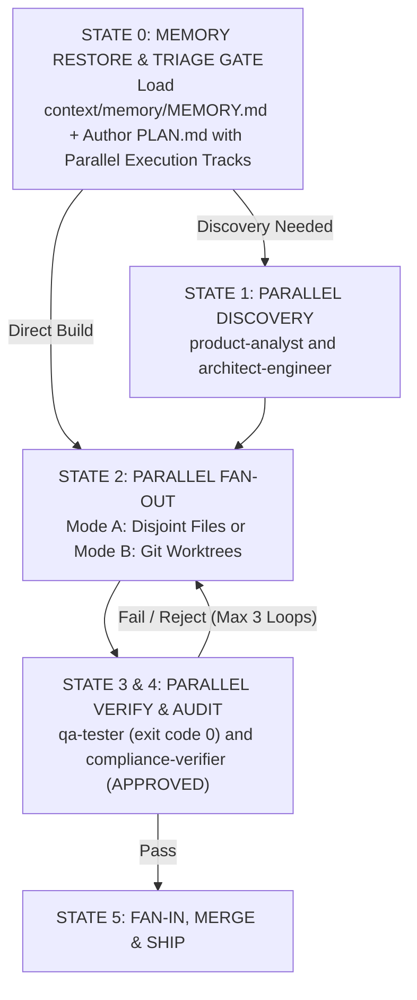

# Multi-Agent Ops Plugin

[](https://github.com/jggomez/expert-ai-developer-skills)
[](.)

The `multi-agent-ops` plugin packages manager-worker orchestration, **Mode A (Disjoint File Partitioning)** and **Mode B (Git Worktree Isolation)** parallel execution, self-correcting development loops, and context-guard safety gates for **Google Antigravity** and **Claude Code**.

> **Maintaining the bundled skills**: `skills/` below is a physical copy of the matching directories in the root `/skills` catalog. After editing either skill under `/skills`, run `python3 scripts/sync_plugin_skills.py` from the repo root to re-sync this copy. `tests/structure/test_plugin_structure.py::test_plugin_skills_match_root_skills` fails CI if the two ever drift.

---

## 1. Directory Tree & Architecture

```
plugins/antigravity/multi-agent-ops/
├── README.md                       # This usage manual
├── plugin.json                     # Antigravity plugin manifest
├── .claude-plugin/
│   └── plugin.json                 # Claude Code plugin manifest
├── hooks.json                      # Hook registrations
├── hooks/
│   └── context-guard-gate.js       # PreToolUse gate protecting token budget
├── rules/
│   └── multi-agent-ops-rules.md    # Multi-agent DAG & parallel Mode A/B coordination rules
└── skills/
    ├── loop-engineering/           # Manager-worker parallel-agent workflows (Mode A & Mode B)
    └── repo-research/              # Repository structure/dependency analysis & project-context generation
```

---

## 2. Multi-Agent Topologies & Execution DAG



* **Mode A — Disjoint File Partitioning (`Workspace: "inherit"`) [Default]**: Parallel workers modify strictly non-overlapping files/directories in the same working tree with zero `git merge` overhead on Fan-In.
* **Mode B — Git Worktree Isolation (`Workspace: "branch"` / `git worktree`)**: Parallel workers operate in isolated branches/worktrees when tracks touch shared files (`package.json`, routers, migrations) and merge cleanly at Fan-In.
* **Review Committee**: Concurrent `qa-tester` and `compliance-verifier` evaluation capped at 3 self-correction iterations.

---

## 3. Bundled Skills (2 Packaged Modules)

1. **`loop-engineering`**: Guides parallel subagent dispatching across **Mode A: Disjoint File Partitioning** (default in-tree parallel execution when workers own strictly non-overlapping files) and **Mode B: Git Worktree Isolation** (separate git worktrees when tracks touch shared files), concurrent `qa-tester` + `compliance-verifier` verification, self-correction loops bounded by the 3-loop cap, and PR review automation patterns.
2. **`repo-research`**: Analyzes a repository's structure, technologies, and dependency graph to produce or update a project context document.

---

## 4. Lifecycle Hooks & Token Guard

| Hook Event | Script | Behavior |
| :--- | :--- | :--- |
| **`PreToolUse`** | `hooks/context-guard-gate.js` | Intercepts large file read operations (`view_file`), preventing massive token dumps and enforcing line-offset budgeting. |

---

## 5. Example Prompts

- "Analyze this repository and generate a project context document." (`repo-research`)
- "I have 3 independent features to build — provision isolated worktrees for each so I can dispatch a subagent per branch." (`loop-engineering`)
- "Audit the open feature branches for quality gate failures." (`loop-engineering`, via `pr_cron_reviewer.py`)
- "Orchestrate a self-correcting development loop with a strict 3-loop cap." (`loop-engineering`)

---

## 6. Installation

**Antigravity CLI**:
```bash
agy plugin install ./plugins/antigravity/multi-agent-ops
```

**Claude Code**:
```bash
claude plugin install plugins/claude/multi-agent-ops
```
