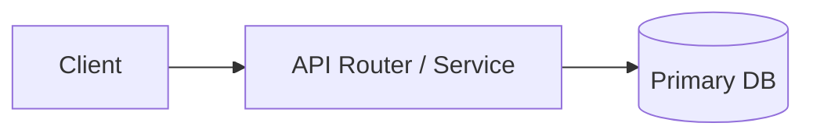

# Backend / API Design Spec: [System Title]

> **Status**: [Draft | Review | Approved | Superceded] — **Date**: [YYYY-MM-DD]

## 1. Objective & Scope
- **Problem**: <1–2 sentences stating the concrete backend/API problem and measurable SLA target.>
- **In Scope**: <Endpoints, domain services, and schema/migration changes delivered.>
- **Out of Scope**: <Explicit exclusions to prevent scope creep.>
- **Acceptance Criteria**: <Measurable contract, SLA, and status-code outcomes verified by automated tests.>

## 2. Architecture & Data Model

- **Schema / Migration Delta**: `<table_name>` (`<column type constraints>`) — reversible migration.
- **Indexes & Keys**: `<index_name>` on `(<columns>)`; FK `<fk_constraint>`.

## 3. API Endpoints & Contracts
| Method & Path | Request Schema (Params / Body) | Response Schema | Status Codes |
| :--- | :--- | :--- | :--- |
| `POST /v1/<resource>` | `{ "field": "string" }` | `{ "id": "uuid", "status": "created" }` | `201`, `400`, `401`, `409`, `422` |
| `GET /v1/<resource>/{id}` | Path: `id: uuid` | `{ "id": "uuid", "field": "string" }` | `200`, `401`, `403`, `404` |

## 4. Security, Edge Cases & Trade-offs
- **AuthN / AuthZ**: <JWT / RBAC scope enforcement and tenant ownership rules.>
- **Validation & Rate Limits**: <Strict DTO/Pydantic bounds, idempotency keys, quota limits.>
- **Edge Cases**: <Timeouts, duplicate retries, dead-letter / rollback behavior.>
- **Trade-offs**:
  - **+ Pros**: <Concrete latency, consistency, or simplicity gain.>
  - **- Risks**: <Operational constraint or failure mode> -> **Mitigation**: <Safeguard / fallback.>
