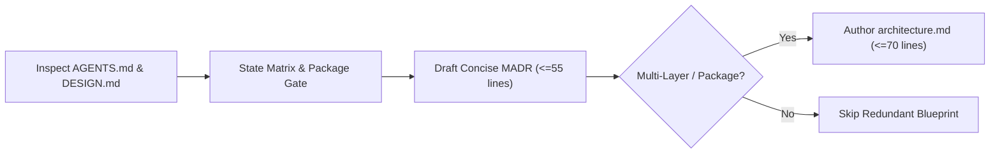

# Flutter Architecture Decisions

## Overview
**Flutter Architecture Decisions** provides a pragmatic framework for selecting one primary state management solution (Riverpod, Bloc/Cubit, Signals, or `setState`), drawing high-bar package boundaries, and recording concise **MADR** records (`docs/<feature-name>/adr-NNN-*.md <= 55 lines`) and conditional blueprints (`docs/<feature-name>/architecture.md <= 70 lines`) across **Claude Code** and **Google Antigravity**.

## When to Use
### Trigger Scenarios
- Scaffolding a Flutter app, choosing/migrating state management, or introducing `GoRouter`/FFI/platform-channel topology shifts.
- Evaluating whether a domain boundary warrants a standalone Dart package vs. folder namespace.
- Resolving PR disputes on dependency direction across UI, Domain, and Data layers.

### When NOT to Use
- **Routine feature or single-widget work**: When changes fit established repository architecture, **skip** creating redundant ADRs or `architecture.md`.
- **Backend / non-Dart services**: Use `senior-architect-engineering` or `design-spec-expert`.

## Process

### 1. Align Layered Split & Root Contracts
Inspect root `AGENTS.md` (`<= 90 lines` wired to `context/memory/MEMORY.md`) and official Google root `DESIGN.md` (`<= 110 lines` 2-layer YAML + 8 sections) + optional `docs/<feature-name>/design.md` (`<= 35 lines` screen delta). Enforce clean **UI** (widgets/themes) -> **Domain** (use cases/entities) -> **Data** (repositories/DTOs/clients) separation.

### 2. State Management & High-Bar Package Gate
Evaluate state complexity via [references/state-management-decision-matrix.md](references/state-management-decision-matrix.md): pick **one primary solution** per app (`setState` for local ephemeral state). Extract a separate package **only** if `>= 2` hold: reused across apps, decoupled release cadence, 1-sentence public API, and standalone test suite.

### 3. Author Concise MADR & Conditional Blueprint
- **Concise MADR (`docs/<feature-name>/adr-NNN-*.md <= 55 lines`)**: Follow [references/adr-template.md](references/adr-template.md)—**Status & Date**, `## 1. Context` (`<= 5 lines`), `## 2. Options Considered` (2–3 concrete options), `## 3. Decision & Justification`, and `## 4. Trade-offs & Reviewer Compliance` (`+` Pros / `-` Cons + 1-line lint/PR rule for `flutter-reviewer`). Sync `doc/adr/` if used by the repo.
- **Blueprint (`docs/<feature-name>/architecture.md <= 70 lines`)**: Author **ONLY** when multiple layers or packages interact; skip when a single ADR suffices.

## Usage
### Example Prompts & Host Execution
- `"Compare Riverpod vs Bloc for our offline-first cart flow and write a <=55-line MADR ADR."`
- **Claude Code / Google Antigravity**: Invoke `flutter-architecture-decisions` or run `dart analyze lib/` to inspect boundary imports before drafting.

## Red Flags
- Mixing 3+ state libraries or picking heavy enterprise Bloc for simple leaf screens.
- Creating `shared`/`core` packages without a 1-sentence API or standalone tests.
- Writing verbose ADRs (`> 55 lines`), bloated `architecture.md` (`> 70 lines`), or redundant docs when changes already follow established architecture.
- Allowing UI widgets to import `dio`, SQLite, or platform channels directly.

## Verification
- [ ] One primary state solution selected against [references/state-management-decision-matrix.md](references/state-management-decision-matrix.md) and package gate checked.
- [ ] `docs/<feature-name>/adr-NNN-*.md` (`<= 55 lines`) matches [references/adr-template.md](references/adr-template.md) including the 1-line `flutter-reviewer` rule.
- [ ] `docs/<feature-name>/architecture.md` (`<= 70 lines`) created **only** for multi-layer/package interactions; zero cyclic dependencies.

## References
- [State Management Decision Matrix](references/state-management-decision-matrix.md)
- [Concise MADR Template (Flutter)](references/adr-template.md)
