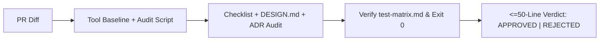

# Flutter Review Checklist

## Overview
**Flutter Review Checklist** provides a systematic quality, performance, and accessibility audit for Flutter/Dart diffs across **Claude Code** and **Google Antigravity**—complementing `dart-run-static-analysis` and `flutter-fix-layout-issues` by catching runtime rebuild bloat, `.dispose()` leaks, async `BuildContext` hazards, `DESIGN.md`/ADR drift, and hallucinated test results in a **Zero-Fluff (`<= 50 lines`)** report.

## When to Use
### Trigger Scenarios
- Reviewing PRs touching `lib/**` widgets, controllers/blocs/notifiers, routing, or platform channels.
- Auditing screens for 60/120fps jank, memory leaks, accessibility (a11y), and `DESIGN.md` / ADR compliance.

### When NOT to Use
- **Pure formatting or `RenderFlex` overflow fixes**: Use `dart format` or `flutter-fix-layout-issues`.
- **Non-Flutter backend services**: Use `code-critic`, `code-smells-expert`, or `refactoring-code-expert`.

## Process


### 1. Fail-Honest Automated Baseline
Execute automated checks first; if `flutter test` or `integration_test/` cannot run (missing SDK, no simulator/Chrome), report `BLOCKED: Not executed — <exact command & terminal error>` (or `SKIPPED` when N/A)—never fabricate `PASSED`.

### 2. Walk Checklist, `DESIGN.md` & ADR Conformance
Audit diffs against [references/flutter-review-checklist.md](references/flutter-review-checklist.md) with `file:line` precision:
- **Rebuild & Lifecycle**: Leaf-scoped `setState`/consumers, `const` constructors, `.dispose()`/`.cancel()` on all controllers/subscriptions, and `if (!mounted) return;` after every `await` before using `BuildContext`.
- **Lists, Images & a11y**: `ListView.builder`/`CustomScrollView` for dynamic lists, `cacheWidth`/`cacheHeight` on images, `RepaintBoundary` on animations, `>= 48x48dp` tap targets, and explicit `Semantics`/tooltips.
- **Governance & Design Contracts**: Verify alignment with root `AGENTS.md` (`<= 90 lines` wired to `context/memory/MEMORY.md`), official Google root `DESIGN.md` (`<= 110 lines` 2-layer YAML + 8 sections) + optional `docs/<feature-name>/design.md` (`<= 35 lines` screen delta), and concise MADR `docs/<feature-name>/adr-NNN-*.md` (`<= 55 lines`) / `doc/adr/`.

### 3. Zero-Fluff Verdict (`<= 50 lines`)
Output **findings table (`file:line`, severity, fix) + metrics + verdict (`APPROVED` | `REJECTED`) only**. Flag any hallucinated test/E2E `PASSED` claim without `exit code 0` or bloated artifacts exceeding line caps (`DESIGN.md > 110`, `design.md > 35`, `adr > 55`, `architecture.md > 70`, `test-matrix.md > 80`) as **`REJECTED`**.

## Usage
```bash
python3 ./skills/flutter-review-checklist/scripts/flutter_project_audit.py
dart analyze
dart format --output=none --set-exit-if-changed .
flutter test --coverage
```

## Red Flags
- Using `BuildContext` across `await` without `mounted`, instantiating controllers in `build()`, or omitting `.dispose()` / `subscription.cancel()`.
- Using `ListView(children: [...])` on unbounded lists or omitting `Semantics`/48x48dp targets on icon controls.
- Accepting `PASSED` claims without `exit code 0` terminal output, approving ADR/`DESIGN.md` drift, or writing review reports `> 50 lines`.

## Verification
- [ ] `dart analyze`, `dart format`, and `python3 ./skills/flutter-review-checklist/scripts/flutter_project_audit.py` executed with `exit code 0` (or honest `BLOCKED` error).
- [ ] All async `BuildContext` usages guarded by `mounted` and all controllers/subscriptions disposed.
- [ ] Conformance verified against root `AGENTS.md`, Google root `DESIGN.md` (`<= 110 lines`), ADRs (`<= 55 lines`), and IEEE/ISTQB `docs/<feature-name>/test-matrix.md` (`<= 80 lines`).
- [ ] Final review report is `<= 50 lines` with explicit `APPROVED` or `REJECTED` verdict.

## References
- [Flutter Comprehensive Review Checklist](references/flutter-review-checklist.md)
