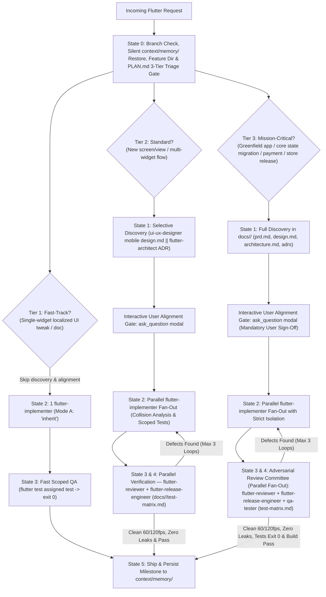

# Flutter Senior Orchestration

## Overview
The **Flutter Senior Orchestration** skill directs the end-to-end delivery lifecycle of Flutter and Dart applications across a 6-state Graph Engineering DAG—from silent Cross-AI LLM Wiki memory restoration (`context/memory/`), **3-Tier Dynamic Routing Rubric**, and mandatory architecture triage through parallel TDD implementation, tiered review and adversarial verification, and milestone memory persistence. Designed for seamless execution across both **Claude Code** and **Google Antigravity**, this skill coordinates specialized subagents (`flutter-architect`, `flutter-implementer`, `flutter-reviewer`, `flutter-release-engineer`, and `qa-tester`) while delegating low-level procedural mechanics to official `flutter-*` and `dart-*` skills.

## When to Use

### Trigger Scenarios
- Orchestrating new Flutter features, multi-screen flows, complex domain logic, or cross-cutting architectural changes.
- Applying 3-tier dynamic routing to Flutter tasks in `PLAN.md` (`## 3-Tier Dynamic Routing & Architecture Triage` and `## Parallel Execution Tracks`).
- Coordinating parallel multi-agent workflows across architecture, TDD implementation, 60/120fps review, and release engineering.
- Mission-critical Flutter initiatives: greenfield applications, core state management migrations (e.g. Provider to Riverpod/Bloc), checkout/payment/auth flows, store releases, and adversarial review.
- Addressing systemic performance jank or planning major framework/dependency migrations.

### When NOT to Use
- **Pure backend tasks**: For Python, Go, or SQL database migrations, use backend-specific skills like `python-expert` or `database-migration-expert`.
- **Ad-hoc layout overflow questions**: For isolated layout overflow Q&A, use official `flutter-fix-layout-issues`.

## Core Invariants
1. **The Orchestrator Never Implements**: The orchestrator is strictly forbidden from writing or modifying Dart source code or tests (`lib/`, `test/`). File-writing tools are reserved exclusively for `PLAN.md`, `doc/adr/*.md`, `docs/`, `.agents/`, and `context/memory/`. All Dart implementation MUST be delegated to `flutter-implementer`.
2. **Automated Git Branch Governance**: Never develop directly on base or protected branches (`main`, `master`, `develop`, `dev`). At State 0, check active branch (`git symbolic-ref --short HEAD`) and auto-create a dedicated feature branch (`feat/<slug>` or `fix/<slug>`). Proactively detect scope drift and ask the user via `ask_question` before branching.
3. **Feature Directory Creation**: Derive the `<feature-name>` slug and ensure `docs/<feature-name>/` is created for all discovery and verification artifacts.
4. **3-Tier Dynamic Routing**: Classify every Flutter task in State 0 into Tier 1 (Fast-Track), Tier 2 (Standard), or Tier 3 (Mission-Critical / Complex).
5. **Interactive User Alignment Gate**: On Tier 2 and Tier 3 tasks, pause and prompt the user via `ask_question` before code implementation. Auto-proceed on Tier 1.
6. **Collision Prevention Analysis & Scoped Test Isolation**: Verify disjoint `Owned Files` in Mode A or enforce Mode B Git Worktree isolation for shared files (`pubspec.yaml`, router, DI, `build_runner`). Implementers run scoped tests only; full test suite execution is reserved for verification gates.
7. **Tiered Verification**: Tier 1 uses scoped QA; Tier 2 uses parallel `flutter-reviewer` + `flutter-release-engineer` with `docs/<feature-name>/test-matrix.md`; Tier 3 uses adversarial review with `flutter-reviewer` + `flutter-release-engineer` + `qa-tester` test matrix. Retries are capped at max 3 iterations.

## Graph Engineering Execution DAG



## 3-Tier Dynamic Routing Rubric for Flutter

At State 0, every Flutter task is classified into one of three execution tiers in `PLAN.md`:

| Tier | Characteristics & Trigger Criteria | Discovery & Alignment Gate | Implementation & Verification Protocol |
| :--- | :--- | :--- | :--- |
| **Tier 1: Fast-Track** | - Single-widget localized UI tweak or bugfix<br>- Minor text/styling adjustment with zero state/routing changes<br>- Documentation or comment update<br>- State management, navigation routes, and native dependencies completely unchanged | - **Discovery**: SKIP discovery specialists (`ui-ux-designer`, `flutter-architect`).<br>- **Alignment Gate**: SKIP interactive modal (auto-proceed). | - **Implementation**: 1 `flutter-implementer` (`Workspace: 'inherit'`).<br>- **Verification**: Fast scoped QA (`flutter test <assigned_test>.dart` -> `exit code 0`). |
| **Tier 2: Standard** | - New screen, view, or multi-widget flow<br>- Addition of presentation components with local state<br>- Route additions in `GoRouter` or sub-routing updates<br>- Moderate state refactoring (>= 2 widgets/notifiers) | - **Discovery**: Selective discovery upfront (`ui-ux-designer` for mobile `design.md` tokens/touch targets and/or `flutter-architect` for ADRs/contracts). Store in `docs/<feature-name>/`.<br>- **Alignment Gate**: PAUSE & `ask_question` modal presenting PRD, design, and architecture summary. | - **Implementation**: 1..N parallel `flutter-implementer` subagents (Mode A Disjoint Files or Mode B Git Worktree).<br>- **Verification**: Full test suite execution documented in `docs/<feature-name>/test-matrix.md` (`exit code 0`), plus parallel `flutter-reviewer` (60/120fps, leaks, `BuildContext` async gaps) and `flutter-release-engineer` (build flavors, signing, pubspec). |
| **Tier 3: Mission-Critical / Complex** | - Greenfield Flutter application from scratch<br>- Core state management architecture migration (e.g. Provider to Riverpod/Bloc)<br>- Authentication, payment processing, checkout, or secure storage flows<br>- Platform channels, native plugins, FFI, or background isolate pipelines<br>- Production store release engineering and multi-platform deployment | - **Discovery**: Full discovery suite in `docs/<feature-name>/` (`prd.md`, mobile `design.md` with tokens and responsive scales, `architecture.md`, `doc/adr/*.md`).<br>- **Alignment Gate**: Mandatory PAUSE & `ask_question` modal requiring explicit user sign-off. | - **Implementation**: Parallel `flutter-implementer` tracks with strict Collision Analysis and workspace isolation.<br>- **Verification**: Parallel dispatch of the full **Adversarial Review Committee**:<br>  1. `flutter-reviewer` (60/120fps frame budgets, `.dispose()` leak audits, `BuildContext` async gap checks, accessibility semantics)<br>  2. `flutter-release-engineer` (flavor separation, `--dart-define-from-file`, app signing, release build matrix for iOS/Android/Web)<br>  3. `qa-tester` (full test suite execution, widget/unit/golden tests, and `docs/<feature-name>/test-matrix.md` with 100% critical path coverage & `exit code 0`). |

## Mandatory Flutter Discovery & Architecture Triage Rubric (Tier 2 & Tier 3)

Every `PLAN.md` must evaluate the discovery triage criteria for Flutter tasks:

- **`ui-ux-designer` / `design.md` Mobile Triage**:
  - **MUST INVOKE / EVALUATE** whenever creating or altering Flutter screens, views, or reusable widgets, modifying styling/theming/layout/accessibility, or when the project lacks a mobile `design.md`.
  - Inspects/creates `design.md` (or `docs/<feature-name>/design.md`) detailing mobile design tokens, color systems, typography scale, responsive breakpoints, touch targets (minimum 48x48dp), and motion curves before architecting widget trees.
  - *Only skip* for pure internal data/state fixes or non-visual utility changes.
- **`flutter-architect` MUST BE INVOKED** whenever:
  - `>= 2` screens, widgets, or notifiers/blocs/controllers are created or modified.
  - State management (`Riverpod` / `Bloc` / `Signals`) contracts or providers change.
  - Navigation routes (`GoRouter` / deep links) change.
  - Platform channels, FFI, or native plugins (`pubspec.yaml` dependencies) are added.
- *Only skip `flutter-architect`* for single-widget localized UI tweaks where state management and routing are completely unchanged.

## Subagent Delegation Matrix

| Subagent | Role | Invocation Policy | Responsibilities & Standard Artifacts |
| :--- | :--- | :--- | :--- |
| `flutter-feature-orchestrator` | Lead Flutter Orchestrator | Main Session | Restores `context/memory/`, authors `PLAN.md` (with 3-Tier Routing, Discovery Triage & Parallel Tracks), coordinates DAG fan-out/fan-in, updates `context/memory/`. **Zero Dart source editing.** |
| `ui-ux-designer` | Mobile Design Systems | **Mandatory for UI in Tier 2/3** | Mobile design tokens, typography, 48x48dp touch targets, responsive layouts in `docs/<feature-name>/design.md`. |
| `flutter-architect` | Flutter Architecture | **Mandatory for multi-screen/state in Tier 2/3** | Widget tree structure, state management contracts (Riverpod/Bloc), GoRouter topology, ADRs in `docs/<feature-name>/architecture.md` / `doc/adr/`. |
| `flutter-implementer` | TDD Widget & Logic Implementer | **MANDATORY (1..N Parallel Fan-Out)** | Writes Dart widgets, state notifiers, repositories, unit/widget/golden tests in assigned `Owned Files` or worktrees. |
| `flutter-reviewer` | Performance & Code Reviewer | **MANDATORY for Tier 2 & Tier 3** | Audits 60/120fps frame budgets, `.dispose()` controller leaks, `BuildContext` async gaps (`if (!mounted) return;`), semantics. |
| `flutter-release-engineer` | Release & CI Specialist | **MANDATORY for Tier 2 & Tier 3** | Flavors, signing configurations, `--dart-define-from-file`, `pubspec.yaml` pinning, release build matrix. |
| `qa-tester` | QA & Test Matrix Auditor | **Mandatory for Tier 3 (Adversarial Review)** | Executes full test suites, generates `docs/<feature-name>/test-matrix.md` with 100% critical path coverage, confirms `exit code 0`. |

## Process

### 1. State 0: Memory Restore, Branch Governance & 3-Tier Dynamic Routing Gate
1. **Automated Git Branch Governance & Scope Drift Protocol**:
   - **Active Branch Inspection & Auto-Branching**: Check active branch via `git symbolic-ref --short HEAD`. If the active branch is a base or protected branch (`main`, `master`, `develop`, `dev`), the orchestrator MUST automatically create and switch to a dedicated feature branch using Conventional naming before modifying any files:
     ```bash
     git checkout -b feat/<descriptive-slug>
     # or for bugfixes:
     git checkout -b fix/<slug>
     ```
     Notify the user of the branch created.
   - **Proactive Scope Drift Detection**: If already on an active feature branch, evaluate whether the incoming user request represents orthogonal or unrelated functionality. If scope drift is detected, proactively prompt the user via `ask_question` recommending a new isolated branch (`feat/<new-slug>`). If the user confirms, switch to a new branch; if the user declines, proceed on the current branch.
2. **Feature Directory Creation**:
   - Detect incoming feature requests and derive the `<feature-name>` slug (e.g. `user-auth`, `order-checkout`).
   - Ensure `docs/<feature-name>/` directory is created (creating `docs/` if not present) where all discovery artifacts (`prd.md`, `design.md`, `architecture.md`, `adr-*.md`) and verification artifacts (`test-matrix.md`) will be stored.
   - If the workspace already has `docs/specifications/` or existing docs, instruct specialists to synchronize them.
3. **Silent Cross-AI LLM Wiki Restore**:
   - Check if `context/memory/MEMORY.md` exists. If it does, silently read **only `context/memory/MEMORY.md`** (`<= 80-100 lines`, ~500 tokens) to absorb the active handoff state (`Claude Code` or `Antigravity`).
   - Open `context/memory/architecture.md`, `context/memory/conventions.md`, or `context/memory/log/YYYY-MM-DD.md` **only on demand** if the task touches those domains.
4. **Author / Update `PLAN.md` with 3-Tier Dynamic Routing & Discovery Triage**:
   - Classify the task into Tier 1 (Fast-Track), Tier 2 (Standard), or Tier 3 (Mission-Critical / Complex).
   - Evaluate `ui-ux-designer` (for `design.md` mobile triage) and `flutter-architect` under the triage rubric.
   - Author `PLAN.md` including `## 3-Tier Dynamic Routing & Architecture Triage` and `## Parallel Execution Tracks`.

### 2. State 1: Upfront Discovery & Architecture Execution (Sequential or Parallel Fan-Out)
- **Tier 1**: Skip State 1 completely.
- **Tier 2 & Tier 3**: When the triage gate triggers `ui-ux-designer` and/or `flutter-architect`, invoke them before dispatching `flutter-implementer`.
- **Artifact Placement**: Store all discovery specifications in `docs/<feature-name>/` (`prd.md`, `design.md`, `architecture.md`, and ADRs). Synchronize with `docs/specifications/` if present.
- **Sequential Hand-off Flow (Default for UI features)**:
  `ui-ux-designer` (`design.md` mobile tokens & UX specs) ➔ `flutter-architect` (ADR & widget/notifier contracts) ➔ `flutter-implementer` (TDD widgets & tests).
- Select state management (`Riverpod`, `Bloc`, `Signals`, or ephemeral `setState`) using `flutter-architecture-decisions` and record ADRs in `doc/adr/` or `docs/<feature-name>/`.
- Update `PLAN.md` with finalized widget/repository contracts and classify work into `## Parallel Execution Tracks` with strict `Owned Files`.

### 2.5. Interactive User Alignment Gate (State 1 -> State 2 Transition)
- **Tier 1**: Auto-proceed directly to State 2 without interruption.
- **Tier 2 & Tier 3**:
  - The Orchestrator MUST PAUSE and query the user using `ask_question` (interactive GUI dialog modal).
  - Present a structured summary of:
    * Product Scope (`docs/<feature-name>/prd.md` if present)
    * UI/UX Design decisions & mobile components (`docs/<feature-name>/design.md`)
    * Architectural decisions & ADRs (`docs/<feature-name>/architecture.md` / `doc/adr/`)
  - Prompt Question: *"Do you approve the product scope, UI design, and architectural decisions before proceeding to code implementation?"*
  - The Orchestrator MUST wait for explicit user confirmation before proceeding to State 2 or delegating to `flutter-implementer`.

### 3. State 2: Implementation — Parallel Fan-Out & Workspace Isolation
- **Reinforced Parallel Collision Prevention Analysis**:
  - **Collision Analysis**: Before dispatching parallel `flutter-implementer` subagents, verify that parallel tracks never share files under Mode A (`Owned Files` strictly non-overlapping).
  - **Mode B Trigger**: If two tracks must modify shared files (e.g. `main.dart`, shared router, `pubspec.yaml`, DI/provider setup, `build_runner` codegen), orchestrator MUST enforce Mode B (Git Worktree Isolation) or split them into sequential phases.
  - **Scoped Test Execution Isolation**: Each parallel implementer must only run its assigned test file (e.g. `flutter test test/features/checkout/presentation_test.dart`), NOT the full test suite in tight loops, to avoid CPU contention, redundant testing, and major execution delays. Full test suite is reserved for State 3 Fan-In by `flutter-reviewer` / QA.
- Dispatch **`flutter-implementer` subagents** (single instance for Tier 1, 1 to N parallel tracks for Tier 2/3) following strict TDD (`flutter-test-strategy`) and Red-Green-Refactor cycles:
  - **Mode A — Disjoint File Partitioning (`Workspace: 'inherit'`) [DEFAULT]**:
    - Parallel tracks touch non-overlapping Dart directories/files (e.g., `lib/features/checkout/presentation/**` || `lib/features/checkout/data/**`) with strict `Owned Files` boundaries and zero `git merge` overhead.
  - **Mode B — Git Worktree Isolation (`Workspace: 'share'` / `'branch'` or `git worktree`)**:
    - Used when parallel `flutter-implementer` instances must modify shared files (`pubspec.yaml`, global router, DI setup) or run conflicting `build_runner` codegen.

### 4. State 3 & 4: Review, Release & Adversarial Verification — Parallel Fan-Out
- **Tier 1 (Fast-Track)**:
  - Run fast scoped tests (`flutter test <assigned_test>.dart` with `exit code 0`).
- **Tier 2 (Standard)**:
  - Dispatch `flutter-reviewer` and `flutter-release-engineer` in parallel.
  - `flutter-reviewer` audits full test suite execution documented in `docs/<feature-name>/test-matrix.md`, 60/120fps frame budgets, widget rebuild scopes, `.dispose()` lifecycle leaks, `BuildContext` async gaps (`if (!mounted) return;`), and accessibility semantics.
  - `flutter-release-engineer` verifies `--dart-define-from-file`, flavor separation, app signing, `pubspec.yaml` constraints, and release build matrix.
- **Tier 3 (Mission-Critical / Complex — Adversarial Review Committee)**:
  - Dispatch `flutter-reviewer`, `flutter-release-engineer`, and `qa-tester` in parallel:
    1. `flutter-reviewer`: Deep 60/120fps frame budget profiling, widget rebuild tree audit, `.dispose()` memory leak sweep, `BuildContext` async gap analysis, and platform accessibility.
    2. `flutter-release-engineer`: Multi-platform release matrix validation, flavor separation, `--dart-define-from-file`, keystore/signing configuration, and store bundle verification.
    3. `qa-tester`: Full test suite execution across unit, widget, and golden tests, generating `docs/<feature-name>/test-matrix.md` with 100% critical path coverage and `exit code 0` empirical proof.
- **Bounded Self-Correction Loop**:
  - If any review or verification agent reports defects, route findings back to `flutter-implementer` (capped at **max 3 iterations** via `loop-engineering`).

### 5. State 5: Ship & LLM Wiki Memory Update
- Mark all tasks completed in `PLAN.md`.
- Persist the completed milestone into `context/memory/`:
  - Overwrite/compact `context/memory/MEMORY.md` (`<= 80-100 lines`).
  - Update `context/memory/architecture.md` and `context/memory/conventions.md` in-place when decisions or conventions changed.
  - Append a concise 5-8 line `[HH:MM | Host: Claude Code | Antigravity]` milestone block to `context/memory/log/YYYY-MM-DD.md`.
- Never write context checkpoints on intermediate turns.
- Present final delivery report with review and test verification evidence.

## Usage

### Example Prompts
```text
"Orchestrate the development of the checkout payment flow in Flutter using parallel presentation and data tracks, including Riverpod state architecture, repository integration, and widget/unit tests."
```
```text
"Fix the overflow error on the profile header avatar widget when text scales up."
```
```text
"Perform full greenfield architecture and store release preparation for our new crypto wallet app on iOS and Android."
```

### Host Execution Instructions
- **Claude Code**: Invoke via `/skill flutter-senior-orchestration` or `flutter-feature-orchestrator`, dispatching parallel `Agent` calls for independent tracks.
- **Google Antigravity**: Invoke subagents using `invoke_subagent` with `flutter-feature-orchestrator`, or execute direct CLI analysis:
```bash
flutter analyze
flutter test
```

## Red Flags
- Developing directly on protected branches (`main`, `master`, `develop`, `dev`) without auto-branching.
- Skipping `State 0` (`context/memory/MEMORY.md` check, `<feature-name>` directory creation in `docs/<feature-name>/`, and `PLAN.md` creation with 3-tier routing).
- Misclassifying multi-screen or core state changes as Tier 1 to bypass discovery and user alignment.
- Skipping `ui-ux-designer` / `design.md` mobile triage when creating or altering Flutter screens/widgets in Tier 2/3.
- Skipping `flutter-architect` when `>= 2` screens/widgets/notifiers, state management contracts, `GoRouter` routes, or native plugins are modified.
- Proceeding to State 2 on Tier 2/3 tasks without pausing for the Interactive User Alignment Gate via `ask_question`.
- Dispatching parallel `flutter-implementer` subagents on overlapping files in `Workspace: 'inherit'` without disjoint `Owned Files` boundaries (or failing to trigger Mode B for shared router/pubspec/DI).
- Parallel implementers running full test suites in tight loops instead of scoped test execution.
- Omitting the Adversarial Review Committee (`flutter-reviewer` + `flutter-release-engineer` + `qa-tester` test matrix) on Tier 3 mission-critical tasks.
- Saving context checkpoints on intermediate turns instead of only at `State 5` or on explicit user handoff.
- Committing secrets or production API keys in Dart code instead of `--dart-define-from-file`.
- Allowing `BuildContext` usage across asynchronous gaps without checking `mounted` or omitting `.dispose()` on controllers.

## Verification
- [ ] Active branch checked via `git symbolic-ref --short HEAD`; dedicated branch auto-created off protected branches (`main`/`master`/`develop`/`dev`); scope drift checked.
- [ ] Feature directory `docs/<feature-name>/` created; `context/memory/MEMORY.md` checked silently at `State 0` before authoring/updating `PLAN.md`.
- [ ] `PLAN.md` contains `## 3-Tier Dynamic Routing & Architecture Triage` and `## Parallel Execution Tracks` with explicit `Owned Files`.
- [ ] For Tier 2/3: `ui-ux-designer` evaluated / `design.md` mobile design tokens generated/verified in `docs/<feature-name>/design.md` before widget implementation.
- [ ] For Tier 2/3: `flutter-architect` invoked and ADR recorded in `doc/adr/` or `docs/<feature-name>/architecture.md` whenever triage criteria are met.
- [ ] Interactive User Alignment Gate completed: On Tier 2/3 tasks, paused and obtained user confirmation via `ask_question` before proceeding to code implementation.
- [ ] State 2 collision analysis verified disjoint `Owned Files` (Mode A) or enforced Mode B worktree isolation; parallel implementers ran scoped tests only.
- [ ] Verification completed per tier:
  - Tier 1: Scoped tests pass (`exit code 0`).
  - Tier 2: `flutter-reviewer` passes, `flutter-release-engineer` passes, `docs/<feature-name>/test-matrix.md` passes with `exit code 0`.
  - Tier 3: Adversarial Review Committee passes (`flutter-reviewer` 60/120fps & zero leaks, `flutter-release-engineer` release config, and `qa-tester` test matrix with `exit code 0`).
- [ ] `context/memory/` (`MEMORY.md`, `architecture.md`, `conventions.md`, `log/YYYY-MM-DD.md`) updated at `State 5`.
