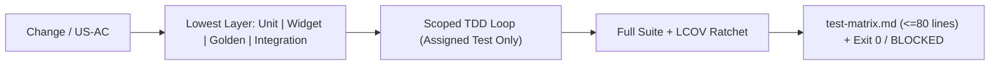

# Flutter Test Strategy

## Overview
**Flutter Test Strategy** defines lowest-layer test placement (`Unit`, `Widget`, `Golden`, `Integration`), per-package coverage ratchets, concise IEEE/ISTQB `docs/<feature-name>/test-matrix.md` (`<= 80 lines`), and **Fail-Honest** execution proof across **Claude Code** and **Google Antigravity**—complementing `dart-add-unit-test`, `flutter-add-widget-test`, `flutter-add-widget-preview`, `flutter-add-integration-test`, `dart-generate-test-mocks`, and `dart-collect-coverage`.

## When to Use
### Trigger Scenarios
- Choosing between `Unit`, `Widget`, `Golden`, and `Integration` tests for a Flutter feature or bugfix.
- Authoring Tier 2/3 `docs/<feature-name>/test-matrix.md` (`<= 80 lines`) or calibrating per-package LCOV gates.

### When NOT to Use
- **Mock or individual test mechanics**: Use `dart-generate-test-mocks` or `flutter-add-widget-test` once the layer is chosen.
- **Non-Dart backend suites**: Use `test-driven-development` or `testing-expert`.

## Process


### 1. Layering Rule & Design Contract Alignment
Inspect root `AGENTS.md` (`<= 90 lines` wired to `context/memory/MEMORY.md`), official Google root `DESIGN.md` (`<= 110 lines` 2-layer YAML + 8 sections), and optional `docs/<feature-name>/design.md` (`<= 35 lines` screen delta). Test at the lowest layer that catches the defect (see [references/test-pyramid-flutter.md](references/test-pyramid-flutter.md)):
- **Unit (`package:test`)**: Domain rules, DTO mappers, Notifier/Bloc transitions with fake repos.
- **Widget (`WidgetTester`)**: Loading/empty/error/data branching, user gestures, 48x48dp & Semantics.
- **Golden**: Pixel/theme/text-scale fidelity against root `DESIGN.md` tokens (`flutter-add-widget-preview`).
- **Integration (`integration_test/`)**: Critical multi-screen flows (auth, checkout) on simulator/device/Chrome.
- **Exclusions**: Never write dedicated tests for generated files (`*.g.dart`, `*.freezed.dart`, `*.gr.dart`) or trivial getters.

### 2. Actionable IEEE/ISTQB `test-matrix.md` (`<= 80 lines`) & Fail-Honest Proof
- **Tier 1 (Fast-Track)**: Run **only** the scoped test file (`flutter test <assigned_test>.dart`); skip `test-matrix.md`.
- **Tier 2 & Tier 3**: Author `docs/<feature-name>/test-matrix.md` (`<= 80 lines`) with `1. Execution Summary` and `2. Test Case Matrix` using per-case columns: `TC-01`... -> `ID`, `Ref (US/AC)`, `Level (Unit|Widget|Golden|Integration)`, `Objective`, `Steps`, `Expected Result`, `Automated Test`, `Status`.
- **Strict Fail-Honest Verification (`BLOCKED` / `SKIPPED`)**: If `flutter test` or `integration_test/` (simulator/emulator/Chrome web) cannot execute (missing Flutter SDK, no simulator booted), you **MUST** report `BLOCKED: Not executed — <exact command & terminal error>` (or `SKIPPED` when N/A)—**strictly forbidden** from claiming `PASSED` without `exit code 0` terminal output.

## Usage
```bash
# Scoped TDD loop vs full coverage ratchet excluding generated code
flutter test test/features/cart/cart_notifier_test.dart
flutter test --coverage
lcov --remove coverage/lcov.info '*.g.dart' '*.freezed.dart' '*.gr.dart' -o coverage/filtered.info
```

## Red Flags
- Claiming `PASSED` for `flutter test` or `integration_test/` without `exit code 0` terminal output instead of reporting `BLOCKED` / `SKIPPED`.
- Exceeding `80 lines` or omitting `Objective`, `Steps`, or `Expected Result` in `docs/<feature-name>/test-matrix.md`.
- Testing generated `*.g.dart`/`*.freezed.dart` files, running full test suites inside parallel TDD loops, or skipping regression tests on bugfixes.

## Verification
- [ ] Domain logic covered by unit tests, UI branching by widget tests, and `DESIGN.md` visual tokens by golden tests where applicable.
- [ ] Generated files (`*.g.dart`, `*.freezed.dart`, `*.gr.dart`) excluded from per-package LCOV ratchets.
- [ ] Tier 2/3 `docs/<feature-name>/test-matrix.md` stays `<= 80 lines` with full IEEE/ISTQB `TC-01`... columns.
- [ ] Every test tier verified by `exit code 0` terminal output or explicitly marked `BLOCKED: Not executed — <exact command & terminal error>` / `SKIPPED`.

## References
- [Deciding the Layer — Worked Examples](references/test-pyramid-flutter.md)
