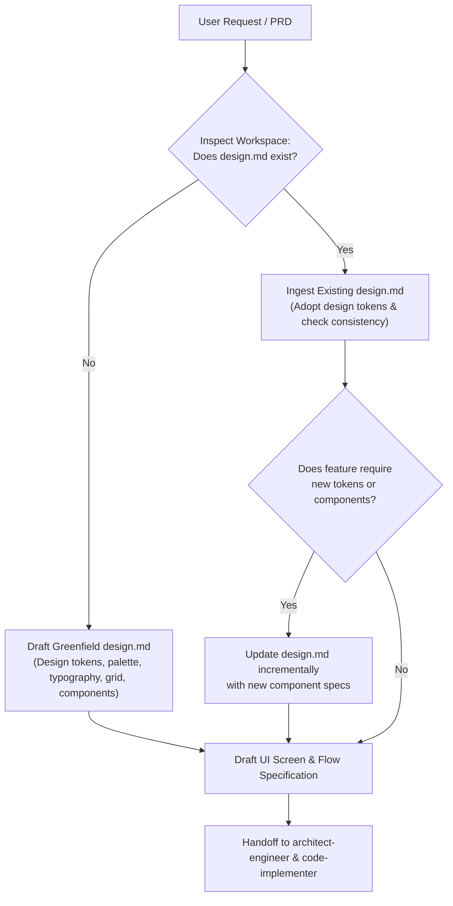

# UI/UX Designer & Design Systems Skill

## Overview
This skill guides the design, specification, and governance of user interfaces (UI) and user experiences (UX) for modern software applications. It acts as a **Principal UI/UX Designer and Design Systems Architect**, ensuring that visual hierarchy, design tokens, responsive breakpoints, accessibility (WCAG 2.1 AA/AAA), and component states are rigorously defined in a standard **`design.md`** artifact before backend/frontend architecture and code implementation begin.

---

## When to Use

### Trigger Scenarios
- **Greenfield Application Design**: Initiating a new web, mobile, or desktop application with a user interface.
- **Frontend / UI Feature Additions & Redesigns**: Adding new screens, modals, complex widgets, views, or restructuring existing user flows.
- **Visual Styling & Design System Evolution**: Establishing or modifying color palettes (light/dark mode), typography scales, spacing units, or component libraries.
- **Accessibility (a11y) & Interaction Design**: Designing keyboard navigation, focus rings, screen reader annotations, touch targets, and interaction states (*default, hover, focus-visible, active, disabled, loading, empty, error*).
- **Standard `design.md` Authoring & Auditing**: Creating a new `design.md` or auditing an existing one for conformance with modern design token standards and Google Stitch MCP integration.

### When NOT to Use
- **Pure Backend Services**: Route API controllers, microservices, gRPC, or database schema design to `senior-architect-engineering`.
- **Data Engineering & SQL**: Route BigQuery, ETL, Datastream, or SQL tuning to `senior-data-engineer` or `sql-query-optimizer`.
- **Direct Source Code Implementation**: Route widget coding, HTML/CSS markup, and component TDD to `code-implementer` or `flutter-implementer`.
- **E2E Test Execution**: Route automated UI tests and test runner execution to `qa-tester`.

---

## Process: The Standard `design.md` Lifecycle

The primary design artifact is **`design.md`** (or `DESIGN.md`), placed in the workspace root or `docs/design/`.

### Centralized Artifact Output Path & Synchronization
- **Feature Design Storage**: Store feature-specific design specifications, component wireframes, and tokens in `docs/<feature-name>/design.md` (where `<feature-name>` is the kebab-case feature slug, e.g., `docs/auth-session/design.md`).
- **Directory Creation**: Ensure the target directory `docs/<feature-name>/` is created before writing the artifact.
- **Global Design System Synchronization**: If the project maintains a global `design.md` (in repository root) or `docs/design/`, synchronize all newly introduced design tokens, typography scales, and component contracts back to the global specification to preserve design system coherence across features.

### Core Sections of `design.md`
Every production-grade `design.md` must adhere to the standardized template in [references/design-md-template.md](references/design-md-template.md):
1. **Product Vision & Design Principles**: Brand tone, design ethos, and guiding heuristics.
2. **Platforms & Viewport Breakpoints**: Target devices, screen sizes, grid columns, margins, and gutters (xs: `<640px`, sm: `640-767px`, md: `768-1023px`, lg: `1024-1279px`, xl: `>=1280px`).
3. **Color Palette & Semantic Tokens**: Primary, Secondary, Accent, Surface, Canvas, Elevated, Text, Borders, and Feedback (Success, Warning, Danger, Info) across both **Light** and **Dark** themes with verified WCAG contrast ratios (>= 4.5:1).
4. **Typography Scale**: Display, H1-H4, Body (Large/Regular), Caption, Overline with explicit font size, line-height, and weight.
5. **Spacing, Elevation & Radii**: 8pt/4pt baseline scale, border radii, and z-index elevation shadows.
6. **Component Catalog & Interactive States**: Atom and molecule definitions with explicit states (*default, hover, focus-visible, active, disabled, loading, error*).
7. **Information Architecture & User Flow**: Screen and route catalog with Mermaid state diagrams.
8. **Accessibility (a11y) Checklist**: Touch targets (>= 44x44pt on iOS / 48x48dp on Android / 32-40px on web), focus rings, and screen-reader semantics.
9. **Platform & Framework Token Mappings**: Tailwind CSS variables, Flutter `ThemeData`, or native styles.

---

## Multi-Platform Guidelines

### 1. Web Applications (Responsive & Fluid)
- **Layout**: Fluid CSS Grid and Flexbox layouts. Never lock layouts to fixed pixel widths that cause horizontal scroll.
- **Units**: Use relative units (`rem`, `em`, `%`, `vh/vw`) for typography and responsive containers.
- **Interactions**: Include mouse hover states, clear `:focus-visible` outlines (2px solid offset ring), and keyboard shortcuts.
- **Performance**: Prevent Cumulative Layout Shift (CLS) by reserving dimensions for images, icons, and async content.

### 2. Mobile Applications (Flutter, iOS, Android)
- **Touch-First Ergonomics**: Minimum touch targets of 44x44pt (iOS) or 48x48dp (Android). Critical interactive elements placed within natural thumb reach (bottom third of screen).
- **Safe Area Insets**: Respect notch, dynamic island, home indicator, and status bar padding.
- **Platform Conventions**:
  - iOS: Cupertino styling, subtle navigation bars, back-swipe gestures, bottom sheet modals.
  - Android: Material Design 3, floating action buttons (FAB), top AppBars, predictive back gestures.
- **Adaptive Flutter Layouts**: Leverage `LayoutBuilder`, `MediaQuery`, and responsive widget hierarchies for tablet/foldable form factors.

---

## Usage & Tooling Integration

### Example Prompts
- *"Create a comprehensive design.md for a new Flutter mobile app with dark/light themes and 8pt spacing."*
- *"Design the user interaction states and responsive wireframes for the user onboarding checkout flow."*
- *"Audit our existing design.md and verify WCAG 2.1 AA accessibility contrast ratios for our button palette."*

### Design Intelligence & Standards Integration

The `ui-ux-designer` skill leverages two specialized companion design intelligence engines installed in the workspace (`.agents/skills/`):
1. **`ui-ux-pro-max` (NextLevelBuilder)**:
   - Provides deep UI/UX intelligence across 79 styles, 192 product domain color palettes, 74 typography pairings, 119 UX heuristics, and 22 technology stacks.
   - Utilize when researching domain-specific color palettes (Fintech, SaaS, Healthcare, E-commerce), font pairings, responsive layout architectures, motion curves, and chart types to substantiate decisions in `design.md`.
2. **`web-design-guidelines` (Vercel Labs)**:
   - Provides strict Web Interface Guidelines compliance rules for modern web applications.
   - Utilize when reviewing and auditing UI components, form ergonomics, keyboard navigation, touch targets, focus outlines, and accessibility standards.

### Google Stitch Integration
When working with Google Stitch or external design tools:
- `design.md` serves as the exact markdown payload for Stitch MCP tools:
  - `upload_design_md`: Encodes `design.md` content in Base64 and uploads it to a Stitch project.
  - `create_design_system_from_design_md`: Converts the uploaded specification into a live Stitch design system and interactive screens.

---

## Hand-off Protocol

- **Input from `product-analyst`**: Consumes user stories, acceptance criteria, personas, and domain boundaries.
- **Output Artifact**: Validated, formatted feature design artifact in `docs/<feature-name>/design.md` (with directory created), UI screen blueprints, and synchronized updates to global `design.md` or `docs/design/` if present.
- **Handoff to `architect-engineer`**: Delivers component trees, visual token interfaces, state needs (modals, dropdowns, optimistic updates), and styling architecture.
- **Handoff to `code-implementer`**: Delivers pixel-perfect specs, exact hex tokens, spacing classes, and accessibility requirements.

---

## Anti-Patterns & Red Flags

- ❌ **Hardcoded Magic Numbers**: Specifying arbitrary colors (e.g. `#1e40af` without a token name) or magic padding (`padding: 17px`).
- ❌ **Ignoring Accessibility**: Using low-contrast gray text on white (e.g., `#999999` with 2.8:1 contrast) or removing focus outlines (`outline: none`).
- ❌ **Desktop-Only Blindness**: Designing solely for 1920x1080 resolution without considering mobile or tablet reflow.
- ❌ **Static-Only Thinking**: Omitting loading spinners, empty states, or error validation feedback for async UI interactions.
- ❌ **Writing Production Code**: The UI/UX Designer authors specifications, design systems, and wireframes in markdown/Mermaid; production code authoring belongs to `code-implementer`.

---

## Verification & Quality Gates

- [ ] User personas, core user tasks, and target platforms (Web/Mobile) identified.
- [ ] Workspace `design.md` inspected, updated, or created using the standard template.
- [ ] Feature design specifications stored in `docs/<feature-name>/design.md` with `docs/<feature-name>/` directory created.
- [ ] Global `design.md` or `docs/design/` synchronized with new tokens and component contracts if existing.
- [ ] Design tokens (colors, typography, spacing, radii, elevation) defined without magic numbers.
- [ ] Light and Dark theme palettes verified with WCAG 2.1 AA contrast compliance (>= 4.5:1).
- [ ] Component interaction states (*default, hover, focus-visible, active, disabled, loading, error*) specified.
- [ ] Touch targets (>= 44x44pt on iOS / 48x48dp on Android) and responsive breakpoints verified.
- [ ] User navigation flows and screen wireframes documented for `architect-engineer` and `code-implementer`.

---

## References
- Standard `design.md` Blueprint: [references/design-md-template.md](references/design-md-template.md)
