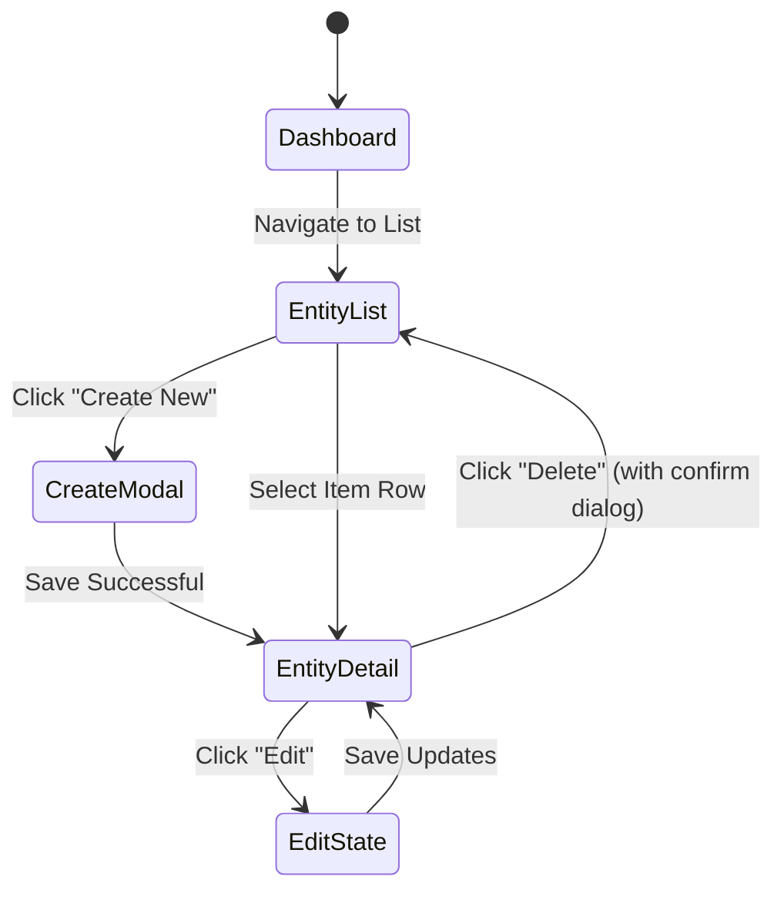

# Design System & UI/UX Specification: [Project/Application Name]

> **Standard UI/UX Design System Document (`design.md`)**
> **Status**: [Draft / Review / Approved]
> **Target Platforms**: [Web Responsive (Desktop/Tablet/Mobile) | Mobile (Flutter / iOS / Android) | Cross-Platform]
> **Design Version**: 1.0.0
> **Last Updated**: [YYYY-MM-DD]

---

## 1. Product Vision & Design Principles

### 1.1. Visual Tone & Brand Archetype
- **Visual Identity**: [e.g., Clean, Minimalist, Modern, Enterprise, High-Trust, Dynamic]
- **Design Philosophy**: [e.g., Clarity over decoration, content-first hierarchy, zero visual clutter, seamless micro-interactions]

### 1.2. Core Design Principles
1. **Consistency**: Unified tokens, components, and layout patterns across all viewports.
2. **Accessibility-First**: WCAG 2.1 AA minimum contrast (>= 4.5:1 for normal text, >= 3:1 for UI elements and large text).
3. **Responsive & Adaptive**: Fluid reflow without horizontal scroll; touch-first affordances on mobile, keyboard & mouse-first on desktop.
4. **Predictable Feedback**: Immediate visual acknowledgment for every user action (hover, focus, active, loading, error).

---

## 2. Platforms & Viewport Breakpoints

| Breakpoint Name | Viewport Range | Target Devices | Grid Columns | Margin / Gutter |
| :--- | :--- | :--- | :--- | :--- |
| **xs (Mobile)** | `< 640px` (360–428dp / pt) | iPhone SE, 13/14/15, Android phones | 4 columns | 16px / 12px |
| **sm (Small Tablet)** | `640px – 767px` | iPad Mini, small foldable devices | 8 columns | 24px / 16px |
| **md (Tablet / Small Laptop)** | `768px – 1023px` | iPad Pro 11", small laptops | 12 columns | 32px / 20px |
| **lg (Desktop)** | `1024px – 1279px` | Standard desktops & laptops | 12 columns | 40px / 24px |
| **xl (Wide Desktop)** | `>= 1280px` | Large monitors & wide workstations | 12 columns (max 1280px) | Auto / 32px |

---

## 3. Color Palette & Semantic Tokens

### 3.1. Light Mode Palette

| Token Name | Hex Code | Contrast vs Bg | Purpose & Usage |
| :--- | :--- | :--- | :--- |
| `--color-primary` | `#0D6EFD` | 4.6:1 on white | Primary actions, key callouts, active links |
| `--color-primary-hover` | `#0B5ED7` | 5.2:1 on white | Hover & focus state for primary elements |
| `--color-secondary` | `#6C757D` | 4.5:1 on white | Secondary actions, badges, subtle controls |
| `--color-accent` | `#6610F2` | 7.1:1 on white | Feature highlights, premium badges |
| `--color-bg-canvas` | `#FFFFFF` | N/A | Base page background |
| `--color-bg-surface` | `#F8F9FA` | N/A | Card, panel, and sidebar background |
| `--color-bg-elevated` | `#FFFFFF` | N/A | Modals, dropdowns, popovers (elevated with shadow) |
| `--color-text-primary` | `#212529` | 14.5:1 on white | Headings, primary body text |
| `--color-text-secondary`| `#495057` | 7.3:1 on white | Subtitles, labels, secondary metadata |
| `--color-text-muted` | `#6C757D` | 4.5:1 on white | Captions, placeholders, timestamps |
| `--color-border-subtle` | `#E9ECEF` | N/A | Subtle dividers, inactive borders |
| `--color-border-bold` | `#CED4DA` | 3.1:1 on white | Input borders, card outlines |
| `--color-success` | `#198754` | 4.5:1 on white | Confirmations, success badges, valid inputs |
| `--color-warning` | `#B76E00` | 4.5:1 on white | Alerts, cautionary notices, attention required |
| `--color-danger` | `#DC3545` | 4.8:1 on white | Destructive actions, error text, invalid inputs |
| `--color-info` | `#055160` | 7.2:1 on white | Informational banners, informational toasts |

### 3.2. Dark Mode Palette

| Token Name | Hex Code | Purpose & Usage |
| :--- | :--- | :--- |
| `--color-primary` | `#3D8BFD` | Primary actions in dark theme |
| `--color-primary-hover` | `#6EA8FE` | Hover state for primary actions |
| `--color-bg-canvas` | `#121212` | Dark canvas root background |
| `--color-bg-surface` | `#1E1E1E` | Card and container background |
| `--color-bg-elevated` | `#2D2D2D` | Dialogs and dropdowns |
| `--color-text-primary` | `#F8F9FA` | Main body and heading text |
| `--color-text-secondary`| `#ADB5BD` | Secondary descriptive text |
| `--color-border-subtle` | `#2D3238` | Dividers and structural lines |
| `--color-border-bold` | `#495057` | Form inputs and active borders |
| `--color-danger` | `#EA868F` | Accessible error state in dark theme |

---

## 4. Typography Scale

- **Primary Font Family**: `Inter`, `-apple-system`, `BlinkMacSystemFont`, `"Segoe UI"`, `Roboto`, `sans-serif`
- **Monospace Font Family**: `"JetBrains Mono"`, `"Fira Code"`, `Menlo`, `monospace`

| Type Style | Font Size | Line Height | Weight | Letter Spacing | CSS / Token |
| :--- | :--- | :--- | :--- | :--- | :--- |
| **Display** | 36px / 2.25rem | 44px / 1.2 | 700 (Bold) | -0.02em | `text-display` |
| **Heading 1 (H1)** | 30px / 1.875rem | 38px / 1.25 | 700 (Bold) | -0.015em | `text-h1` |
| **Heading 2 (H2)** | 24px / 1.5rem | 32px / 1.33 | 600 (SemiBold) | -0.01em | `text-h2` |
| **Heading 3 (H3)** | 20px / 1.25rem | 28px / 1.4 | 600 (SemiBold) | 0 | `text-h3` |
| **Heading 4 (H4)** | 18px / 1.125rem | 24px / 1.33 | 600 (SemiBold) | 0 | `text-h4` |
| **Body Large** | 16px / 1.0rem | 24px / 1.5 | 400 (Regular) | 0 | `text-body-lg` |
| **Body Regular** | 14px / 0.875rem | 20px / 1.43 | 400 (Regular) | 0 | `text-body-base` |
| **Caption / Label** | 12px / 0.75rem | 16px / 1.33 | 500 (Medium) | +0.01em | `text-caption` |
| **Overline** | 11px / 0.6875rem| 14px / 1.27 | 600 (SemiBold) | +0.05em (Uppercase) | `text-overline` |

---

## 5. Spacing, Elevation & Radii

### 5.1. Spacing Scale (8pt / 4pt Baseline)
- `space-2xs`: `4px` / `0.25rem`
- `space-xs`: `8px` / `0.5rem`
- `space-sm`: `12px` / `0.75rem`
- `space-md`: `16px` / `1.0rem` (Default element padding)
- `space-lg`: `24px` / `1.5rem` (Card and section padding)
- `space-xl`: `32px` / `2.0rem` (Layout block gaps)
- `space-2xl`: `48px` / `3.0rem` (Major section vertical separation)
- `space-3xl`: `64px` / `4.0rem` (Hero section vertical spacing)

### 5.2. Border Radius
- `radius-sm`: `4px` (Badges, tags, small controls)
- `radius-md`: `8px` (Inputs, buttons, small cards)
- `radius-lg`: `12px` (Cards, panels, modal dialogs)
- `radius-full`: `9999px` (Pill badges, circular avatars)

### 5.3. Elevation & Shadows
- `shadow-none`: `none`
- `shadow-sm`: `0 1px 2px 0 rgba(0, 0, 0, 0.05)` (Subtle card border relief)
- `shadow-md`: `0 4px 6px -1px rgba(0, 0, 0, 0.1), 0 2px 4px -1px rgba(0, 0, 0, 0.06)` (Interactive hover cards)
- `shadow-lg`: `0 10px 15px -3px rgba(0, 0, 0, 0.1), 0 4px 6px -2px rgba(0, 0, 0, 0.05)` (Dropdowns, popovers)
- `shadow-xl`: `0 20px 25px -5px rgba(0, 0, 0, 0.1), 0 10px 10px -5px rgba(0, 0, 0, 0.04)` (Modals, full overlays)

---

## 6. Component Catalog & Interaction States

### 6.1. Buttons
- **Primary Button**: Background `--color-primary`, Text white, Radius `8px`, Height `40px` (Web) / `48px` (Mobile touch target).
- **Secondary Button**: Outlined `--color-border-bold`, Text `--color-text-primary`, Hover bg `--color-bg-surface`.
- **Destructive Button**: Background `--color-danger`, Text white.
- **Ghost / Text Button**: Transparent background, text `--color-primary`, hover subtle fill.
- **States**:
  - *Default*: Static rest style.
  - *Hover*: Brightness shift / deeper tone, pointer cursor.
  - *Focus-Visible*: 2px solid `--color-primary` offset ring by 2px (essential for a11y).
  - *Active / Pressed*: Scale down to `0.98` or darkening background.
  - *Disabled*: Opacity `0.5`, `cursor: not-allowed`, `pointer-events: none`.
  - *Loading*: Disabled with inline spinner; button width stays fixed to prevent layout shift.

### 6.2. Form Inputs
- **Text Inputs & Dropdowns**: Height `40px`, border `1px solid --color-border-bold`, radius `8px`, padding `8px 12px`.
- **States**: Default, Hover, Focus (border `--color-primary` + ring), Error (border `--color-danger` + error message below in 12px red).
- **Floating/Persistent Labels**: Always maintain a visible label above or inside; never rely solely on placeholders.

### 6.3. Cards & Containers
- Surface background `--color-bg-surface`, border `1px solid --color-border-subtle`, radius `12px`, padding `16px` to `24px`.
- Optional hover lift with `shadow-md` for clickable cards.

### 6.4. Navigation & App Bars
- **Desktop**: Sticky top navigation bar (Height `64px`) with brand logo, search, route links, and user avatar menu.
- **Mobile**: Top AppBar (Height `56px` with Safe Area padding) + Bottom Navigation Bar (Height `64px` with 3 to 5 primary destinations).

---

## 7. Information Architecture & Screen Inventory

### 7.1. Screen & Route Catalog
| Screen / Route | Route Path | Description | Key User Actions |
| :--- | :--- | :--- | :--- |
| **Home / Dashboard** | `/` or `/dashboard` | Main overview, KPI cards, recent activity | Filter, search, navigate to detail |
| **Entity List** | `/items` | Paginated or virtualized data table/grid | Sort, filter, search, create new |
| **Entity Detail / Form**| `/items/:id` | Full profile/details or edit form | Edit, save, delete, export |
| **Settings / Profile** | `/settings` | User preferences, theme toggle, security | Switch theme, update credentials |

### 7.2. User Journey Flow (Mermaid)


---

## 8. Accessibility (a11y) & Usability Checklist

- [ ] **Contrast**: All text meets WCAG AA 4.5:1 ratio against its background.
- [ ] **Touch Targets**: Minimum 44x44pt (iOS) / 48x48dp (Android) / 32-40px (Web).
- [ ] **Focus Rings**: Never remove `outline: none` without providing an explicit `:focus-visible` styling ring.
- [ ] **Keyboard Navigation**: Entire screen flow navigable using `Tab`, `Shift+Tab`, `Enter`, `Space`, and `Esc`.
- [ ] **Screen Readers**: All icon-only buttons include `aria-label` or `tooltip`; images include meaningful `alt` text.
- [ ] **Motion & Transitions**: Respect `prefers-reduced-motion` media query by disabling parallax and high-frequency animations.
- [ ] **Color Independence**: Statuses (Success, Warning, Error) are communicated via icons/text labels in addition to color alone.

---

## 9. Framework & Tooling Mapping

### 9.1. Web (Tailwind CSS / CSS Variables)
```css
:root {
  --color-primary: #0D6EFD;
  --color-bg-canvas: #FFFFFF;
  --color-text-primary: #212529;
}

[data-theme="dark"] {
  --color-primary: #3D8BFD;
  --color-bg-canvas: #121212;
  --color-text-primary: #F8F9FA;
}
```

### 9.2. Mobile (Flutter ThemeData)
```dart
final lightTheme = ThemeData(
  useMaterial3: true,
  brightness: Brightness.light,
  colorScheme: ColorScheme.fromSeed(
    seedColor: const Color(0xFF0D6EFD),
    primary: const Color(0xFF0D6EFD),
    surface: const Color(0xFFFFFFFF),
  ),
);
```
