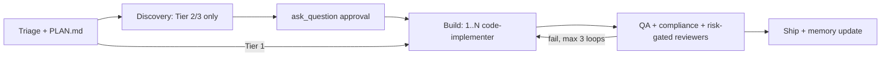

# senior-dev

> A senior-developer orchestrator and nine specialist subagents that plan, build, test and audit code with TDD.

[](../../../LICENSE)


`senior-dev` is a Google Antigravity plugin for teams that want a repeatable SDLC loop: triage, discovery, TDD build, QA, and a compliance audit before shipping.
The orchestrator writes `PLAN.md`, delegates work to specialist subagents, and never edits application code itself.
Hooks enforce plan-first, branch safety and passing tests before the agent stops.

## Requirements

- Antigravity CLI (`agy`).
- Node.js on `PATH`: every hook runs with `node`.
- `npx`: starts the bundled MCP servers (Cloud Run, Firebase).
- `git`, plus the test tools your project uses (`pytest`, `npm`, `dart`, `cargo`, `go`), for the Stop gate.

## Installation

```bash
agy plugin install ./plugins/antigravity/senior-dev
```

## Quick start

Run the full pipeline through the orchestrator:

```text
Use the senior-dev-orchestrator agent to build a password-reset feature end to end — requirements, design, implementation, tests, and a final audit.
```

```text
Orchestrate a fix for this bug report using senior engineering best practices.
```

Invoke a single specialist directly:

```text
Have the architect-engineer agent draft an ADR comparing sync vs. async processing for this endpoint.
Use the code-implementer agent to build the new endpoint with TDD.
Ask the compliance-verifier agent for a release-readiness verdict on this branch.
```

## What's included

### Agents

`product-analyst`, `ui-ux-designer`, `qa-tester` and `e2e-blackbox-tester` run on `model: flash` (template-driven work); the rest use `model: inherit`. All agents use `commandExecutionPolicy: auto`.

| Agent | Role |
| :--- | :--- |
| `senior-dev-orchestrator` | Main agent: triages the task, writes `PLAN.md`, dispatches subagents via `invoke_subagent` |
| `product-analyst` | Clarifies business rules; writes `## Product` in `docs/<feature-name>/spec.md` |
| `ui-ux-designer` | Maintains root `DESIGN.md` and `## Design`; WCAG AA |
| `architect-engineer` | Module boundaries, API/DB contracts, MADR records, `## Architecture` |
| `code-implementer` | Writes production code with Red-Green-Refactor TDD |
| `qa-tester` | Runs unit/integration/E2E suites; writes `test-matrix.md` |
| `critic` | Independent review: complexity, DRY, SOLID, maintainability |
| `challenger` | Stress tests, fuzzing, boundary and concurrency probes |
| `e2e-blackbox-tester` | Browser journeys with `.png` evidence in `docs/<feature-name>/evidence/`, proven by `skills/blackbox-tester/scripts/check_evidence.py` |
| `compliance-verifier` | Static analysis, security and NFR audit; issues `APPROVED` |

Reviewers return their verdict in the final message (50 lines or fewer); they do not write report files.

### Rules

`rules/senior-dev-rules.md` (`trigger: always_on`, ~400 tokens) holds only invariants: branch safety, scope discipline, plan-first, test proof, fail-honest reporting. The state machine lives in the orchestrator agent and the `loop-engineering` skill.

## Bundled Skills

| Skill | Purpose |
| :--- | :--- |
| **`senior-dev-orchestrator`** | SDLC orchestration: tier routing, gated dispatch, parallel TDD, memory |
| **`loop-engineering`** | Tier state machine, worker isolation (disjoint files or git worktree), review loops |
| **`product-analyst`** | `## Product` section with user stories and acceptance criteria |
| **`ui-ux-designer`** | `DESIGN.md` contracts, design tokens, `## Design` deltas |
| **`senior-architect-engineering`** | MADR decision records and `## Architecture` section |
| **`code-implementer`** | TDD and clean-code implementation |
| **`code-smells-expert`** | Code smell and technical debt diagnosis |
| **`refactoring-code-expert`** | Behavior-preserving refactoring |
| **`qa-tester`** | Test suites and QA test matrix with exit-code proof |
| **`compliance-verifier`** | NFR, static analysis, coverage and security checks |
| **`code-critic`** | Independent code review |
| **`adversarial-challenger`** | Fuzzing, worst-case inputs, failure-path probes |
| **`blackbox-tester`** | Browser verification with 4-viewport screenshot evidence |
| **`context-capture`** | Writes milestone memory to `context/memory/` |
| **`context-restore`** | Restores `context/memory/MEMORY.md` at session start |

`skills/` is a copy of the root `/skills` catalog. Edit the root copy, then run `python3 scripts/sync_plugin_skills.py`; `tests/structure/test_plugin_structure.py` fails if they drift.

### Hooks

| Event | Script | Behavior |
| :--- | :--- | :--- |
| `PreToolUse` (`write_to_file\|replace_file_content\|multi_replace_file_content`) | `hooks/orchestrator-role-gate.js` | Allows docs and plans (`*.md`, `*.txt`, `docs/`, `.agents/`, `context/`, `.gemini/`). For code: denies edits on `main`/`master`/`develop`/`dev`, denies edits without a `PLAN.md` (edits of 10 lines or fewer are exempt), and denies edits from the main orchestrator session. |
| `Stop` | `hooks/universal-quality-gate.js` | On `model_stop`, runs `scripts/verify.sh`, `dart analyze`, `npm test`, `pytest -q`, `cargo test` or `go test ./...` when they apply, within a 180 s budget, and asks the agent to continue if one fails. |

Stop gates share one library (`hooks/shared/gate-utils.js`): they act only on `terminationReason: model_stop`, cache a green result until the code changes, never run the same suite twice across plugins, and stop asking to continue after 3 blocks per user message.

### MCP servers

Declared in `mcp_config.json`:

| Server | Command | Purpose |
| :--- | :--- | :--- |
| `cloudrun` | `npx -y @google-cloud/cloud-run-mcp` | Google Cloud Run deployments and logs |
| `firebase-mcp-server` | `npx -y firebase-tools@latest mcp` | Firebase projects, Firestore, Auth, deploys |

The Claude Code build of this plugin also ships the Playwright MCP. The Antigravity build does not, because the docs do not say whether subagents can reach plugin MCP servers: `e2e-blackbox-tester` drives Chromium with scripted Playwright, and `check_evidence.py` must exit 0 before a `PASSED` verdict is accepted.

## How it works



The orchestrator classifies each task as Tier 1 (fast-track), Tier 2 (standard) or Tier 3 (mission-critical) and invokes only the specialists the task needs.
Well-specified work stays light: scale alone never makes a task Tier 3, the orchestrator never adds unrequested features, and a multi-phase request runs discovery, review and E2E once for the whole request, with one commit per phase. Parallel workers (at most 3) own disjoint files; shared files change first in one committed step.
Discovery specialists run in sequence on one shared `docs/<feature-name>/spec.md`, each editing only its own section.
The full state machine is documented in [AGENTS.md](../../../AGENTS.md) and the [root README](../../../README.md).

**Worktrees in Antigravity.** No setting is needed: when two tracks must edit the same files, the orchestrator runs each worker with subagent workspace `branch`. The docs do not say which commit that branch starts from, so each worker first runs `git merge-base --is-ancestor <feature HEAD> HEAD` and stops if your feature commits are missing; the orchestrator then sequences the tracks or creates the worktrees from your current `HEAD` with `run_parallel_agents.py` (loop-engineering skill). A worktree is a fresh checkout, so the worker installs dependencies inside it before testing.

## Configuration

`hooks.json` groups both gates under `senior-dev-gates` with `"enabled": true`.

## Troubleshooting

| Symptom | Cause | Fix |
| :--- | :--- | :--- |
| `PLAN FIRST` denial on a code edit | No `PLAN.md` in the root, `docs/` or `.agents/` | Create `PLAN.md` before editing code |
| `PROTECTED BRANCH` denial | Working on `main`, `master`, `develop` or `dev` | Run `git checkout -b feat/<slug>` |
| `ORCHESTRATOR CODE PROHIBITION` denial | The main orchestrator session tried to edit code | Expected: delegate to `code-implementer` via `invoke_subagent` |
| Agent keeps working; `UNIVERSAL QUALITY GATE VIOLATION` | A detected test suite or linter fails | Fix the failures shown in the gate output |

## Related plugins

- [senior-dev-flutter](../senior-dev-flutter/README.md): Flutter layer.
- [python-backend](../python-backend/README.md): Python backend layer.
- [shared-context](../shared-context/README.md), [git-workflow](../git-workflow/README.md), [docs-and-quality](../docs-and-quality/README.md), [multi-agent-ops](../multi-agent-ops/README.md).

## License

Apache-2.0. See [LICENSE](../../../LICENSE).
