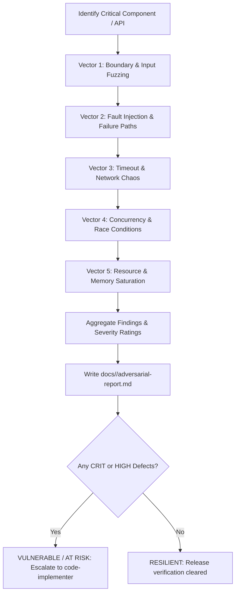

# Adversarial Challenger & Stress Testing Skill

## Overview
This skill implements an adversarial testing philosophy designed to actively attempt to break software components. Operating as an objective, hostile challenger, it subjects systems to worst-case boundary inputs, fuzzing, intentional fault injection, network latency/disconnections, race conditions, and memory/resource saturation. 

Its primary objective is discovering brittle edge cases, memory leaks, concurrency races, and unhandled exceptions *before* code reaches staging or production environments, compiling findings into the formal standard artifact: `docs/<feature-name>/adversarial-report.md`.

---

## When to Use

### Trigger Scenarios
- Validating business-critical features (payments, authentication, order processing, state machines) prior to release.
- Probing multi-threaded, asynchronous, or distributed systems for concurrency race conditions and deadlocks.
- Simulating network chaos, slow dependencies, socket timeouts, and intermittent connection drops.
- Fuzzing APIs and interfaces with malformed JSON, boundary integers, null bytes, unicode overflows, and schema violations.
- Generating the mandatory `docs/<feature-name>/adversarial-report.md` deliverable during adversarial verification stages.

### When NOT to Use
- **Happy-path functional verification**: Route standard acceptance testing to `qa-tester`.
- **Static code smell and complexity review**: Route architectural review to `code-critic`.
- **Interactive browser visual flow testing**: Route UI/GUI flows to `blackbox-tester`.
- **Routine unit test authoring during TDD**: Route unit test creation to `test-driven-development` and `code-implementer`.

---

## Process

The adversarial probing lifecycle tests resilience across 5 core attack and stress vectors:



### Phase 1: The 5 Adversarial Vectors

1. **Vector 1: Boundary & Malformed Input Fuzzing**:
   - **Boundary Numerics**: $0$, negative numbers ($-1$, $-2^{31}$), maximum integers ($2^{31}-1$, $2^{63}-1$), float overflows, `NaN`, and `Infinity`.
   - **String Fuzzing**: Empty strings `""`, whitespace-only, 100k-character strings, null bytes (`\x00`), emoji clusters, multi-byte UTF-8 sequences, path traversal strings (`../../etc/passwd`), and SQL/XSS payloads.
   - **Malformed Structures**: Truncated JSON payloads, unexpected field types (arrays instead of strings, objects instead of booleans), missing required keys, extra unexpected keys.

2. **Vector 2: Failure-Path & Fault Injection**:
   - **Downstream Dependency Outages**: Inject mock exceptions simulating third-party HTTP 500, 502, 503, connection refused, or DNS lookup failures.
   - **Filesystem & Database Faults**: Simulate disk-full errors, permission denied, locked records, and transaction rollbacks.
   - **Verification**: Ensure the application fails gracefully, unrolls state changes cleanly, returns consistent error models, and never crashes the process.

3. **Vector 3: Timeout & Network Chaos**:
   - **Artificial Latency**: Simulate downstream responses delayed by 5s, 10s, 30s.
   - **Premature Socket Closes**: Terminate TCP connections mid-payload.
   - **Connection Pool Exhaustion**: Exhaust HTTP client or database connection pools and verify non-blocking queueing or clear timeout errors.

4. **Vector 4: Concurrency, Race Conditions & Deadlocks**:
   - **Parallel Requests**: Send 20-50 simultaneous concurrent requests against the same resource (e.g. concurrent balance deductions or seat reservations).
   - **Idempotency Probes**: Send rapid duplicated requests sharing identical idempotency keys to ensure exactly-once execution.
   - **Locking Invariants**: Verify optimistic or pessimistic locking prevents corrupted intermediate states or negative values.

5. **Vector 5: Resource Saturation & Memory Stress**:
   - **Payload Flooding**: Submit multi-megabyte payloads to observe memory consumption.
   - **Leak Probing**: Execute 1,000 rapid iterations of a workflow while tracking memory growth, unclosed file descriptors, or dangling event listeners.

---

### Phase 2: Severity Classification

- **CRITICAL (`CRIT`)**: Process crash, unhandled panic, data corruption, negative balance/state inconsistency, security/auth bypass under load.
- **HIGH (`HIGH`)**: Unbounded memory growth, thread starvation, infinite socket hang without timeout, uncaught 500 error leaking internal stack traces.
- **MEDIUM (`MED`)**: Inconsistent error response format, slow recovery from downstream failure, missing retry backoff jitter.
- **LOW (`LOW`)**: Sub-optimal error messaging, minor latency jitter under load.

---

### Phase 3: Zero-Fluff Deliverable Generation (`docs/<feature-name>/adversarial-report.md` `<= 50 lines`)

Create the target directory `docs/<feature-name>/` if not present. Generate a **Zero-Fluff** report strictly capped at **`<= 50 lines`** (`<= 20 lines` on clean passes) following the [Adversarial Report Template](references/adversarial-report-template.md). Omit empty per-probe prose sections—output ONLY the compact metadata header, the 5-vector summary table, and actionable defects (or `None.` when `RESILIENT`):

```markdown
# Adversarial Stress & Resiliency Report

- **Feature**: `<feature-name>` | **Date**: `YYYY-MM-DD` | **Targets**: `[Modules / Endpoints]`
- **Tester**: `challenger` | **Verdict**: `[RESILIENT | AT RISK | VULNERABLE]` | **Probes**: `[Passed/Total]` (`0` Crashes)

## 1. Adversarial Vector Summary
| Vector Category | Probes | Passed | Failed | Max Severity | Status |
| :--- | :---: | :---: | :---: | :---: | :---: |
| **1. Boundary & Input Fuzzing** | `[N]` | `[N]` | `0` | `NONE` | `PASS` |
| **2. Failure-Path & Fault Injection** | `[N]` | `[N]` | `0` | `NONE` | `PASS` |
| **3. Timeout & Network Chaos** | `[N]` | `[N]` | `0` | `NONE` | `PASS` |
| **4. Concurrency & Race Conditions** | `[N]` | `[N]` | `0` | `NONE` | `PASS` |
| **5. Resource & Memory Stress** | `[N]` | `[N]` | `0` | `NONE` | `PASS` |
| **Total** | **`[N]`** | **`[N]`** | **`0`** | **`NONE`** | **`RESILIENT`** |

## 2. Actionable Defects (Write `None.` if `RESILIENT`)
| ID | Severity | Vector | Location | Impact | Reproduction Probe | Required Fix |
| :---: | :---: | :---: | :--- | :--- | :--- | :--- |
| `ADV-01` | `CRIT` | Concurrency | `path/to/file:L#` | Negative state under race | 20 concurrent threads | Atomic DB transaction |
```

---

## Usage

### Commands & Invocations
Execute targeted adversarial tests, fuzzers, or concurrency scripts:

```bash
# Execute adversarial and stress test files
pytest tests/adversarial/ -v

# Run concurrency and race condition tests under pytest
pytest tests/stress/test_concurrency.py -n 4

# Run hypothesis fuzzing tests (Python)
pytest -k "test_fuzz" --hypothesis-show-statistics

# Node.js artillery / k6 load & stress probing
npx artillery run tests/stress/load-config.yaml
```

### Example Prompts
- *"Execute an adversarial fuzzing campaign against the user registration API and check for unhandled 500 crashes."*
- *"Simulate slow database responses and connection timeouts on the payment processing service; write `docs/payments/adversarial-report.md`."*
- *"Run 50 concurrent transactions against the balance transfer endpoint to check for race conditions and double-spending bugs."*

### Host Execution Instructions
- **Claude Code**: Invoke as `challenger` subagent; author adversarial stress tests in `tests/adversarial/`; execute via `Bash`; write report with `Write`.
- **Antigravity**: Launch as the `challenger` subagent; execute stress probes using `run_command`; capture logs and compile the report to `docs/<feature-name>/adversarial-report.md`.

---

## Red Flags
- Testing only happy paths and calling the system "resilient".
- Assuming network calls will always succeed without testing connection timeouts and drops.
- Ignoring concurrency testing because "it works in the single-threaded unit test".
- Swallowing exceptions inside tests to artificially produce green outputs.
- Failing to clean up test processes, background sockets, or test database rows after fault injection.
- Emitting bloated per-probe prose exceeding the strict **`<= 50 lines` Zero-Fluff cap** (`<= 20 lines` on clean passes).
- Leaving `CRIT` or `HIGH` vulnerabilities unresolved before declaring a release ready.

---

## Verification
- [ ] All 5 adversarial attack vectors tested or explicitly triaged.
- [ ] Worst-case inputs (nulls, boundary numbers, 100k strings, malformed JSON) probed.
- [ ] Network timeout and connection drop recovery tested.
- [ ] Concurrent execution probed for race conditions and data corruption.
- [ ] Formal deliverable saved to `docs/<feature-name>/adversarial-report.md` within the strict **`<= 50 lines` Zero-Fluff cap** (`<= 20 lines` when clean, omitting empty prose sections).
- [ ] Any `CRIT` or `HIGH` defect accompanied by reproduction steps and remediation guidance.

---

## References
- Adversarial Deliverable Template: [references/adversarial-report-template.md](references/adversarial-report-template.md)
