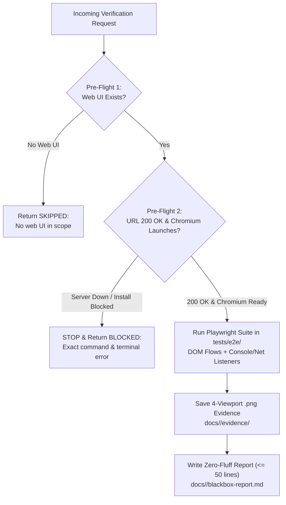

# Black-Box Browser Verification & Visual Testing Skill

## Overview
This skill provides deterministic, fail-honest black-box browser verification from the perspective of an actual end user. Operating as a Senior Black-Box QA Engineer, it executes real Chromium browser journeys via **Playwright** (`run_command` / `Bash`), exercises interactive GUI forms, attaches console and network error listeners, captures physical `.png` screenshots across 4 responsive viewports in `docs/<feature-name>/evidence/`, and publishes a concise Zero-Fluff report (`<= 50 lines`) to `docs/<feature-name>/blackbox-report.md`.

It enforces a strict **Fail-Honest Anti-Hallucination Protocol**: if no web UI exists in scope it immediately returns `SKIPPED`, and if the dev server or Chromium binary cannot run it immediately stops and returns `BLOCKED` with the exact terminal error—never substituting `curl`, `TestClient`, `jsdom`, or static code inspection for a real browser.

---

## When to Use

### Trigger Scenarios
- Validating runnable web applications, SPAs, and frontend portals served over HTTP/HTTPS.
- Testing real end-to-end user flows (signup, login, navigation, checkout, wizard steps) in a live Chromium DOM.
- Auditing GUI form behavior (validation errors, disabled submit states, loading feedback, focus management).
- Asserting `0` unhandled JavaScript runtime crashes (`pageerror` / `console.error`) and `0` unexpected HTTP `4xx/5xx` responses.
- Capturing physical `.png` evidence across Mobile (`375x812`), Tablet (`768x1024`), Desktop (`1280x800`), and Widescreen (`1920x1080`) viewports in `docs/<feature-name>/evidence/`.
- Authoring the standard deliverable `docs/<feature-name>/blackbox-report.md` (`<= 50 lines`) during State 3/4 verification.

### When NOT to Use
- **Pure backend/API/CLI/pipeline projects without a web UI**: Immediately return `SKIPPED: No web UI in scope`; route headless API tests to `qa-tester`.
- **Unit test creation during coding**: Route to `test-driven-development` or `code-implementer`.
- **Static code smell and complexity review**: Route to `code-critic`.
- **Adversarial stress and concurrency fuzzing**: Route to `adversarial-challenger`.
- **Flutter native mobile apps**: Route to `flutter-reviewer` and `senior-dev-flutter`.

---

## Process

The black-box verification lifecycle enforces a mandatory 2-step Pre-Flight before executing real Chromium suites:



### Phase 1: Mandatory 2-Step Pre-Flight & Fail-Honest Gate
1. **Step 1 — Web UI Scope & HTTP `200 OK` Check**:
   - Confirm a web UI exists in scope. If the task has no web UI, immediately return `SKIPPED: No web UI in scope` without creating fake E2E tests.
   - Probe the running dev/staging URL to verify it responds with `200 OK`.
2. **Step 2 — Auto-Bootstrap by Stack & Chromium Launch Check**:
   - If Playwright is not yet installed, auto-bootstrap via `run_command` / `Bash`:
     * **Python (`pyproject.toml` / `uv`)**:
       ```bash
       uv add --dev playwright pytest-playwright && uv run playwright install chromium
       # Fallback when uv is unavailable:
       .venv/bin/pip install playwright pytest-playwright && .venv/bin/playwright install chromium
       ```
     * **Node / Frontend (`package.json`)**:
       ```bash
       npm install -D @playwright/test && npx playwright install chromium
       # Respect lockfiles: pnpm add -D @playwright/test && pnpm exec playwright install chromium
       #                    yarn add -D @playwright/test && yarn playwright install chromium
       ```
   - Verify `playwright` + `chromium` launches cleanly.
   - **Strict Fail-Honest Stop**: If the dev server fails to start, the port is unreachable, network policies block Chromium download, or OS shared libraries are missing, **STOP IMMEDIATELY** and write/return:
     `BLOCKED: Not executed — <exact command & terminal error>`

### Phase 2: Real Browser Execution (`tests/e2e/`)
Write and execute real Playwright E2E tests in `tests/e2e/` running Chromium (headless by default for speed, or `--headed` when live visual observation is requested):
- **DOM Journeys & GUI Forms**: Exercise real navigation, form input filling (empty, invalid, boundary, and valid payloads), button clicks, disabled in-flight submit states, and deterministic locator assertions.
- **Console & Network Listeners**: Attach `page.on("console")`, `page.on("pageerror")`, and `page.on("response")` listeners asserting **`0` unhandled JS errors** and **`0` unexpected HTTP `4xx/5xx` responses**.

### Phase 3: Mandatory 4-Viewport Screenshot Evidence (`docs/<feature-name>/evidence/`)
Capture real, non-empty `.png` screenshots saved to `docs/<feature-name>/evidence/` across all 4 viewports and assert zero horizontal overflow (`document.documentElement.scrollWidth <= window.innerWidth`):
1. **Mobile (`375x812`)**: Fluid single-column layout, drawer navigation, touch targets $\ge 44 \times 44$ px (`mobile-375x812.png`).
2. **Tablet (`768x1024`)**: Adaptive grid spacing (`tablet-768x1024.png`).
3. **Desktop (`1280x800`)**: Full navigation bar, modals, and hover/focus states (`desktop-1280x800.png`).
4. **Widescreen (`1920x1080`)**: Max-width container alignment (`widescreen-1920x1080.png`).

### Phase 4: Zero-Fluff Deliverable Generation (`<= 50 lines`)
Verify that Playwright exited `0` **AND** non-empty `.png` files physically exist in `docs/<feature-name>/evidence/`, then write `docs/<feature-name>/blackbox-report.md` (`<= 50 lines` max, `<= 20 lines` on clean pass) using [references/blackbox-report-template.md](references/blackbox-report-template.md):

```markdown
# Black-Box Browser Verification Report

- **Feature**: `<feature-name>` | **Date**: `YYYY-MM-DD` | **Target URL**: `http://localhost:3000`
- **Runner**: `Playwright Chromium` | **Verdict**: `[PASSED | REJECTED | BLOCKED | SKIPPED]`
- **Journeys**: `[X/Y Passed]` | **Unhandled JS Errors**: `0` | **Unexpected HTTP 4xx/5xx**: `0`

## 1. Viewport & Journey Metrics
| Viewport | Dimensions | Evidence (`docs/<feature-name>/evidence/`) | Overflow-X | Forms & Flows | JS / HTTP Errors | Status |
| :--- | :---: | :--- | :---: | :---: | :---: | :---: |
| **Mobile** | `375x812` | `mobile-375x812.png` | `0px` | `PASS` | `0 / 0` | `PASS` |
| **Tablet** | `768x1024` | `tablet-768x1024.png` | `0px` | `PASS` | `0 / 0` | `PASS` |
| **Desktop** | `1280x800` | `desktop-1280x800.png` | `0px` | `PASS` | `0 / 0` | `PASS` |
| **Widescreen** | `1920x1080` | `widescreen-1920x1080.png` | `0px` | `PASS` | `0 / 0` | `PASS` |

## 2. Actionable Defects
None.
```

---

## Usage

### Invocations & Commands

#### Node / Frontend Playwright Suite
```bash
# Headless Chromium execution (default)
npx playwright test tests/e2e/

# Live visual observation when requested
npx playwright test tests/e2e/ --headed
```

#### Python Playwright Suite
```bash
# Headless Chromium execution (default)
uv run pytest tests/e2e/ --browser chromium

# Live visual observation when requested
uv run pytest tests/e2e/ --browser chromium --headed
```

### Example Prompts
- *"Execute Playwright black-box browser verification on `http://localhost:3000/checkout` across all 4 viewports and capture `.png` evidence."*
- *"Verify sign-up form validation and console/network cleanliness in Chromium, saving `docs/auth-signup/blackbox-report.md`."*

### Host Execution Instructions
- **Claude Code**: Bootstrap and run Playwright in `tests/e2e/` via `Bash`; author tests and `docs/<feature-name>/blackbox-report.md` via `Write`/`Edit`; verify `.png` evidence via `Glob`.
- **Antigravity**: Launch as `e2e-blackbox-tester`; bootstrap and execute Playwright suites via `run_command`; verify physical `.png` files in `docs/<feature-name>/evidence/` via `list_dir`; write concise `docs/<feature-name>/blackbox-report.md` via `write_to_file`.

---

## Red Flags
- Using `curl`, `httpx`, `requests`, FastAPI `TestClient`, `jsdom`, or static HTML/JSX code reading as a substitute for a real Chromium browser.
- Claiming `PASSED` without Playwright exit code `0` **AND** non-empty `.png` screenshots on disk in `docs/<feature-name>/evidence/`.
- Fabricating test results instead of returning `SKIPPED` (no web UI) or `BLOCKED` (unreachable server / blocked Chromium binary).
- Ignoring `console.error`, `pageerror`, or unexpected HTTP `4xx/5xx` responses.
- Using arbitrary `sleep()` calls instead of Playwright auto-waiting locators.
- Emitting verbose reports exceeding `50` lines (`<= 20` lines expected on clean passes).

---

## Verification
- [ ] Mandatory 2-step Pre-Flight passed (`200 OK` + Chromium launch), or honest `SKIPPED` / `BLOCKED` returned immediately.
- [ ] Real Playwright E2E suite in `tests/e2e/` exited with code `0`.
- [ ] Console (`console` / `pageerror`) and HTTP response listeners verified `0` unhandled errors.
- [ ] Non-empty `.png` screenshots saved in `docs/<feature-name>/evidence/` for `375x812`, `768x1024`, `1280x800`, and `1920x1080`.
- [ ] Concise report (`<= 50 lines`, `<= 20 lines` if clean) written to `docs/<feature-name>/blackbox-report.md`.

---

## References
- Black-Box Deliverable Template: [references/blackbox-report-template.md](references/blackbox-report-template.md)
