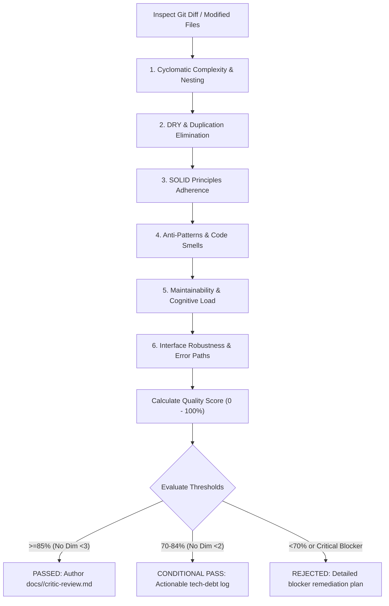

# Code Critic & Independent Architectural Review Skill

## Overview
This skill provides an uncompromising, independent architectural code review discipline. Operating as an objective Senior Code Critic, it systematically inspects source code for excessive cyclomatic complexity, code duplication (DRY violations), SOLID principles non-conformance, object-oriented and architectural anti-patterns, maintainability friction, and interface brittleness. 

Unlike conventional linters or superficial PR approvals, this skill conducts deep structural evaluations, calculates an empirical quality score, and publishes a formal review deliverable to `docs/<feature-name>/critic-review.md`.

---

## When to Use

### Trigger Scenarios
- Conducting independent code reviews on completed feature implementations or refactorings before merge.
- Evaluating complex modules exhibiting high churn, fragile test setups, or recurring regressions.
- Auditing adherence to SOLID principles, DRY standards, and Clean Architecture layer boundaries.
- Inspecting cyclomatic complexity and cognitive depth across modified files.
- Producing a formal architectural critique deliverable (`docs/<feature-name>/critic-review.md`) during State 3/4 verification workflows.

### When NOT to Use
- **Authoring production code or fixing defects**: Route implementation tasks to `code-implementer`.
- **Executing automated unit or E2E tests**: Route test runners to `qa-tester` or `testing-expert`.
- **Black-box visual/browser flow inspection**: Route browser verification to `blackbox-tester`.
- **Adversarial stress and fuzzing probing**: Route fuzzing and fault injection to `adversarial-challenger`.
- **Static security scanning and secret leak detection**: Route vulnerability scanning to `compliance-verifier` and `security-audit`.

---

## Process

The code critique process evaluates code across six structural dimensions and produces the standard artifact at `docs/<feature-name>/critic-review.md`.



### Phase 1: Dimension Inspection

1. **Cyclomatic Complexity & Control Flow**:
   - Assess McCabe cyclomatic complexity: Target $CC \le 10$ per function/method.
   - Enforce nesting depth $\le 3$ (loops, branches, and callback depth).
   - Identify convoluted boolean conditions, deeply nested `if/else` ladders, and arrow-shaped code.

2. **DRY (Don't Repeat Yourself) & Redundancy**:
   - Detect duplicate algorithms, validation blocks, and copied utility functions.
   - Differentiate between incidental similarity and true domain duplication.
   - Flag parallel inheritance hierarchies and repetitive boilerplate.

3. **SOLID Principles Adherence**:
   - **Single Responsibility (SRP)**: Ensure each class or module has one, and only one, reason to change.
   - **Open/Closed (OCP)**: Verify extensibility via polymorphism, strategy patterns, or dependency injection without modifying existing core logic.
   - **Liskov Substitution (LSP)**: Verify subtypes can substitute for their base types without breaking invariants.
   - **Interface Segregation (ISP)**: Ensure clients are not forced to depend on methods they do not use.
   - **Dependency Inversion (DIP)**: Verify high-level modules depend on abstractions, not concrete implementations.

4. **Architectural Anti-Patterns & Code Smells**:
   - Detect God Classes, Feature Envy, Primitive Obsession, Shotgun Surgery, Inappropriate Intimacy, and Leaky Abstractions.
   - Identify dead code, speculative generality (YAGNI violations), and circular dependencies.

5. **Maintainability & Cognitive Load**:
   - Verify function length stays within clean bounds (ideally $\le 30-40$ lines).
   - Ensure variable, parameter, and function names are written in unambiguous English.
   - Verify that code is self-documenting; reject comments explaining *what* instead of *why*.

6. **Interface Robustness, Error Handling & Type Safety**:
   - Enforce explicit type annotations and strict null/undefined checks.
   - Verify boundaries: sanitize external inputs, validate preconditions, and handle edge states.
   - Enforce zero swallowed exceptions (`try/except` without logging or re-raising).

---

### Phase 2: Scoring Rubric & Thresholds

Each dimension is scored from 1 (unacceptable) to 5 (exemplary). The weighted score is compiled into a 30-point baseline and normalized to a 100% scale.

| Dimension | Weight | Max Points | Passing Standard (>= 4) |
| :--- | :---: | :---: | :--- |
| **1. Cyclomatic Complexity & Control Flow** | 20% | 5 | $CC \le 10$, nesting depth $\le 3$, flat control flow |
| **2. DRY & Duplication Elimination** | 15% | 5 | Reusable abstractions, zero duplicate validation or business logic |
| **3. SOLID Principles Adherence** | 25% | 5 | Clean SRP boundaries, dependency injection, pure interface contracts |
| **4. Architectural Anti-Patterns** | 15% | 5 | Zero God classes, no feature envy or leaky abstractions |
| **5. Maintainability & Cognitive Load** | 10% | 5 | Concise functions ($\le 30$ lines), clear English naming, high readability |
| **6. Interface Robustness & Error Paths**| 15% | 5 | Complete type hints, exhaustive validation, robust error propagation |

#### Scoring Thresholds
- **PASSED ($\ge 85\%$, no dimension $< 3$)**: Implementation is clean, robust, and maintainable. Recommended for immediate release.
- **CONDITIONAL PASS ($70\% - 84\%$, no dimension $< 2$)**: Implementation is functionally sound but carries non-critical debt. Non-blocking recommendations recorded.
- **REJECTED ($< 70\%$ OR any dimension $= 1$ OR critical blocker present)**: Unacceptable complexity, critical SOLID breach, or severe fragility. Handoff to `code-implementer` with concrete line-by-line remediation steps.

---

### Phase 3: Deliverable Generation (`docs/<feature-name>/critic-review.md`)

Create the target directory `docs/<feature-name>/` if not present. Generate the review artifact conforming to the [Critic Review Template](references/critic-review-template.md):

```markdown
# Critic Code Review Report

## Executive Summary
- **Feature Name**: `<feature-name>`
- **Reviewer**: `critic` (Independent Code Review Specialist)
- **Review Date**: `YYYY-MM-DD`
- **Git Commit / Diff Ref**: `HEAD`
- **Overall Verdict**: `[PASSED | CONDITIONAL PASS | REJECTED]`
- **Overall Quality Score**: `[Score]/30 ([Percentage]%)`

## 1. Quality Scoring Rubric
| Dimension | Weight | Max Points | Score (1-5) | Weighted Score | Notes & Findings |
| :--- | :---: | :---: | :---: | :---: | :--- |
| **1. Cyclomatic Complexity & Control Flow** | 20% | 5 | `[1-5]` | `[X.X]` | Nesting depth <= 3, CC <= 10 |
| **2. DRY & Duplication Elimination** | 15% | 5 | `[1-5]` | `[X.X]` | Reusable abstractions, zero copy-paste |
| **3. SOLID Principles Adherence** | 25% | 5 | `[1-5]` | `[X.X]` | Invariants for SRP, OCP, LSP, ISP, DIP |
| **4. Architectural Anti-Patterns** | 15% | 5 | `[1-5]` | `[X.X]` | Zero God classes, no feature envy |
| **5. Maintainability & Cognitive Load** | 10% | 5 | `[1-5]` | `[X.X]` | Clean English naming, concise functions |
| **6. Interface Robustness & Error Handling** | 15% | 5 | `[1-5]` | `[X.X]` | Strict typing, robust error propagation |
| **Total** | **100%** | **30** | — | **[Total]/30** | **Final Quality Percentage: [XX]%** |

## 2. Detailed Dimension Breakdown
### 2.1. Cyclomatic Complexity & Control Flow
- **Findings**: [Line-by-line analysis]
### 2.2. DRY (Don't Repeat Yourself) & Duplication
- **Findings**: [Line-by-line analysis]
### 2.3. SOLID Principles Adherence
- **Findings**: [Line-by-line analysis]
### 2.4. Architectural Anti-Patterns & Code Smells
- **Findings**: [Line-by-line analysis]
### 2.5. Maintainability & Cognitive Load
- **Findings**: [Line-by-line analysis]
### 2.6. Interface Robustness & Error Handling
- **Findings**: [Line-by-line analysis]

## 3. Prioritized Action Items for `code-implementer`
| Priority | Dimension | File & Line | Issue Summary | Required Remediation |
| :---: | :---: | :--- | :--- | :--- |
| **P0 (Blocker)** | SOLID / SRP | `path/to/file:L#` | God method handling multi-domain logic | Split into dedicated service classes |
```

---

## Usage

### Invocations & Inspection Techniques
Reviewers inspect code using AST analysis tools, diff inspectors, and complexity metrics:

```bash
# Measure cyclomatic complexity with radon (Python)
radon cc src/ -s -a

# Measure maintainability index with radon (Python)
radon mi src/ -s

# Run ESLint complexity and maintainability rules (TypeScript/JavaScript)
npx eslint src/ --rule "complexity: [error, 10]" --rule "max-depth: [error, 3]"

# Dart complexity analysis
dart analyze --fatal-infos
```

### Example Prompts
- *"Perform an independent code critique on the newly implemented authentication flow and produce `docs/auth-flow/critic-review.md`."*
- *"Evaluate the order checkout service against SOLID principles, calculate our cyclomatic complexity score, and provide remediation steps."*
- *"Audit this pull request diff for code smells, God methods, and swallowed error blocks."*

### Host Execution Instructions
- **Claude Code**: Invoke as `critic` subagent; inspect files using `Read` and `Grep`; generate `docs/<feature-name>/critic-review.md` using `Write`.
- **Antigravity**: Launch as the `critic` subagent; inspect code using `view_file` and `grep_search`; calculate scores and write the report to disk.

---

## Red Flags
- Giving rubber-stamp "LGTM" approvals without inspecting control flow and complexity metrics.
- Overlooking swallowed exceptions (`except: pass` or empty catch blocks).
- Tolerating cyclomatic complexity $> 15$ or nesting depth $> 4$.
- Writing code changes or modifying production files directly (violates reviewer separation of concerns).
- Reporting vague subjective critiques without concrete `file:line` locations and actionable remediations.
- Failing to create the destination directory before saving `docs/<feature-name>/critic-review.md`.

---

## Verification
- [ ] Ensure all 6 critique dimensions are thoroughly inspected.
- [ ] Ensure cyclomatic complexity ($CC$) and nesting depth are computed and documented.
- [ ] Ensure SOLID violations are categorized with exact `file:line` references.
- [ ] Ensure the scoring rubric is filled out with a clear verdict (`PASSED`, `CONDITIONAL PASS`, or `REJECTED`).
- [ ] Ensure standard artifact is written to `docs/<feature-name>/critic-review.md`.
- [ ] Ensure non-passing verdicts include a prioritized remediation table for `code-implementer`.

---

## References
- Standard Review Deliverable Template: [references/critic-review-template.md](references/critic-review-template.md)
