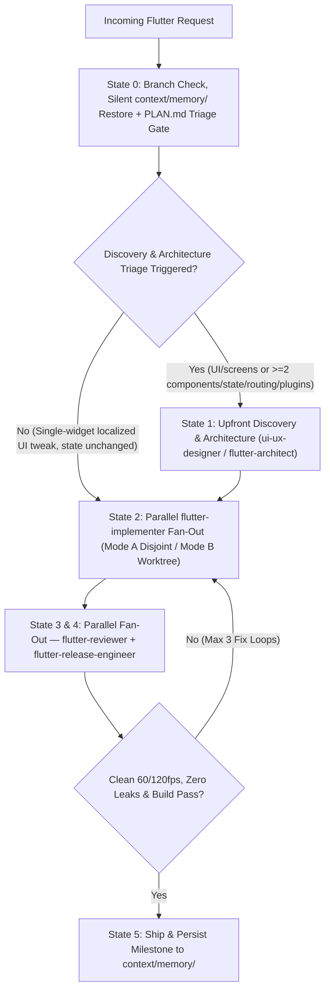

# Flutter Senior Orchestration

## Overview
The **Flutter Senior Orchestration** skill directs the end-to-end delivery lifecycle of Flutter and Dart applications across a 6-state Graph Engineering DAG—from silent Cross-AI LLM Wiki memory restoration (`context/memory/`) and mandatory architecture triage through parallel TDD implementation, parallel review/release verification, and milestone memory persistence. Designed for seamless execution across both **Claude Code** and **Google Antigravity**, this skill coordinates specialized subagents (`flutter-architect`, `flutter-implementer`, `flutter-reviewer`, and `flutter-release-engineer`) while delegating low-level procedural mechanics to official `flutter-*` and `dart-*` skills.

## When to Use

### Trigger Scenarios
- Orchestrating new Flutter features, multi-screen flows, complex domain logic, or cross-cutting architectural changes.
- Triaging incoming Flutter tasks via `PLAN.md` (`## Discovery & Architecture Triage` and `## Parallel Execution Tracks`).
- Coordinating parallel multi-agent workflows across architecture, TDD implementation, 60/120fps review, and release engineering.
- Addressing systemic performance jank or planning major framework/dependency migrations.

### When NOT to Use
- **Pure backend tasks**: For Python, Go, or SQL database migrations, use backend-specific skills like `python-expert` or `database-migration-expert`.
- **Ad-hoc layout overflow questions**: For isolated layout overflow Q&A, use official `flutter-fix-layout-issues`.

## Process



### 1. State 0: Memory Restore, Branch Governance & Mandatory Discovery Triage Gate
1. **Automated Git Branch Governance & Scope Drift Protocol**:
   - **Active Branch Inspection & Auto-Branching**: Check active branch via `git symbolic-ref --short HEAD`. If the active branch is a base or protected branch (`main`, `master`, `develop`, `dev`), the orchestrator MUST automatically create and switch to a dedicated feature branch using Conventional naming before modifying any files:
     ```bash
     git checkout -b feat/<descriptive-slug>
     # or for bugfixes:
     git checkout -b fix/<slug>
     ```
     Notify the user of the branch created.
   - **Proactive Scope Drift Detection**: If already on an active feature branch, evaluate whether the incoming user request represents orthogonal or unrelated functionality. If scope drift is detected, proactively prompt the user via `ask_question` recommending a new isolated branch (`feat/<new-slug>`). If the user confirms, switch to a new branch; if the user declines, proceed on the current branch.
2. **Silent Cross-AI LLM Wiki Restore**:
   - Check if `context/memory/MEMORY.md` exists. If it does, silently read **only `context/memory/MEMORY.md`** (`<= 80-100 lines`, ~500 tokens) to absorb the active handoff state (`Claude Code` or `Antigravity`).
   - Open `context/memory/architecture.md`, `context/memory/conventions.md`, or `context/memory/log/YYYY-MM-DD.md` **only on demand** if the task touches those domains.
3. **Author / Update `PLAN.md` with Mandatory Discovery & Architecture Triage Table**:
   - Every `PLAN.md` must include a `## Discovery & Architecture Triage` table and `## Parallel Execution Tracks`:
   - **`ui-ux-designer` / `design.md` Mobile Triage**:
     - **MUST INVOKE / EVALUATE** whenever creating or altering Flutter screens, views, or reusable widgets, modifying styling/theming/layout/accessibility, or when the project lacks a mobile `design.md`.
     - Inspects/creates `design.md` detailing mobile design tokens, color systems, typography scale, responsive breakpoints, touch targets (minimum 48x48dp), and motion curves before architecting widget trees.
     - *Only skip* for pure internal data/state fixes or non-visual utility changes.
   - **`flutter-architect` MUST BE INVOKED** whenever:
     - `>= 2` screens, widgets, or notifiers/blocs/controllers are created or modified.
     - State management (`Riverpod` / `Bloc` / `Signals`) contracts or providers change.
     - Navigation routes (`GoRouter` / deep links) change.
     - Platform channels, FFI, or native plugins (`pubspec.yaml` dependencies) are added.
   - *Only skip `flutter-architect`* for single-widget localized UI tweaks where state management and routing are unchanged.

### 2. State 1: Upfront Discovery & Architecture Execution (Sequential or Parallel Fan-Out)
- When the triage gate triggers `ui-ux-designer` and/or `flutter-architect`, invoke them before dispatching `flutter-implementer`.
- **Sequential Hand-off Flow (Default for UI features)**:
  `ui-ux-designer` (`design.md` mobile tokens & UX specs) ➔ `flutter-architect` (ADR & widget/notifier contracts) ➔ `flutter-implementer` (TDD widgets & tests).
- Select state management (`Riverpod`, `Bloc`, `Signals`, or ephemeral `setState`) using `flutter-architecture-decisions` and record ADRs in `doc/adr/`.
- Update `PLAN.md` with finalized widget/repository contracts and classify work into `## Parallel Execution Tracks` with strict `Owned Files`.

### 3. State 2: Implementation — Parallel Fan-Out & Workspace Isolation
Dispatch **1 to N `flutter-implementer` subagents in parallel** following strict TDD (`flutter-test-strategy`) and Red-Green-Refactor cycles:
- **Mode A — Disjoint File Partitioning (`Workspace: 'inherit'`) [DEFAULT]**:
  - Parallel tracks touch non-overlapping Dart directories/files (e.g., `lib/features/checkout/presentation/**` || `lib/features/checkout/data/**`) with strict `Owned Files` boundaries and zero `git merge` overhead.
- **Mode B — Git Worktree Isolation (`Workspace: 'share'` / `'branch'` or `git worktree`)**:
  - Used when parallel `flutter-implementer` instances must modify shared files (`pubspec.yaml`, global router, DI setup) or run conflicting `build_runner` codegen.

### 4. State 3 & 4: Review & Release Verification — Parallel Fan-Out
Dispatch `flutter-reviewer` and `flutter-release-engineer` **in parallel**:
- **`flutter-reviewer`** (`flutter-review-checklist`): Audits 60/120fps frame budgets, widget rebuild scopes, `.dispose()` lifecycle leaks, `BuildContext` async gaps (`if (!mounted) return;`), accessibility semantics, and ADR compliance.
- **`flutter-release-engineer`** (`flutter-release-engineering`): Verifies `--dart-define-from-file`, flavor separation, app signing, `pubspec.yaml` constraints, and release build matrix.
- If either reports defects, loop back to `flutter-implementer` (capped at **max 3 iterations** via `loop-engineering`).

### 5. State 5: Ship & LLM Wiki Memory Update
- Mark all tasks completed in `PLAN.md`.
- Persist the completed milestone into `context/memory/`:
  - Overwrite/compact `context/memory/MEMORY.md` (`<= 80-100 lines`).
  - Update `context/memory/architecture.md` and `context/memory/conventions.md` in-place when decisions or conventions changed.
  - Append a concise 5-8 line `[HH:MM | Host: Claude Code | Antigravity]` milestone block to `context/memory/log/YYYY-MM-DD.md`.
- Never write context checkpoints on intermediate turns.

## Usage

### Example Prompts
```text
"Orchestrate the development of the checkout payment flow in Flutter using parallel presentation and data tracks, including Riverpod state architecture, repository integration, and widget/unit tests."
```
```text
"Resume from context/memory/MEMORY.md, size and execute the upgrade to Flutter 3.29 along with our core Riverpod dependencies."
```

### Host Execution Instructions
- **Claude Code**: Invoke via `/skill flutter-senior-orchestration` or `flutter-feature-orchestrator`, dispatching parallel `Agent` calls for independent tracks.
- **Google Antigravity**: Invoke subagents using `Agent` with `flutter-feature-orchestrator`, or execute direct CLI analysis:
```bash
flutter analyze
flutter test
```

## Red Flags
- Developing directly on protected branches (`main`, `master`, `develop`, `dev`) without auto-branching.
- Skipping `ui-ux-designer` / `design.md` mobile triage when creating or altering Flutter screens/widgets.
- Skipping `flutter-architect` when `>= 2` screens/widgets/notifiers, state management contracts, `GoRouter` routes, or native plugins are modified.
- Dispatching parallel `flutter-implementer` subagents on overlapping files in `Workspace: 'inherit'` without disjoint `Owned Files` boundaries.
- Saving context checkpoints on intermediate turns instead of only at `State 5` or on explicit user handoff.
- Committing secrets or production API keys in Dart code instead of `--dart-define-from-file`.
- Allowing `BuildContext` usage across asynchronous gaps without checking `mounted` or omitting `.dispose()` on controllers.

## Verification
- [ ] Active branch checked via `git symbolic-ref --short HEAD`; dedicated branch auto-created off protected branches (`main`/`master`/`develop`/`dev`); scope drift checked.
- [ ] `context/memory/MEMORY.md` checked silently at `State 0` before authoring/updating `PLAN.md`.
- [ ] `PLAN.md` contains `## Discovery & Architecture Triage` and `## Parallel Execution Tracks` with explicit `Owned Files`.
- [ ] `ui-ux-designer` evaluated / `design.md` mobile design tokens generated/verified before widget implementation.
- [ ] `flutter-architect` invoked and ADR recorded in `doc/adr/` whenever triage criteria are met.
- [ ] Unit, widget, and golden tests pass with zero analyzer warnings (`dart analyze` and `flutter test` exit 0).
- [ ] Parallel `flutter-reviewer` and `flutter-release-engineer` gates both pass with zero controller leaks and valid release config.
- [ ] `context/memory/` (`MEMORY.md`, `architecture.md`, `conventions.md`, `log/YYYY-MM-DD.md`) updated at `State 5`.
