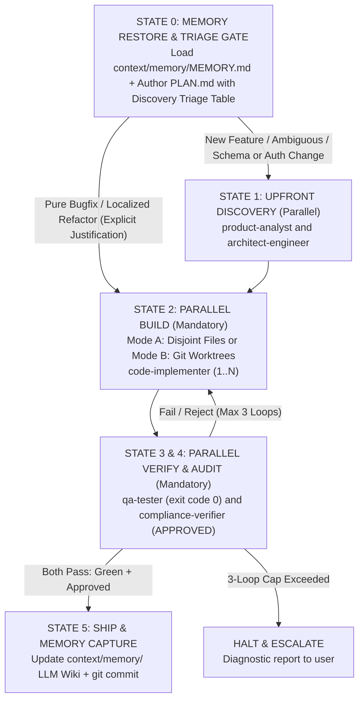

# Senior Dev Plugin (Claude Code)

[](https://github.com/jggomez/expert-ai-developer-skills)
[](.)

The `senior-dev` plugin packages the repository's **Graph Engineering** subagent topology — a Senior Developer Orchestrator plus six specialized subagents (Product Analyst, UI/UX Designer, Architect, Code Implementer, QA Tester, Compliance Verifier) — as a self-contained plugin for **Claude Code**.

Key architectural capabilities:
- **LLM Wiki Memory (`context/memory/`)**: Cross-AI persistent memory shared seamlessly between Claude Code and Google Antigravity. At **State 0**, the orchestrator silently restores `context/memory/MEMORY.md` (~500 tokens) and reads linked topic pages (`architecture.md`, `conventions.md`, `log/YYYY-MM-DD.md`) on demand. At **State 5**, completed milestones update `context/memory/` via `context-capture`.
- **Mandatory Discovery Triage Gate**: Before writing implementation tasks for `code-implementer`, the orchestrator evaluates a deterministic **Discovery Triage Rubric** in `PLAN.md` (`## Discovery & Architecture Triage`) to determine when `product-analyst` and/or `architect-engineer` **MUST** be invoked upfront.
- **Parallel Fan-Out / Fan-In Execution & Workspace Isolation**: Supports concurrent subagent execution via parallel `Agent` calls across discovery (`product-analyst` || `architect-engineer`), implementation (1 to N `code-implementer` instances using **Mode A: Disjoint File Partitioning** or **Mode B: Git Worktree Isolation**), and verification (`qa-tester` || `compliance-verifier`).

- **Claude Code**: Install via `/plugin install senior-dev` from the marketplace or `claude plugin install plugins/claude/senior-dev`. Subagents use native Claude Code tools (`Bash`, `Read`, `Write`, `Edit`, `Glob`, `Grep`, `Agent`).

---

## 1. Directory Tree & Architecture

```
plugins/claude/senior-dev/
├── README.md               # This usage manual
├── .claude-plugin/
│   └── plugin.json         # Claude Code plugin manifest
├── .mcp.json               # MCP definitions (GCP Cloud Run, Firebase)
├── hooks.json              # Lifecycle hook definitions
├── hooks/
│   ├── orchestrator-role-gate.js # PreToolUse gate preventing orchestrator from editing code
│   └── universal-quality-gate.js # Stop hook executing test suites and linters
├── agents/                 # 7 bundled subagents
│   ├── senior-dev-orchestrator.md  # Main orchestrator; governs DAG, Triage Gate & PLAN.md
│   ├── product-analyst.md          # Requirements & PRDs
│   ├── ui-ux-designer.md           # UI/UX design systems & design.md
│   ├── architect-engineer.md       # Architecture & ADRs
│   ├── code-implementer.md         # Strict TDD implementation (parallel fan-out capable)
│   ├── qa-tester.md                # E2E / integration testing (parallel fan-out capable)
│   └── compliance-verifier.md      # Final NFR / security audit (parallel with qa-tester)
└── skills/                 # Physical copy of the 12 skills these agents depend on (sanitized for Claude)
    ├── senior-dev-orchestrator/
    ├── product-analyst/
    ├── ui-ux-designer/
    ├── senior-architect-engineering/
    ├── code-implementer/
    ├── code-smells-expert/
    ├── refactoring-code-expert/
    ├── qa-tester/
    ├── compliance-verifier/
    ├── context-capture/
    ├── context-restore/
    └── loop-engineering/
```

---

## 2. Subagent Panel & Inviolable Boundaries

| Agent | Role | Invocation | Responsibilities |
| :--- | :--- | :--- | :--- |
| **`senior-dev-orchestrator`** | Lead Orchestrator | Main Session | Restores/updates `context/memory/`, authors `PLAN.md` with Discovery Triage & Parallel Tracks, governs DAG state machine. **Prohibited from writing code directly.** |
| **`product-analyst`** | Requirements Engineer | `Agent` | **Mandatory via Triage Gate** when new user-facing features, unstated edge cases/permissions, or open-ended prompts arise. Drafts PRDs and acceptance criteria. |
| **`ui-ux-designer`** | UI/UX Designer | `Agent` | **Mandatory via Triage Gate** when greenfield UI, new screens/views, layout/theming modifications, or `design.md` creation/updates arise. Drafts `design.md` and UI specifications. |
| **`architect-engineer`** | System Designer | `Agent` | **Mandatory via Triage Gate** when tasks touch >= 2 files/modules, alter schemas/contracts, or cross layers. Produces QADs, SEI tactics, ADRs, and interface boundaries. |
| **`code-implementer`** | TDD Implementer | `Agent` | **MANDATORY worker (1..N parallel fan-out)**: Writes and refactors production code using strict Red-Green-Refactor within assigned `Disjoint Files` or `Git Worktree`. |
| **`qa-tester`** | Test Engineer | `Agent` | **MANDATORY worker (parallel with audit)**: Executes unit, integration, and regression suites; requires `exit code 0`. |
| **`compliance-verifier`** | Release Auditor | `Agent` | **MANDATORY worker (parallel with QA)**: Audits linters, OWASP, code smells, and architectural invariants; issues `APPROVED` verdict. |

---

## 3. Graph Engineering State Machine (DAG) & Topologies

Multi-agent coordination in `senior-dev` follows a deterministic **6-State Directed Acyclic Graph (DAG)** with a **Mandatory Discovery Triage Gate** and **Parallel Fan-Out / Fan-In**:



### Multi-Agent Topologies Taxonomy
1. **Manager-Worker Topology (Mode A & Mode B Parallelism)**: `senior-dev-orchestrator` coordinates high-level objectives and delegates atomic tasks to concurrent workers via parallel `Agent` calls using **Mode A: Disjoint File Partitioning** (non-overlapping file sets) or **Mode B: Git Worktree Isolation** (dedicated branches/worktrees when tracks touch shared files).
2. **Sequential Pipeline with Parallel Fan-Out/Fan-In (DAG)**: Deterministic progression through State 0 (Memory Restore + Triage Gate in `PLAN.md`) &rarr; State 1 (Upfront Discovery) &rarr; State 2 (Parallel Build) &rarr; State 3 & 4 (Concurrent QA & Compliance Audit) &rarr; State 5 (Memory Capture & Ship) with bounded failure loops (max 3 retries).
3. **Review Committee**: Parallel specialist evaluations where `qa-tester` and `compliance-verifier` audit diffs concurrently and fan-in before completion.

---

## 4. The 9-Stage Command Framework

The subagents and orchestrator execute along the standardized 9-stage engineering cycle:

| Phase | Command | Key Principle | Responsible Role |
| :--- | :--- | :--- | :--- |
| **Define what to build** | `/spec` | Spec before code | `product-analyst` (PRD, user stories, acceptance criteria) |
| **Plan how to build it** | `/plan` | Small, atomic tasks | `senior-dev-orchestrator` / `architect-engineer` (Discovery Triage, ADR, parallel tracks) |
| **Build incrementally** | `/build` | One slice at a time | `code-implementer` (1..N parallel fan-out, Red-Green-Refactor, vertical slices) |
| **Prove it works** | `/test` | Tests are proof | `qa-tester` (unit, integration, regression verification) |
| **Set the quality bar** | `/constraints` | Decide once, enforce everywhere | `compliance-verifier` (security gates, OWASP, linter rules) |
| **Review before merge** | `/review` | Improve code health | `compliance-verifier` / peer review (code smells, debt) |
| **Audit performance** | `/perf` | Measure before you optimize | `code-implementer` / orchestrator (profiling, bottlenecks) |
| **Simplify the code** | `/code-simplify` | Clarity over cleverness | `code-implementer` (dead code elimination, KISS) |
| **Ship to production** | `/ship` | Faster is safer | `senior-dev-orchestrator` (conventional commits, `context/memory/` update, release) |

---

## 5. Lifecycle Hooks & Deterministic Gates

| Hook Event | Script | Behavior |
| :--- | :--- | :--- |
| **`PreToolUse`** | `hooks/orchestrator-role-gate.js` | Enforces Inviolable Role Boundaries: intercepts file edit tools (`Write`, `Edit`) when called by `senior-dev-orchestrator` on production code files (allowing `PLAN.md`, `ADR-*.md`, `docs/`, `.agents/`, and `context/memory/`), mandating delegation to `code-implementer`. |
| **`Stop`** | `hooks/universal-quality-gate.js` | Enforces that tests pass (`exit code 0`) and no critical quality defects remain before session termination. |

---

## 6. Bundled Skills (12 Packaged Modules)

1. **`senior-dev-orchestrator`**: Phase breakdown, DAG state machine, Mandatory Discovery Triage Gate, Parallel Fan-Out/Fan-In orchestration, and LLM Wiki memory lifecycle.
2. **`product-analyst`**: Requirement discovery workflow and PRD template.
3. **`ui-ux-designer`**: Visual design systems, design tokens, component interaction states, responsive layouts, accessibility (WCAG AA/AAA), and standard `design.md` artifact generation.
4. **`senior-architect-engineering`**: SEI quality attribute scenarios, tactics, ATAM, ADR template.
5. **`code-implementer`**: Red-Green-Refactor TDD workflow.
6. **`code-smells-expert`**: AST-based code smell detection.
7. **`refactoring-code-expert`**: Safe, test-guarded refactoring steps.
8. **`qa-tester`**: E2E/integration test-plan construction and RTM template.
9. **`compliance-verifier`**: Final NFR/security/coverage audit and verdict format.
10. **`context-capture`**: Cross-AI LLM Wiki memory persistence (`context/memory/MEMORY.md`, `architecture.md`, `conventions.md`, and `log/YYYY-MM-DD.md`) at milestone completion (`State 5`).
11. **`context-restore`**: Cross-AI LLM Wiki memory restoration (`context/memory/MEMORY.md` and on-demand topic pages) at task initialization (`State 0`).
12. **`loop-engineering`**: Parallel Fan-Out/Fan-In execution, Disjoint File Partitioning vs. Git Worktree isolation, and autonomous verification loops.

---

## 7. Installation

**In Claude Code**:
```bash
/plugin install senior-dev
# or local:
claude plugin install plugins/claude/senior-dev
```
