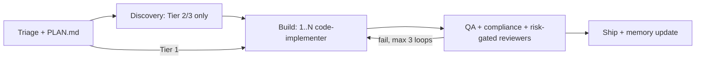

# senior-dev

> A senior-developer orchestrator and nine specialist subagents that plan, build, test and audit code with TDD.

[](../../../LICENSE)


`senior-dev` is a Claude Code plugin for teams that want a repeatable SDLC loop: triage, discovery, TDD build, QA, and a compliance audit before shipping.
The orchestrator writes `PLAN.md`, delegates work to specialist subagents, and never edits application code itself.
Hooks enforce plan-first, branch safety and passing tests; a Playwright MCP server lets the black-box tester verify real browser flows.
`senior-dev-flutter` and `python-backend` depend on this plugin and install it automatically.

## Requirements

- Claude Code with plugin marketplace support (the one-step `--marketplace` install needs 2.1.292+).
- Node.js on `PATH`: every hook runs with `node`.
- `npx`: starts the bundled MCP servers (Playwright, Cloud Run, Firebase).
- Google Chrome for browser E2E runs (the Playwright MCP default browser).
- `git`, plus the test tools your project uses (`pytest`, `npm`, `dart`, `cargo`, `go`), for the Stop gate.

## Installation

```bash
claude plugin marketplace add jggomez/expert-ai-developer-skills
claude plugin install senior-dev@expert-ai-developer-skills
```

Updates, install scopes, per-project settings and branch pinning: [docs/claude-code-installation.md](../../../docs/claude-code-installation.md).

## Quick start

Run the orchestrator as the main thread so its alignment gate can ask you questions (`AskUserQuestion` is not available inside subagents):

```bash
claude --agent senior-dev:senior-dev-orchestrator
```

Then describe the work:

```text
Build a password-reset feature end to end: requirements, implementation with tests, and a final audit.
```

Call a single specialist from any session by its `subagent_type`:

```text
Use the senior-dev:code-implementer agent to add the /health endpoint with TDD.
Ask the senior-dev:compliance-verifier agent for a release-readiness verdict on this branch.
```

## What's included

### Agents

| Agent | Role | Model |
| :--- | :--- | :--- |
| `senior-dev-orchestrator` | Triages the task, writes `PLAN.md`, dispatches and coordinates subagents | `inherit` |
| `product-analyst` | Clarifies business rules; writes user stories and acceptance criteria | `sonnet` |
| `ui-ux-designer` | Maintains `DESIGN.md` and feature UI deltas; WCAG AA | `sonnet` |
| `architect-engineer` | Module boundaries, API/DB contracts, MADR records | `inherit` |
| `code-implementer` | Writes production code with Red-Green-Refactor TDD | `inherit` |
| `qa-tester` | Runs unit/integration/E2E suites; writes `test-matrix.md` | `sonnet` |
| `critic` | Independent review: complexity, DRY, SOLID, maintainability | `inherit` |
| `challenger` | Stress tests, fuzzing, boundary and concurrency probes | `inherit` |
| `e2e-blackbox-tester` | Browser journeys via Playwright MCP with screenshot evidence | `sonnet` |
| `compliance-verifier` | Static analysis, security and NFR audit; final verdict | `sonnet` |

## Bundled Skills

| Skill | Purpose |
| :--- | :--- |
| **`senior-dev-orchestrator`** | SDLC orchestration: tier routing, gated dispatch, parallel TDD, memory |
| **`loop-engineering`** | Tier state machine, worker isolation (disjoint files or git worktree), review loops |
| **`product-analyst`** | User stories and acceptance criteria for ambiguous requests |
| **`ui-ux-designer`** | `DESIGN.md` contracts, design tokens, responsive and accessible components |
| **`senior-architect-engineering`** | MADR decision records and architecture sections |
| **`code-implementer`** | TDD and clean-code implementation |
| **`code-smells-expert`** | Code smell and technical debt diagnosis |
| **`refactoring-code-expert`** | Behavior-preserving refactoring |
| **`qa-tester`** | Test suites and QA test matrix with exit-code proof |
| **`compliance-verifier`** | NFR, static analysis, coverage and security checks |
| **`code-critic`** | Independent code review |
| **`adversarial-challenger`** | Fuzzing, worst-case inputs, failure-path probes |
| **`blackbox-tester`** | Browser verification with 4-viewport screenshot evidence |
| **`context-capture`** | Writes milestone memory to `context/memory/` |
| **`context-restore`** | Restores `context/memory/MEMORY.md` at session start |

Each agent preloads only its core skills; others load on demand through the `Skill` tool.

### Hooks

| Event | Script | Behavior |
| :--- | :--- | :--- |
| `PreToolUse` (`Write\|Edit`) | `hooks/orchestrator-role-gate.js` | Allows docs and plans (`*.md`, `*.txt`, `docs/`, `.agents/`, `context/`, `.claude/`). For code: denies edits on `main`/`master`/`develop`/`dev`, denies edits without a `PLAN.md` (Edits of 10 lines or fewer are exempt), and denies edits when the running agent is an orchestrator. |
| `Stop` | `hooks/universal-quality-gate.js` | Runs `scripts/verify.sh`, `dart analyze`, `npm test`, `pytest -q`, `cargo test` or `go test ./...` when they apply. Skips when no code changed or the same code state already passed. Blocks at most 3 times per turn. |
| `SubagentStop` | `hooks/e2e-evidence-gate.js` | Rejects an `e2e-blackbox-tester` `PASSED`/`REJECTED` verdict unless its transcript shows a successful navigate + screenshot (or a `playwright` run) and real PNG files exist. `BLOCKED`/`SKIPPED` always pass. |

Stop-gate caching, retry limits and cross-plugin de-duplication live in `hooks/shared/gate-utils.js`. Gate ids are shared with `python-backend` and `senior-dev-flutter`, so a suite runs once per code state.

### MCP servers

| Server | Command | Purpose |
| :--- | :--- | :--- |
| `playwright` | `npx -y @playwright/mcp@latest --isolated` | Headed, isolated browser for `e2e-blackbox-tester` |
| `cloudrun` | `npx -y @google-cloud/cloud-run-mcp` | Google Cloud Run deployments and logs |
| `firebase-mcp-server` | `npx -y firebase-tools@latest mcp` | Firebase projects, Firestore, Auth, deploys |

## How it works



The orchestrator classifies each task as Tier 1 (fast-track), Tier 2 (standard) or Tier 3 (mission-critical) and invokes only the specialists the task needs.
Parallel workers run in one message, at most 3 at a time, on disjoint files; shared files change first in one committed step. Worktree isolation (`isolation: "worktree"`) is a last resort and needs `"worktree": {"baseRef": "head"}` in `.claude/settings.json`, because Claude Code otherwise branches worktrees from the default branch.
Well-specified work stays light: scale alone never makes a task Tier 3, the orchestrator never adds unrequested features, and a multi-phase request runs discovery, review and E2E once for the whole request, with one commit per phase.
The full state machine is documented in [AGENTS.md](../../../AGENTS.md) and the [root README](../../../README.md).

## Configuration

| Setting | How |
| :--- | :--- |
| Orchestrator as default agent | Add `{ "agent": "senior-dev:senior-dev-orchestrator" }` to `.claude/settings.json` |
| Headless browser (CI, no display) | Add `--headless` to the `playwright` args in `.mcp.json` |
| Model per agent (maintainers) | Edit `CLAUDE_AGENT_OVERRIDES` in [scripts/claude_sync_config.py](../../../scripts/claude_sync_config.py), then run `python3 scripts/sync_agents.py` |

## Troubleshooting

| Symptom | Cause | Fix |
| :--- | :--- | :--- |
| `PLAN FIRST` denial on a code edit | No `PLAN.md` in the root, `docs/` or `.agents/` | Create `PLAN.md`, or keep the change to a small Edit (10 lines or fewer) |
| `PROTECTED BRANCH` denial | Working on `main`, `master`, `develop` or `dev` | Run `git checkout -b feat/<slug>` |
| `ORCHESTRATOR CODE PROHIBITION` denial | The orchestrator tried to edit code | Expected: it must delegate to `code-implementer` |
| Turn will not end; `UNIVERSAL QUALITY GATE VIOLATION` | A detected test suite or linter fails | Fix the failures. After 3 blocks in one turn the gate lets the turn end with a notice |
| `E2E EVIDENCE GATE - UNPROVEN VERDICT` | Tester claimed `PASSED`/`REJECTED` without browser evidence | Make sure `npx` can start Playwright MCP and the app is running; otherwise the tester must report `BLOCKED`. After 3 blocks the result is shown as `UNVERIFIED` |
| Orchestrator cannot ask for approval | It runs as a subagent, where `AskUserQuestion` is removed | Start it with `claude --agent senior-dev:senior-dev-orchestrator` |

## Related plugins

- [senior-dev-flutter](../senior-dev-flutter/README.md): Flutter layer; depends on `senior-dev`.
- [python-backend](../python-backend/README.md): Python backend layer; depends on `senior-dev`.
- [shared-context](../shared-context/README.md), [git-workflow](../git-workflow/README.md), [docs-and-quality](../docs-and-quality/README.md), [multi-agent-ops](../multi-agent-ops/README.md).

## License

Apache-2.0. See [LICENSE](../../../LICENSE).
