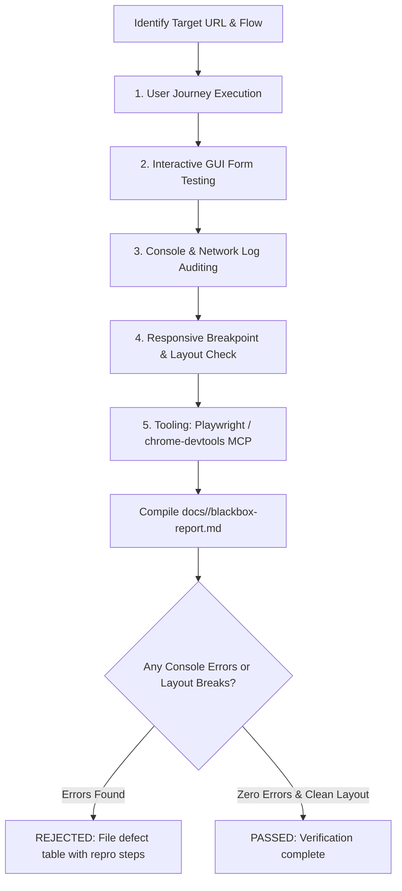

# Black-Box Browser Verification & Visual Testing Skill

## Overview
This skill provides automated black-box browser verification from the perspective of an actual user. Operating as a Senior Black-Box QA Engineer, it exercises real user journeys through live browsers, submits interactive GUI forms, validates responsive visual layouts across mobile/tablet/desktop breakpoints, and captures console errors and failed network requests.

It leverages modern browser automation tools, specifically **Playwright** via CLI/scripts and **`chrome-devtools` MCP** tools (`navigate_page`, `click`, `fill_form`, `type_text`, `take_screenshot`, `list_console_messages`, `list_network_requests`, `resize_page`), publishing its verification findings to `docs/<feature-name>/blackbox-report.md`.

---

## When to Use

### Trigger Scenarios
- Validating client-side web applications, SPAs, and frontend portals running in local dev servers or staging URLs.
- Testing real end-to-end user flows (signup, login, navigation, checkout, wizard steps) through the browser DOM.
- Auditing GUI form behavior (validation messages, disabled buttons, input masks, loading indicators, error boundaries).
- Detecting silent JavaScript runtime crashes, unhandled promise rejections, and console errors (`console.error`).
- Verifying responsive visual layouts across multiple breakpoints (Mobile 375px, Tablet 768px, Desktop 1280px) to spot clipping, overflows, or broken flex/grid containers.
- Authoring the standard deliverable `docs/<feature-name>/blackbox-report.md` during State 3/4 verification.

### When NOT to Use
- **Pure backend/API service testing without UI**: Route headless API testing to `qa-tester`.
- **Unit test creation during coding**: Route to `test-driven-development` or `code-implementer`.
- **Static code smell and complexity review**: Route to `code-critic`.
- **Adversarial stress and concurrency fuzzing**: Route to `adversarial-challenger`.
- **Flutter native mobile apps**: Route to `flutter-reviewer` and `senior-dev-flutter`.

---

## Process

The black-box verification process operates across five distinct phases to validate frontend integrity:



### Phase 1: User Journey Execution
- **Happy Paths**: Execute complete end-to-end journeys from initial page landing to completion (e.g. login $\to$ browse $\to$ add to cart $\to$ checkout $\to$ confirmation).
- **Navigation Invariants**: Verify URL updates match application state, back/forward browser button navigation functions without breaking state, and bookmarks/deep links load correctly.
- **State Persistence**: Verify that sessions, local storage, and cookies persist across page reloads.

### Phase 2: Interactive GUI Forms & Input Validation
- **Boundary Inputs**: Test empty inputs, boundary strings, invalid email/phone formats, and special characters in input fields.
- **Visual Feedback**: Verify clear inline error labels, focus highlights, and disabled submit buttons during in-flight network requests.
- **Form Submission**: Confirm that valid submissions trigger appropriate success notifications, redirect smoothly, or update the view without whole-page flickering.

### Phase 3: Browser Console & Network Log Auditing
- **Zero Console Errors Policy**: Inspect browser console logs (`list_console_messages` or Playwright `page.on('console')`). Reject any build that emits unhandled JavaScript errors, syntax warnings, or uncaught promise rejections.
- **Network Failures**: Inspect network requests (`list_network_requests` or Playwright request logs) to ensure no unexpected HTTP 4xx/5xx status codes occur during happy-path user flows.
- **Resource Integrity**: Ensure zero missing images (broken `` tags), missing fonts, or 404 static assets.

### Phase 4: Responsive Breakpoint & Visual Layout Analysis
Test views across standard viewport dimensions:
1. **Mobile (`375 x 812` px - iPhone profile)**:
   - Verify single-column fluid layout, burger menu/drawer toggles, and touch target minimums ($\ge 44 \times 44$ px).
   - Ensure zero horizontal scrolling (`overflow-x: hidden`).
2. **Tablet (`768 x 1024` px - iPad profile)**:
   - Verify adaptive multi-column grids and balanced spacing.
3. **Desktop (`1280 x 800` px - Laptop profile)**:
   - Verify full navigation menus, modals centered, sidebars, and hover states.
4. **Widescreen (`1920 x 1080` px - FHD profile)**:
   - Verify maximum container bounds (`max-w-7xl` or similar) preventing excessive stretching.

### Phase 5: Deliverable Generation (`docs/<feature-name>/blackbox-report.md`)
Create the target directory `docs/<feature-name>/` if not present. Generate the report following the [Black-Box Report Template](references/blackbox-report-template.md):

```markdown
# Black-Box Browser Verification & Visual Test Report

## Executive Summary
- **Feature Name**: `<feature-name>`
- **Tester**: `e2e-blackbox-tester`
- **Execution Date**: `YYYY-MM-DD`
- **Application URL / Environment**: `http://localhost:3000`
- **Tooling Used**: `[Playwright | chrome-devtools MCP]`
- **Overall Verification Verdict**: `[PASSED | BLOCKED | REJECTED]`
- **User Journeys Tested**: `[Count]`
- **Console Errors Detected**: `[Count]`

## 1. User Journey Verification Matrix
[Journey ID, Description, Viewport, Steps Run, Form Submissions, Console Errors, Status]

## 2. Interactive GUI Form & Input Validation
[Form ID, Field Tested, Input Value, Expected Validation, Observed Feedback, Status]

## 3. Browser Console & Network Log Audit
[Console message logs, Unhandled errors count, Failed 4xx/5xx requests]

## 4. Visual Layout & Responsive Breakpoint Analysis
[Mobile 375px, Tablet 768px, Desktop 1280px checks, Overflow, Touch targets]

## 5. Identified Defects & UX Anomalies
[Defect ID, Severity, Category, Observed Bug, Reproduction Steps, Remediation Required]
```

---

## Usage

### Invocations & Commands

#### 1. Playwright CLI Execution
```bash
# Run all browser E2E tests headlessly
npx playwright test

# Run tests targeting specific browser or device emulation
npx playwright test --project="Mobile Chrome"
npx playwright test --project="Desktop Chrome"

# Run with trace and video recording enabled for debugging
npx playwright test --trace on
```

#### 2. Chrome DevTools MCP Tool Invocations
When interacting with live web apps via MCP tools:
- Navigate: `navigate_page(url="http://localhost:3000")`
- Resize Viewport: `resize_page(width=375, height=812)` (Mobile) or `resize_page(width=1280, height=800)` (Desktop)
- Inspect Elements: `take_snapshot()`
- Interact: `type_text(selector="input[name='email']", text="user@example.com")`, `click(selector="button#submit")`
- Audit Logs: `list_console_messages()`, `list_network_requests()`
- Capture Proof: `take_screenshot(name="checkout-mobile.png")`

### Example Prompts
- *"Execute black-box browser testing on our newly implemented checkout flow at `http://localhost:3000/checkout` across mobile and desktop breakpoints."*
- *"Verify the sign-up form with invalid email inputs, inspect console error logs, and generate `docs/auth-signup/blackbox-report.md`."*
- *"Check our landing page for horizontal overflow on 375px mobile viewports using chrome-devtools MCP."*

### Host Execution Instructions
- **Claude Code**: Run Playwright test runner via `Bash`, or interact with browser via Playwright CLI; author test files with `Write`.
- **Antigravity**: Launch as the `e2e-blackbox-tester` subagent; call `chrome-devtools` MCP tools via `call_mcp_tool` or run Playwright suites using `Bash`; write report to `docs/<feature-name>/blackbox-report.md`.

---

## Red Flags
- Reporting visual verification passing without actually rendering or inspecting the UI in a browser engine.
- Ignoring console errors or treating JavaScript runtime exceptions as "normal".
- Testing exclusively on desktop viewports while ignoring mobile form factors and touch targets.
- Using fragile arbitrary sleeps (`sleep(5000)`) instead of event/DOM-driven condition waiters.
- Failing to verify error messaging when invalid form data is submitted.
- Marking a task verified when horizontal scrollbar appears on mobile viewports.

---

## Verification
- [ ] Real user journeys executed against a running web application.
- [ ] Interactive form validation verified for both valid and invalid input sets.
- [ ] Browser console logs audited with zero unhandled JavaScript errors.
- [ ] Responsive layouts verified across Mobile (`375px`), Tablet (`768px`), and Desktop (`1280px`).
- [ ] Formal deliverable saved to `docs/<feature-name>/blackbox-report.md`.
- [ ] Any visual or functional bug recorded with exact reproduction steps.

---

## References
- Black-Box Deliverable Template: [references/blackbox-report-template.md](references/blackbox-report-template.md)
