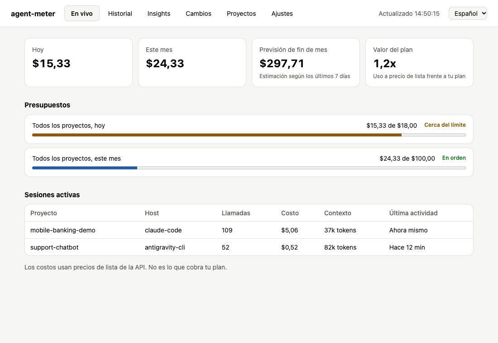
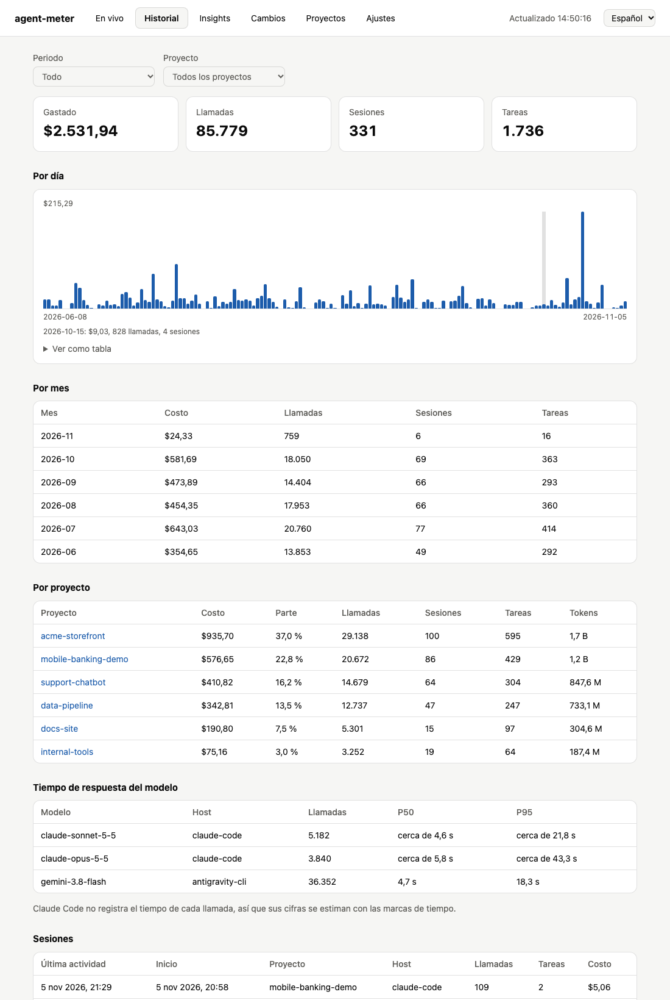
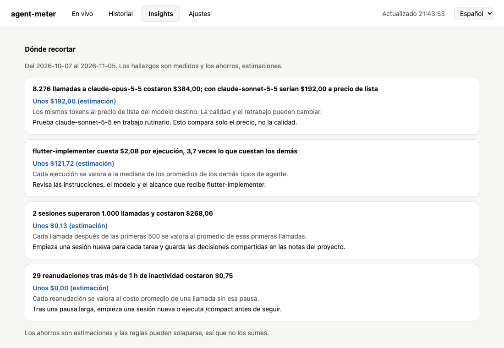
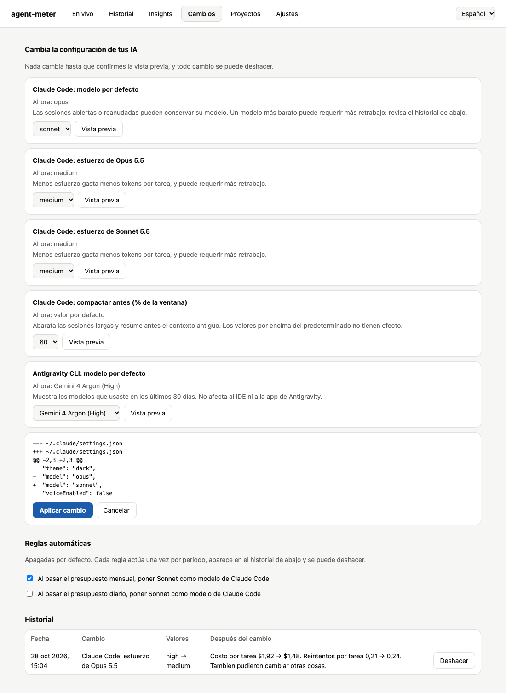
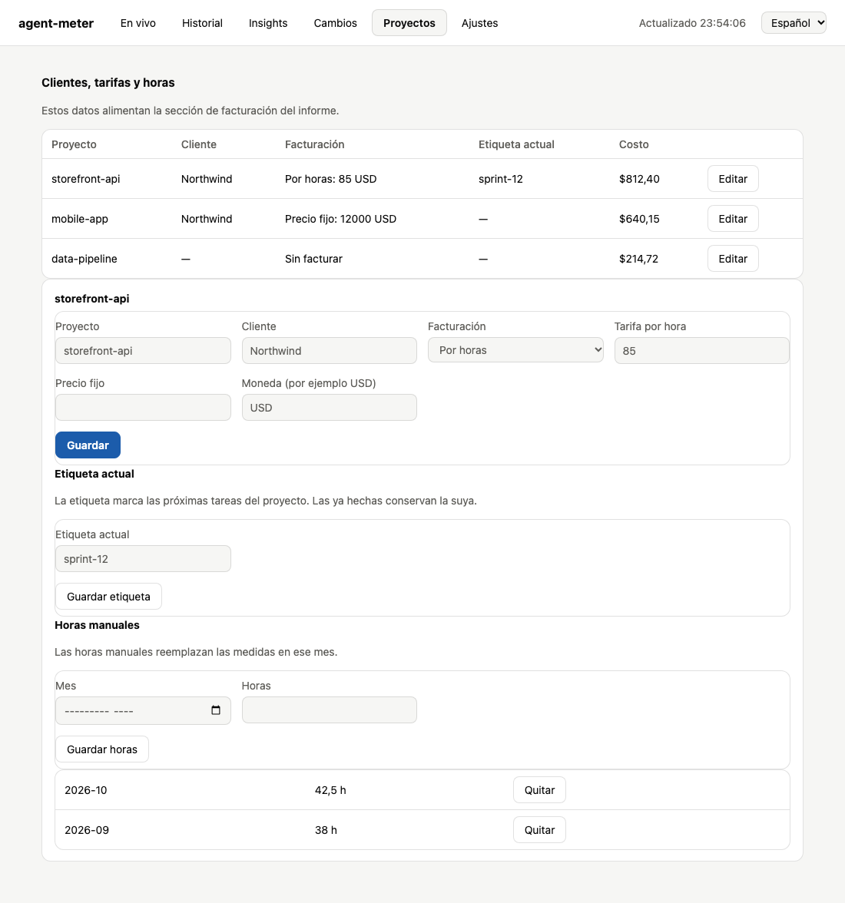
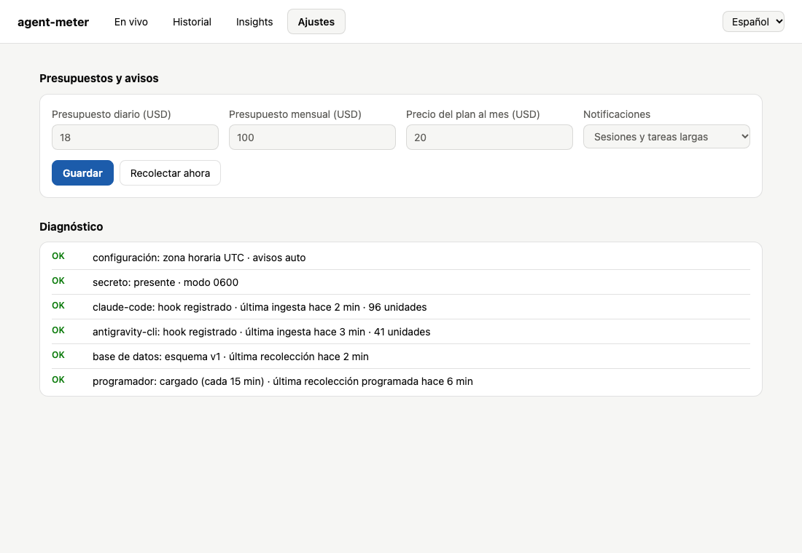

# Guía de la app de agent-meter

Esta guía explica cada pantalla de la app de escritorio: para qué sirve, cómo leerla y qué puedes hacer en ella. Para instalar la
app, consulta [La app de escritorio](../README.es.md#54-la-app-de-escritorio).

> 🇬🇧 English guide: [app-guide.md](app-guide.md)

Las capturas usan datos de demostración ficticios.

**Pantallas:** [En vivo](#en-vivo) · [Historial](#historial) · [Insights](#insights) · [Cambios](#cambios) · [Proyectos](#proyectos) · [Ajustes](#ajustes)

**También aquí:** [Funciones comunes a todas las pantallas](#funciones-comunes-a-todas-las-pantallas)

## Antes de empezar

- **Los costes son a precio de lista de la API.** Muestran lo que costaría ese uso por la API, no lo que cobra tu plan.
- **La cabecera indica lo actualizados que están los datos.** Durante una recolección ves las últimas cifras guardadas y un mensaje que lo avisa.
- **Las sesiones necesitan una primera recolección.** La app importa tu historial al abrirse por primera vez, y puede tardar más de un minuto.

## En vivo

**Sirve para responder:** ¿cuánto he gastado hoy y hay algo en marcha?

| Parte | Qué muestra |
| :--- | :--- |
| **Hoy** y **Este mes** | El gasto hasta ahora, a precio de lista |
| **Previsión de fin de mes** | Una estimación del total del mes, según el ritmo de los últimos 7 días |
| **Valor del plan** | El uso del mes a precio de lista dividido entre el precio de tu plan. `3,0x` significa un uso que vale tres veces lo que pagas. Muestra **Sin definir** hasta que indiques el precio en Ajustes |
| **Presupuestos** | Cada presupuesto con su gasto y límite: **En orden**, **Cerca del límite** desde el 80 % o **Límite superado** |
| **Sesiones activas** | Sesiones con actividad en los últimos 15 minutos, con proyecto, host, llamadas, coste, contexto y última actividad |

**Contexto** es el tamaño del último prompt de la sesión. Un contexto grande encarece cada llamada nueva.

Para definir un presupuesto o el precio de tu plan, ve a [Ajustes](#ajustes).

## Historial

**Sirve para responder:** ¿en qué y cuándo se fue el dinero?

Elige un **Periodo** y un **Proyecto** arriba. Todas las cifras de la pantalla siguen esos filtros.

| Parte | Qué muestra |
| :--- | :--- |
| **Gastado, Llamadas, Sesiones, Tareas** | Totales de la selección. El gasto basado en un precio estimado aparece debajo del total |
| **Por día** | Una barra por día. Pasa el cursor por una barra para ver sus cifras, o abre **Ver como tabla** |
| **Por mes** | Coste, llamadas, sesiones y tareas de cada mes |
| **Por proyecto** | Coste de cada proyecto, su parte del total, llamadas, sesiones, tareas y tokens |
| **Tiempo de respuesta del modelo** | P50 (una llamada típica) y P95 (una llamada lenta) de cada modelo |
| **Sesiones** | Las últimas sesiones, de la más reciente a la más antigua. Una nota al final indica cuántas se muestran del total |

**Sobre los tiempos de respuesta:** Antigravity los registra. Claude Code no, así que sus cifras son estimaciones, medidas desde la
última entrada hasta la última línea de la respuesta. En 1.065 tareas reales nunca superaron el tiempo que Claude Code informa
para el turno. Las sesiones recolectadas antes de esta versión necesitan ejecutar `agent-meter collect --full` una vez.

## Insights

**Sirve para responder:** ¿qué debería cambiar para gastar menos?

La lista **Dónde recortar** sale de reglas fijas sobre tus últimos 30 días. No interviene ninguna IA, así que los mismos datos dan
el mismo resultado. Cada hallazgo incluye un hecho medido, qué hacer y, cuando se puede calcular, un ahorro estimado.

| Hallazgo | Cuándo aparece | Qué hacer |
| :--- | :--- | :--- |
| Sesiones largas | Una sesión llega a 1.000 llamadas | Empieza una sesión nueva para cada tarea y guarda las decisiones compartidas en notas del proyecto |
| Caché caducada | Al menos 5 llamadas de Claude Code que reanudan tras más de 1 hora sin actividad | Tras una pausa larga, empieza una sesión nueva o ejecuta `/compact` antes de seguir |
| Implementadores repetidos | Una tarea vuelve a lanzar un implementador al menos dos veces cuando otro ya había terminado | Revisa si esas tareas tienen especificaciones poco claras o criterios de aceptación débiles. Las fases planificadas no son retrabajo |
| Agentes caros | Un agente cuesta al menos el doble que los demás, en 5 ejecuciones o más | Revisa las instrucciones, el modelo y el alcance de ese agente |
| Tareas atípicas | Pocas tareas concentran la mayor parte del gasto, a partir de 10 tareas | Abre las tareas más caras y divide el trabajo similar en tareas más pequeñas |
| Comparación de modelos | Usaste un modelo con una alternativa más barata | Prueba el modelo más barato en trabajo rutinario |
| Bucles de tests en rojo | Al menos 3 ejecuciones de agentes fallaron los tests 5 veces o más cada una | Haz que los agentes paren tras 3 ejecuciones en rojo seguidas y expliquen qué los bloquea |
| Implementadores sin tests | Al menos 3 ejecuciones de implementadores cambiaron archivos sin ejecutar ningún test | Da a cada implementador el comando de test que prueba su trabajo y considera sin terminar la respuesta que no lo traiga |

Los hallazgos son hechos y los ahorros son estimaciones. La comparación de modelos muestra solo el precio: no dice nada de la
calidad ni del retrabajo.

Si ves **Ninguna regla se activó en este periodo**, es que nada pasó estos límites. Para aplicar un cambio, ve a [Cambios](#cambios).

## Cambios

**Sirve para:** cambiar la configuración de tus herramientas de IA, de forma segura y con opción de deshacer.

### Hacer un cambio

1. Elige un valor en uno de los ajustes.
2. Pulsa **Preparar este cambio**. La app muestra la diferencia exacta en el archivo.
3. Pulsa **Aplicar cambio**, o **Cancelar** para dejarlo todo como estaba.

Los cambios se aplican a las sesiones nuevas. Las sesiones abiertas y reanudadas pueden conservar su modelo.

| Ajuste | Archivo y clave |
| :--- | :--- |
| Modelo por defecto de Claude Code (`opus`, `sonnet`, `haiku`) | `~/.claude/settings.json`: `model` |
| Esfuerzo de Claude Code para Opus 5.5 y Sonnet 5.5 | `~/.claude/settings.json`: `modelSettings.<model>.effortLevel` |
| Umbral de compactación de Claude Code (60, 70 u 80 %) | `~/.claude/settings.json`: `env.CLAUDE_AUTOCOMPACT_PCT_OVERRIDE` |
| Barra de estado de Claude Code | `~/.claude/settings.json`: `statusLine` |
| Modelo por defecto de Antigravity CLI, entre los usados en los últimos 30 días | `~/.gemini/antigravity-cli/settings.json`: `model` |

La barra de estado muestra, por ejemplo, `$1.23 session · $46.20 today · 38% context`. Ejecuta `agent-meter statusline`, así que
necesita la línea de comandos. La cifra de la sesión viene de Claude Code, y la de hoy, de la última recolección. Si ya tenías una
barra de estado, vuelve al deshacer.

### Reglas automáticas

Las reglas empiezan desactivadas y se activan una a una.

| Regla | Qué hace |
| :--- | :--- |
| Presupuesto mensual superado | Pone `sonnet` como modelo por defecto de Claude Code, una vez al mes |
| Presupuesto diario superado | Pone `sonnet` como modelo por defecto de Claude Code, una vez al día |

Las reglas solo se ejecutan con la app abierta, después de una recolección. Usan las mismas comprobaciones y copias de seguridad que
un cambio manual, envían una notificación y aparecen en el historial. Si deshaces una, no se repite hasta el siguiente periodo. Su
estado está en `~/.agent-meter/rules.json`.

### Historial y deshacer

La tabla **Historial** lista cada cambio con sus valores y un botón **Deshacer**. Deshacer restaura el archivo byte a byte, o solo esa
clave si editaste el archivo después.

**Después del cambio** compara el coste y los reintentos por tarea en hasta 7 días a cada lado, cuando ya han terminado 5 tareas.
Muestra correlación, no causa. Un coste menor con más reintentos puede no ser un ahorro.

### Límites de seguridad

- Cada cambio guarda una copia de seguridad y queda registrado en `~/.agent-meter/changes.json`.
- La app rechaza un JSON no válido, un archivo que cambió después de la vista previa y los ajustes gestionados por tu organización.
- Nunca edita `~/.gemini/settings.json`, que es de Gemini CLI.
- No pone un tope al gasto y no puede compactar una sesión abierta.

## Proyectos

**Sirve para:** añadir clientes, tarifas y horas para la sección de facturación del informe, sin editar `projects.yaml`.

La tabla lista cada proyecto con su cliente, tipo de facturación, etiqueta actual y coste. Pulsa **Editar** para abrir sus detalles.

| Parte | Qué puedes hacer |
| :--- | :--- |
| **Detalles del proyecto** | Define el nombre, el cliente, el tipo de facturación, la tarifa o el precio, y una moneda de 3 letras |
| **Etiqueta actual** | Marca las próximas tareas del proyecto, por ejemplo con un track o un ticket. Las tareas ya hechas conservan la suya |
| **Horas manuales** | Introduce las horas de un mes. Sustituyen a las horas medidas de ese mes |

Los proyectos aparecen tras tu primera sesión. Consulta el §9 del [README](../README.es.md) para saber cómo se calcula la facturación.

## Ajustes

**Sirve para:** definir presupuestos y notificaciones, y comprobar que todo funciona.

| Parte | Qué hace |
| :--- | :--- |
| **Presupuestos y avisos** | Define el presupuesto diario, el mensual y el precio del plan, en USD. Deja un presupuesto vacío para no poner límite. Los presupuestos avisan y nunca bloquean nada |
| **Notificaciones** | Elige entre **Sesiones y tareas largas**, **Solo sesiones**, **Solo tareas largas** o **Desactivadas** |
| **Recolectar ahora** | Lee las sesiones nuevas al momento. Una recolección grande puede tardar más de un minuto |
| **Actualizaciones** | **Buscar actualizaciones** contacta con GitHub solo cuando lo pulsas. Si hay una versión nueva, ofrece la página de descarga y nunca instala nada por sí sola |
| **Diagnóstico** | Muestra las comprobaciones de `agent-meter doctor` como **OK**, **WARN** o **FAIL** |

## Funciones comunes a todas las pantallas

- **Idioma:** elige English o Español en la cabecera. La elección se guarda como `language` y también se aplica a los avisos de
  presupuesto. La línea de comandos y el informe HTML siguen en inglés.
- **Actualización en vivo:** la app vigila tus carpetas de transcripts y recolecta cuando cambian, como máximo una vez cada 30
  segundos desde que termina la recolección anterior. Lo que cambie entre medias entra en la siguiente.
- **Junto al reloj:** la barra de menús del Mac muestra el gasto de hoy. En Windows aparece un icono en el área de notificación. Su
  menú incluye el mes, los avisos de presupuesto y opciones para abrir la app o salir.
- **Seguridad:** no hay servidor local ni puerto abierto.
