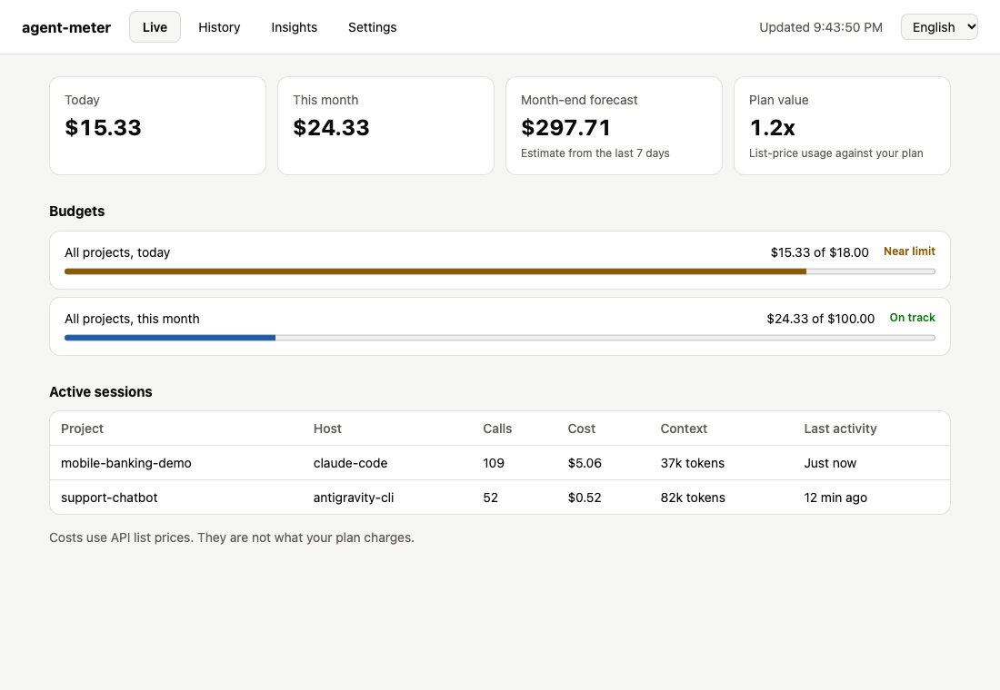
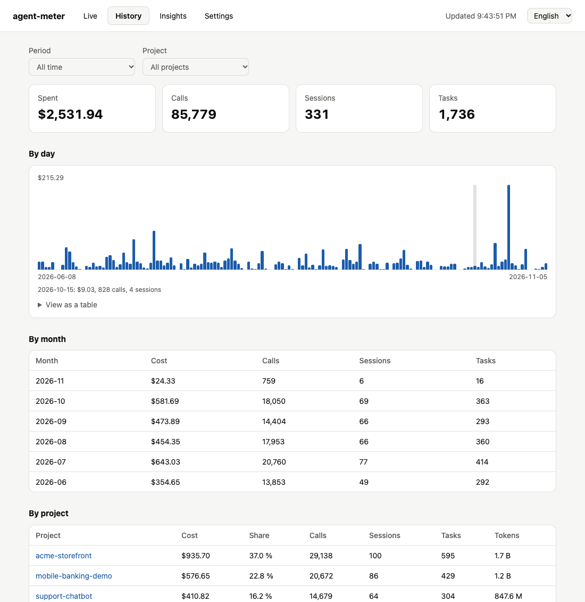
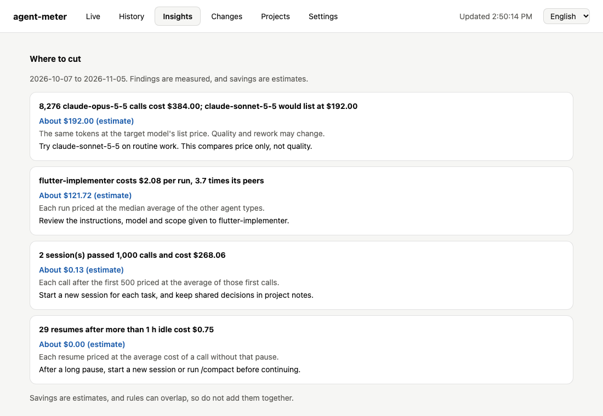
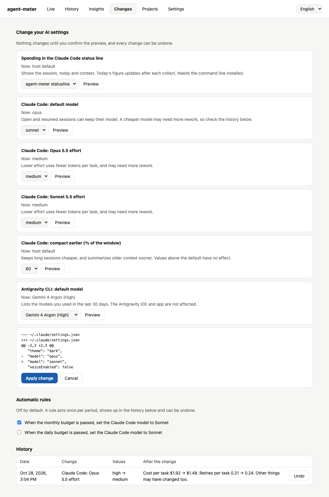
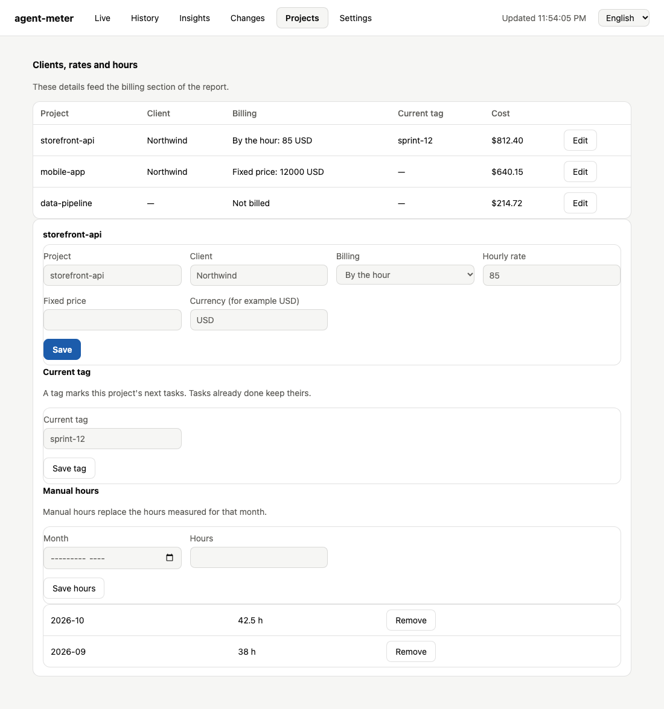
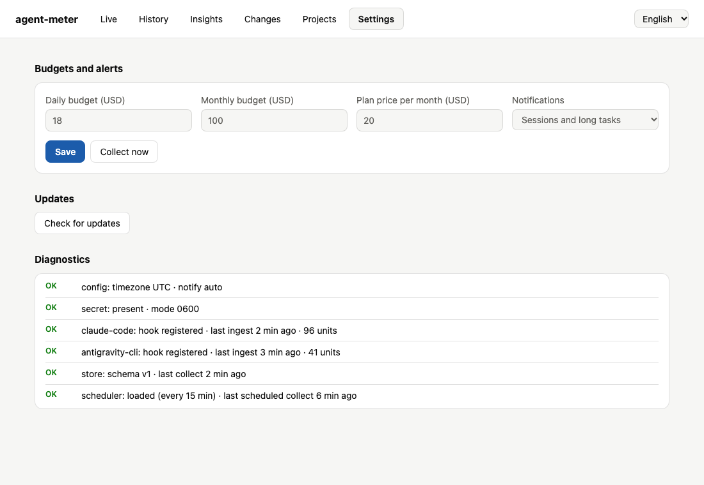

# agent-meter app guide

This guide explains each screen of the desktop app: what it is for, how to read it and what you can do there. To install the
app, see [The desktop app](../README.md#54-the-desktop-app).

> 🇪🇸 Guía en español: [app-guide.es.md](app-guide.es.md)

The screenshots use fictional demo data.

**Screens:** [Live](#live) · [History](#history) · [Insights](#insights) · [Changes](#changes) · [Projects](#projects) · [Settings](#settings)

**Also here:** [Working across screens](#working-across-screens)

## Before you start

- **Costs are at API list prices.** They show what the usage would cost through the API, not what your plan charges.
- **The header shows how fresh the data is.** While a collect runs, you see the last saved figures and a message saying so.
- **Sessions need a first collect.** The app imports your history on first launch, which can take over a minute.

## Live

**Use it to answer:** how much have I spent today, and is anything running now?

| Part | What it shows |
| :--- | :--- |
| **Today** and **This month** | Spending so far, at list prices |
| **Month-end forecast** | An estimate of the month's total, based on the pace of the last 7 days |
| **Plan value** | This month's list-price usage divided by your plan price. `3.0x` means usage worth three times what you pay. It shows **Not set** until you enter the price in Settings |
| **Budgets** | Each budget with its spending and limit: **On track**, **Near limit** from 80%, or **Over limit** |
| **Active sessions** | Sessions with activity in the last 15 minutes, with project, host, calls, cost, context and last activity |

**Context** is the size of the session's latest prompt. A large context makes each new call more expensive.

To set a budget or your plan price, go to [Settings](#settings).

## History

**Use it to answer:** where did the money go, and when?

Choose a **Period** and a **Project** at the top. Every figure on the screen follows those filters.

| Part | What it shows |
| :--- | :--- |
| **Spent, Calls, Sessions, Tasks** | Totals for the selection. Spending based on an estimated price is shown below the total |
| **By day** | A bar for each day. Hover over a bar for its figures, or open **View as a table** |
| **By month** | Cost, calls, sessions and tasks per month |
| **By project** | Each project's cost, share of the total, calls, sessions, tasks and tokens |
| **Model response time** | P50 (a typical call) and P95 (a slow call) for each model |
| **Sessions** | The latest sessions, newest first. A note at the end says how many of the total are shown |

**About response times:** Antigravity records them. Claude Code does not, so its figures are estimates, measured from the last
input to the last line of the answer. Over 1,065 real tasks they never passed the time Claude Code reports for the turn.
Sessions collected before this version need `agent-meter collect --full` once.

## Insights

**Use it to answer:** what should I change to spend less?

The **Where to cut** list comes from fixed rules over your last 30 days. No AI is involved, so the same data gives the same
result. Each finding has a measured fact, what to do about it and, when it can be calculated, an estimated saving.

| Finding | When it appears | What to do |
| :--- | :--- | :--- |
| Long sessions | A session reaches 1,000 calls | Start a new session for each task, and keep shared decisions in project notes |
| Expired cache | At least 5 Claude Code calls resume after more than 1 hour idle | After a long pause, start a new session or run `/compact` before continuing |
| Repeated implementers | A task runs an implementer again at least twice after an earlier run finished | Check those tasks for unclear specs or weak acceptance criteria. Planned phases are not rework |
| Expensive agents | An agent costs at least twice as much as the others, over 5 runs or more | Review the instructions, model and scope given to that agent |
| Outlier tasks | A few tasks hold most of the spending, once you have 10 tasks or more | Open the costliest tasks and split similar work into smaller tasks |
| Model comparison | You used a model with a cheaper alternative | Try the cheaper model on routine work |

Findings are facts, and savings are estimates. The model comparison shows price only: it says nothing about quality or rework.

If you see **No rule fired in this period**, nothing passed these limits. To apply a change, go to [Changes](#changes).

## Changes

**Use it to:** change the settings of your AI tools, safely and with undo.

### Make a change

1. Choose a value in one of the settings.
2. Press **Prepare this change**. The app shows the exact difference in the file.
3. Press **Apply change**, or **Cancel** to leave everything as it was.

Changes apply to new sessions. Open and resumed sessions can keep their model.

| Setting | File and key |
| :--- | :--- |
| Claude Code default model (`opus`, `sonnet`, `haiku`) | `~/.claude/settings.json`: `model` |
| Claude Code effort for Opus 5.5 and Sonnet 5.5 | `~/.claude/settings.json`: `modelSettings.<model>.effortLevel` |
| Claude Code compaction threshold (60, 70 or 80%) | `~/.claude/settings.json`: `env.CLAUDE_AUTOCOMPACT_PCT_OVERRIDE` |
| Claude Code status line | `~/.claude/settings.json`: `statusLine` |
| Antigravity CLI default model, from those you used in the last 30 days | `~/.gemini/antigravity-cli/settings.json`: `model` |

The status line shows, for example, `$1.23 session · $46.20 today · 38% context`. It runs `agent-meter statusline`, so it needs the
command line. The session figure comes from Claude Code, and today's figure from the last collect. A status line you already had
comes back on undo.

### Automatic rules

Rules start off, and you turn them on one at a time.

| Rule | What it does |
| :--- | :--- |
| Monthly budget passed | Sets `sonnet` as the Claude Code default model, once a month |
| Daily budget passed | Sets `sonnet` as the Claude Code default model, once a day |

Rules run only while the app is open, after a collect. They use the same checks and backups as a manual change, send a
notification and appear in the history. If you undo one, it does not repeat until the next period. Their state is in
`~/.agent-meter/rules.json`.

### History and undo

The **History** table lists each change with its values and an **Undo** button. Undo restores the file byte for byte, or only that
key if you edited the file afterwards.

**After the change** compares cost and retries per task over up to 7 days on each side, once 5 tasks have finished. It shows
correlation, not cause. A lower cost with more retries may not be a saving.

### Safety limits

- Each change keeps a backup and is listed in `~/.agent-meter/changes.json`.
- The app refuses invalid JSON, a file that changed after the preview and settings managed by your organization.
- It never edits `~/.gemini/settings.json`, which belongs to Gemini CLI.
- It does not cap spending and cannot compact an open session.

## Projects

**Use it to:** add clients, rates and hours for the billing section of the report, without editing `projects.yaml`.

The table lists each project with its client, billing type, current tag and cost. Press **Edit** to open its details.

| Part | What you can do |
| :--- | :--- |
| **Project details** | Set the name, client, billing type (**Not billed**, **By the hour** or **Fixed price**), rate or price, and a 3-letter currency |
| **Current tag** | Mark this project's next tasks, for example with a track or ticket. Tasks already done keep their tag |
| **Manual hours** | Enter the hours of a month. They replace the hours measured for that month |

Projects appear after your first session. See [Projects, clients, rates and hours](../README.md#9-projects-clients-rates-and-hours)
for how billing is calculated.

## Settings

**Use it to:** set budgets and notifications, and check that everything works.

| Part | What it does |
| :--- | :--- |
| **Budgets and alerts** | Sets the daily budget, monthly budget and plan price, in USD. Leave a budget empty for no limit. Budgets warn you and never block anything |
| **Notifications** | Chooses between **Sessions and long tasks**, **Sessions only**, **Long tasks only** or **Off** |
| **Collect now** | Reads new sessions right away. A large collect can take over a minute |
| **Updates** | **Check for updates** contacts GitHub only when you press it. If there is a new version, it offers the download page and never installs anything by itself |
| **Diagnostics** | Shows the `agent-meter doctor` checks as **OK**, **WARN** or **FAIL** |

## Working across screens

- **Language:** choose English or Español in the header. The choice is saved as `language` and also applies to budget alerts. The
  CLI and the HTML report stay in English.
- **Live updates:** the app watches your transcript folders and collects when they change, at most once every 30 seconds after the
  previous collect ends. Changes in between are picked up by the next one.
- **Next to the clock:** the Mac menu bar shows today's spending. On Windows, an icon appears in the notification area. Its menu
  includes the month, budget alerts and options to open the app or quit.
- **Security:** there is no local server and no open port.
