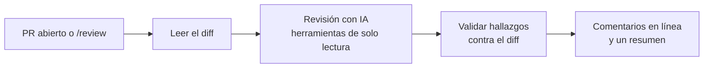
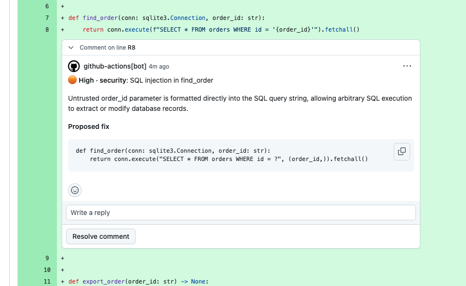
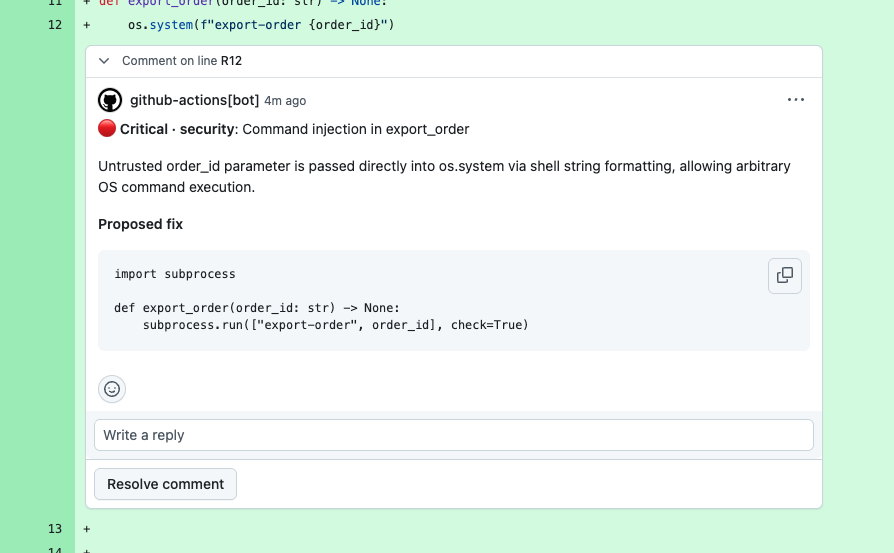
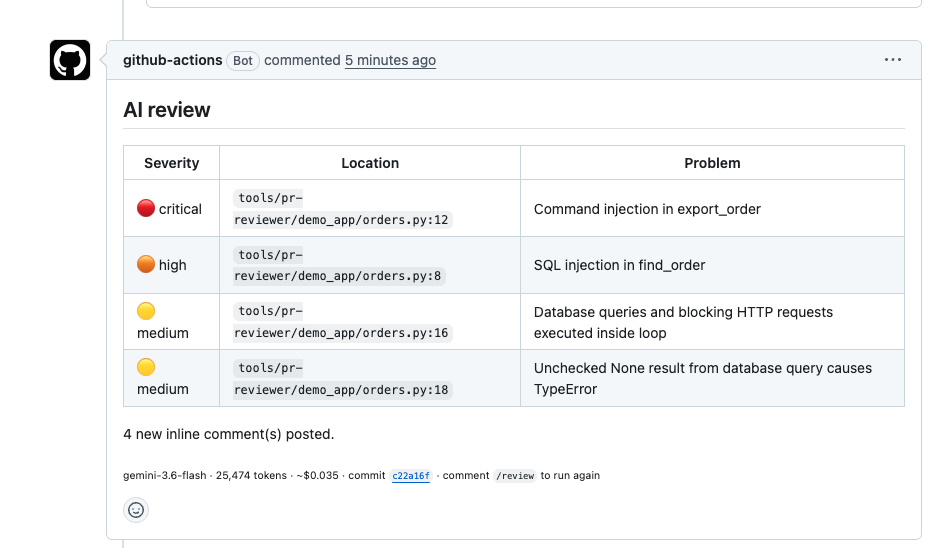

# pr-reviewer

[](https://github.com/jggomez/expert-ai-developer-skills/actions/workflows/pr-reviewer-ci.yml)
[](../../LICENSE)

Un revisor de código con IA para tus pull requests. Corre en GitHub Actions, comenta sobre seguridad, rendimiento,
escalabilidad, diseño, buenas prácticas y coste, y nunca bloquea un merge.

[Read in English](README.md)

- **Sin servidor:** corre en los runners de GitHub Actions de tu repositorio.
- **Tú eliges la IA:** Gemini, un plan Claude Pro o Max, o una clave de API de Anthropic.
- **Seguro con código no confiable:** el agente solo tiene herramientas de solo lectura.
- **Adaptable:** cambia el modelo, los límites y los criterios de revisión desde la configuración del repositorio.

## Inicio rápido

Ejecuta esto desde la raíz de tu repositorio. Añade el workflow, fijado al último commit:

```bash
mkdir -p .github/workflows
SHA=$(git ls-remote https://github.com/jggomez/expert-ai-developer-skills refs/heads/main | cut -f1)
curl -fsSL https://raw.githubusercontent.com/jggomez/expert-ai-developer-skills/main/tools/pr-reviewer/examples/pr-review.yml \
  | sed "s/<commit-sha>/$SHA/" > .github/workflows/pr-review.yml
```

Después conecta un proveedor de IA. Gemini es el camino más corto:

1. Crea una [clave de API de Gemini](https://aistudio.google.com/apikey).
2. En tu repositorio, abre **Settings → Secrets and variables → Actions → Secrets** y añádela como
   `GEMINI_API_KEY`.
3. Haz commit del workflow, llévalo a tu rama principal y abre un pull request.

En unos minutos, el pull request recibe comentarios en línea y un resumen. Para usar Claude, sigue
[Conectar un proveedor](docs/guide.es.md#2-conectar-un-proveedor).

> [!WARNING]
> Con la capa gratuita de la API de Gemini, Google puede usar tu código para mejorar sus productos, y revisores
> humanos pueden leerlo. Usa una clave de pago o Vertex AI para cualquier código privado. Consulta los
> [términos de la API de Gemini](https://aistudio.google.com/docs/terms).

## Cómo funciona



La revisión corre cuando un pull request se abre, se reabre o se marca como listo. No corre en cada push, y así
el coste se mantiene bajo. Para revisar de nuevo tras subir commits, un owner, member o collaborator comenta
`/review` en el pull request.

Todos los pasos quedan en verde aunque falle la IA, así que el revisor nunca puede bloquear un merge. Si una
revisión falla, el comentario de resumen explica por qué.

## Cómo se ve una revisión

Estas capturas son de una revisión real de un pull request de prueba, hecha con Gemini.

Cada hallazgo es un comentario en la línea modificada, con su severidad, una explicación y una propuesta de corrección:





Un único comentario de resumen lista los hallazgos por severidad, con el modelo, los tokens y el costo estimado de la ejecución:



## Qué revisa

| Eje | Ejemplos |
| --- | --- |
| Seguridad | Riesgos del OWASP Top 10: control de acceso roto, inyección, XSS, SSRF, autenticación débil, secretos expuestos |
| Rendimiento | Consultas N+1, I/O en bucles, complejidad evitable, código async bloqueante |
| Escalabilidad | Memoria sin límite, falta de paginación o timeouts, estado en un solo proceso, condiciones de carrera |
| Diseño | Problemas SOLID y code smells con daño concreto, lógica duplicada, abstracciones innecesarias |
| Buenas prácticas | Errores silenciados, transacciones ausentes, floats para dinero, cambios de API incompatibles |
| Coste | APIs de pago en bucles, `SELECT *` en almacenes facturados, reintentos sin tope, prompts de LLM enormes, logs excesivos |

El estilo, los nombres y los tests que faltan quedan fuera. Cada hallazgo necesita una línea del diff, un impacto
y un nivel de confianza, y un pull request limpio recibe un resumen corto de "no se encontraron problemas".

Es una revisión con IA, no una auditoría de seguridad: puede pasar por alto vulnerabilidades, así que mantén tus
escáneres. En un repositorio público sus comentarios también son públicos, así que atiende un hallazgo grave antes
de que el pull request tenga mucha visibilidad.

## Elegir un proveedor

| | Gemini (Antigravity) | Plan Claude Pro o Max | Clave de API de Anthropic | Claude Managed Agents |
| --- | --- | --- | --- | --- |
| Ideal para | Empezar | Tus propios repositorios | Equipos y organizaciones | Sandbox alojado con tope en dólares |
| `provider` | `antigravity` | `claude-code` | `claude-code` | `claude` |
| Se paga con | Clave de API de Gemini | Los límites de tu plan | Por token | Por token y tiempo de sesión |
| El agente corre en | Tu runner de GitHub | Tu runner de GitHub | Tu runner de GitHub | Sandbox de Anthropic sin red |
| El agente puede leer | Todo el repositorio (copia limpia) | Todo el repositorio (copia limpia) | Todo el repositorio (copia limpia) | El diff y los archivos cambiados |
| Modelo por defecto | `gemini-3.6-flash` | El de Claude Code | El de Claude Code | `claude-opus-5-5` |
| Tope de gasto | Tokens (`max-tokens`) | 20 turnos y tu plan | 20 turnos. Fija un tope en la Console | Dólares (`budget-usd`) |
| Coste en el resumen | Estimado | No se muestra | No se muestra | Lo informa la API |
| Paso adicional | Ninguno | `claude setup-token` | Ninguno | `pr-reviewer setup-claude`, una vez |

## Documentación

La **[guía](docs/guide.es.md)** tiene todo lo demás:

- [Instalar paso a paso](docs/guide.es.md#instalar)
- [Uso diario](docs/guide.es.md#uso-diario): `/review`, dónde ver los resultados, quién paga
- [Toda la configuración](docs/guide.es.md#cambiar-la-configuración), con inputs o variables del repositorio
- [Cambiar el prompt](docs/guide.es.md#cambiar-el-prompt) con tus reglas o criterios
- [Solución de problemas](docs/guide.es.md#solución-de-problemas)
- [Ejecutarlo en tu ordenador](docs/guide.es.md#ejecutarlo-en-tu-ordenador)

## Entradas

Todas son opcionales excepto la clave. Cada una acepta también una variable `PR_REVIEW_*`, listadas en la
[guía](docs/guide.es.md#cambiar-la-configuración), y el workflow de ejemplo lee variables del repositorio, así que
puedes cambiar el modelo sin editar ningún archivo.

| Entrada | Por defecto | Descripción |
| --- | --- | --- |
| `api-key` | | Clave de API de Gemini o de Anthropic |
| `provider` | `antigravity` | `antigravity`, `claude` o `claude-code` |
| `model` | El del proveedor | Modelo que se usa |
| `max-shards` | `4` | Máximo de grupos en que se divide un PR grande, revisados en paralelo |
| `fallback-model` | `gemini-3.8-flash` | Modelo del último intento si el primero está saturado (Antigravity) |
| `max-tokens` | `200000` | Tope de tokens por grupo de archivos (Antigravity) |
| `budget-usd` | `1.00` | Tope de gasto de toda la revisión (Claude) |
| `claude-code-oauth-token` | | Token de `claude setup-token`, para usar un plan de Claude con `provider: claude-code` |
| `claude-agent-id` | | Lo imprime `pr-reviewer setup-claude` |
| `claude-environment-id` | | Lo imprime `pr-reviewer setup-claude` |
| `max-findings` | `10` | Máximo de hallazgos publicados |
| `min-severity` | `low` | Severidad mínima que se publica: `critical`, `high`, `medium` o `low` |
| `exclude` | | Patrones de rutas adicionales que se omiten, separados por comas o saltos de línea |
| `max-diff-chars` | Límite interno | Tamaño máximo del diff |
| `rubric-file` | | Archivo Markdown que sustituye los criterios, leído del commit base. Consulta [Cambiar el prompt](docs/guide.es.md#cambiar-el-prompt) |
| `instructions` | | Texto que se añade a los criterios |
| `github-token` | `github.token` | Token que lee el PR y publica comentarios. Mantén el valor por defecto: las ejecuciones repetidas reconocen los comentarios anteriores por su autor bot |

## Coste

Como guía aproximada y sin medir, una revisión de 40k tokens de entrada y 4k de salida cuesta unos $0.05 con
`gemini-3.6-flash`, $0.12 con `claude-sonnet-5-5` y $0.24 con `claude-opus-5-5`, más el tiempo de sesión en
Managed Agents. Las revisiones reales varían según el tamaño del pull request. Las de Gemini que medimos costaron
entre $0.04 y $0.14.

## Límites

- Los pull requests desde forks y de Dependabot se omiten, porque sus ejecuciones no tienen acceso a los secretos.
- Se omiten los lockfiles, el código generado, los artefactos de build y el código de terceros.
- Con Gemini y Managed Agents, los pull requests de más de 60.000 caracteres de diff se dividen en grupos de archivos
  cercanos, se revisan en paralelo y se unen. Cuesta más que un solo agente. Si un grupo falla, se publica el resto
  y el resumen lista los archivos que no se revisaron.
- El SDK de Antigravity está en la versión 0.1.x, así que la versión está fijada y puede necesitar actualización.

## Estado del proyecto

| Camino | Estado |
| --- | --- |
| Gemini en pull requests reales | Probado |
| Plan Claude Pro o Max en pull requests reales | Probado |
| Clave de API de Anthropic con Claude Code | Cubierto por tests, aún sin ejecución real |
| Claude Managed Agents | Cubierto por tests, aún sin ejecución real. La API está en beta |
| Comentarios `/review` | Cubierto por tests, aún sin ejecución real |
| Instalar desde otro repositorio | Aún sin ejecución real |

## Seguridad

El autor de un pull request controla el texto que lee el agente, así que ese texto se trata como hostil.

- El agente tiene herramientas de solo lectura: sin shell, red, escritura de archivos ni subagentes.
- Lee una copia limpia del repositorio sin `AGENTS.md`, `GEMINI.md`, `.agents/`, `.git` ni enlaces simbólicos.
- Con Managed Agents no se monta ningún repositorio, porque uno montado carga su `.claude/skills` sin revisión.
- El paso de revisión solo tiene la clave de IA y el de publicación solo tiene el token de GitHub. La excepción es
  `claude-code`: la Action oficial necesita un token de GitHub en su paso, y el agente ahí solo recibe herramientas de lectura.
- Los hallazgos se validan contra el diff, y se eliminan secretos, menciones, imágenes y HTML antes de publicar.
- Un `rubric-file` propio se lee del commit base, así que un pull request no puede reescribir su propia revisión.
- Fija esta Action a un SHA de commit, como hace el inicio rápido.

Cualquiera con permiso de escritura en un repositorio puede editar un workflow en una rama y leer sus secretos. Así
funciona GitHub, de modo que da ese permiso solo a personas a las que confiarías tu clave o token de IA.

## Contribuir

El código sigue una arquitectura limpia. Las dependencias solo apuntan hacia dentro, y `tests/architecture` hace
fallar el build si se rompe esa regla.

```text
src/pr_reviewer/
├── domain/        Reglas sin I/O: análisis del diff, selección de archivos, hallazgos, disparadores, precios
├── application/   Casos de uso (prepare_diff, run_review, publish_review), puertos, prompt, criterios
├── adapters/      Implementaciones de los puertos
│   ├── git/          Lee diffs
│   ├── github/       Cliente REST, render de Markdown, gateway de pull requests
│   ├── filesystem/   Construye la copia limpia
│   └── providers/    Proveedores de revisión Antigravity y Claude
└── entrypoints/   Línea de comandos y raíz de composición
```

Para añadir un proveedor, implementa el puerto `ReviewProvider` en `adapters/providers/` y regístralo en
`entrypoints/composition.py`. No cambia nada más.

```bash
cd tools/pr-reviewer
uv sync --extra dev --extra antigravity --extra claude
uv run pytest && uv run ruff check . && uv run mypy src
```

| Tests | Propósito | Necesitan |
| --- | --- | --- |
| `tests/unit` | Reglas de dominio, casos de uso con puertos en memoria y render de Markdown | Nada |
| `tests/integration` | Adaptadores contra git, el sistema de archivos, una API de GitHub simulada y las clases reales de los SDK | git, extras `antigravity` y `claude` |
| `tests/action` | Reglas de seguridad de `action.yml` y los workflows | Nada |
| `tests/architecture` | Regla de dependencias entre capas | Nada |

Ninguno llama a una API de pago. Consulta también la [guía de contribución](../../CONTRIBUTING.md) del repositorio.

## Licencia

[Apache-2.0](../../LICENSE)
