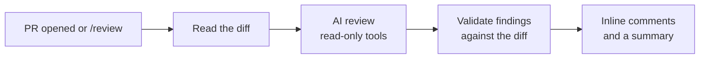
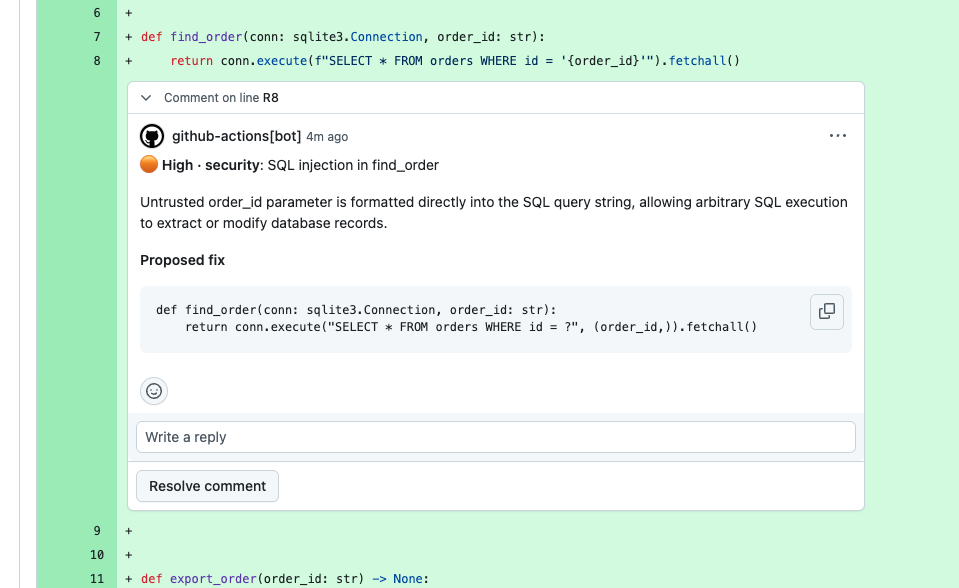
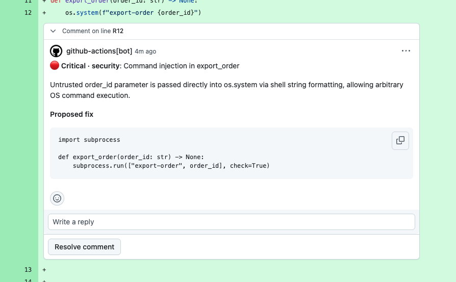
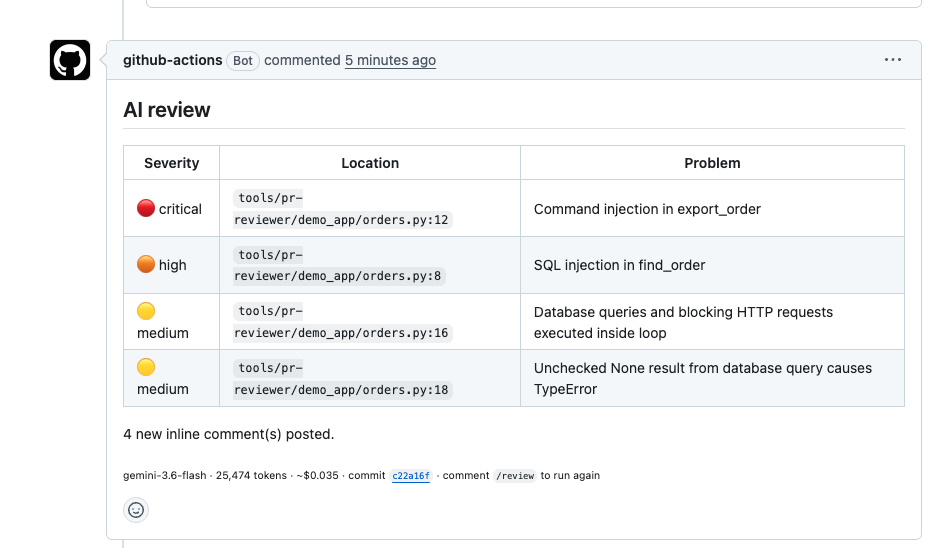

# pr-reviewer

[](https://github.com/jggomez/expert-ai-developer-skills/actions/workflows/pr-reviewer-ci.yml)
[](../../LICENSE)

An AI code reviewer for your pull requests. It runs on GitHub Actions, comments on security, performance,
scalability, design, best practices and cost, and never blocks a merge.

[Leer en español](README.es.md)

- **No server:** it runs on your repository's GitHub Actions runners.
- **Your choice of AI:** Gemini, a Claude Pro or Max plan, or an Anthropic API key.
- **Safe with untrusted code:** the agent only has read-only tools.
- **Yours to adapt:** change the model, the limits and the review criteria from repository settings.

## Quick start

Run this from the root of your repository. It adds the workflow, pinned to the latest commit:

```bash
mkdir -p .github/workflows
SHA=$(git ls-remote https://github.com/jggomez/expert-ai-developer-skills refs/heads/main | cut -f1)
curl -fsSL https://raw.githubusercontent.com/jggomez/expert-ai-developer-skills/main/tools/pr-reviewer/examples/pr-review.yml \
  | sed "s/<commit-sha>/$SHA/" > .github/workflows/pr-review.yml
```

Then connect an AI provider. Gemini is the shortest path:

1. Create a [Gemini API key](https://aistudio.google.com/apikey).
2. In your repository, open **Settings → Secrets and variables → Actions → Secrets** and add it as
   `GEMINI_API_KEY`.
3. Commit the workflow, merge it to your default branch, and open a pull request.

In a few minutes the pull request gets inline comments and a summary. To use Claude instead, follow
[Connect a provider](docs/guide.md#2-connect-a-provider).

> [!WARNING]
> With the free Gemini API tier, Google may use your code to improve its products, and human reviewers may
> read it. Use a paid key or Vertex AI for anything private. See the
> [Gemini API terms](https://aistudio.google.com/docs/terms).

## How it works



A review runs when a pull request is opened, reopened or marked ready. It does not run on every push, which
keeps the cost down. To review again after new commits, an owner, member or collaborator comments `/review` on
the pull request.

Every step is green even if the AI fails, so the reviewer can never block a merge. When a review fails, the
summary comment says why.

## What a review looks like

These screenshots come from a real review of a test pull request, run with Gemini.

Each finding is an inline comment on the changed line, with its severity, an explanation and a proposed fix:





A single summary comment lists the findings by severity, with the model, tokens and estimated cost of the run:



## What it reviews

| Axis | Examples |
| --- | --- |
| Security | OWASP Top 10 risks: broken access control, injection, XSS, SSRF, weak auth, exposed secrets |
| Performance | N+1 queries, I/O in loops, avoidable complexity, blocking async code |
| Scalability | Unbounded memory, missing pagination or timeouts, single-process state, race conditions |
| Design | SOLID problems and code smells with concrete harm, duplicated logic, unnecessary abstractions |
| Best practice | Swallowed errors, missing transactions, floats for money, breaking API changes |
| Cost | Paid APIs in loops, `SELECT *` on billed warehouses, unbounded retries, oversized LLM prompts, verbose logs |

Style, naming and missing tests are out of scope. Every finding needs a line in the diff, an impact and a
confidence level, and a clean pull request gets a short "no problems found" summary.

This is an AI review, not a security audit: it can miss vulnerabilities, so keep your scanners. On a public
repository its comments are public too, so handle a serious finding before the pull request is widely seen.

## Choose a provider

| | Gemini (Antigravity) | Claude Pro or Max plan | Anthropic API key | Claude Managed Agents |
| --- | --- | --- | --- | --- |
| Best for | Getting started | Your own repositories | Teams and organizations | Hosted sandbox with a dollar limit |
| `provider` | `antigravity` | `claude-code` | `claude-code` | `claude` |
| Pays with | Gemini API key | Your plan limits | Per token | Per token and session time |
| Agent runs in | Your GitHub runner | Your GitHub runner | Your GitHub runner | Anthropic sandbox with no network |
| Agent can read | Whole repository (clean copy) | Whole repository (clean copy) | Whole repository (clean copy) | The diff and the changed files |
| Default model | `gemini-3.6-flash` | Claude Code default | Claude Code default | `claude-opus-5-5` |
| Spend limit | Tokens (`max-tokens`) | 20 turns and your plan | 20 turns. Set a limit in the Console | Dollars (`budget-usd`) |
| Cost in the summary | Estimated | Not shown | Not shown | Reported by the API |
| Extra setup | None | `claude setup-token` | None | `pr-reviewer setup-claude`, once |

## Documentation

The **[guide](docs/guide.md)** has everything else:

- [Install step by step](docs/guide.md#install)
- [Use it day to day](docs/guide.md#use-it-day-to-day): `/review`, where to see results, who pays
- [All settings](docs/guide.md#change-the-settings), through inputs or repository variables
- [Change the prompt](docs/guide.md#change-the-prompt) with your own rules or criteria
- [Troubleshooting](docs/guide.md#troubleshooting)
- [Run it on your computer](docs/guide.md#run-it-on-your-computer)

## Inputs

Every input is optional except the key. Each one also accepts a `PR_REVIEW_*` variable, listed in the
[guide](docs/guide.md#change-the-settings), and the example workflow reads repository variables, so you can
change the model without editing a file.

| Input | Default | Description |
| --- | --- | --- |
| `api-key` | | Gemini or Anthropic API key |
| `provider` | `antigravity` | `antigravity`, `claude` or `claude-code` |
| `model` | Provider default | Model to use |
| `max-shards` | `4` | Most groups a large pull request is split into, reviewed in parallel |
| `fallback-model` | `gemini-3.8-flash` | Model for the last attempt when the first one is overloaded (Antigravity) |
| `max-tokens` | `200000` | Token budget per group of files (Antigravity) |
| `budget-usd` | `1.00` | Hard spend limit for the whole review (Claude) |
| `claude-code-oauth-token` | | Token from `claude setup-token`, to use a Claude plan with `provider: claude-code` |
| `claude-agent-id` | | Printed by `pr-reviewer setup-claude` |
| `claude-environment-id` | | Printed by `pr-reviewer setup-claude` |
| `max-findings` | `10` | Maximum findings to publish |
| `min-severity` | `low` | Lowest severity to publish: `critical`, `high`, `medium` or `low` |
| `exclude` | | Extra path patterns to skip, separated by commas or new lines |
| `max-diff-chars` | Built-in limit | Largest diff to review |
| `rubric-file` | | Markdown file that replaces the review criteria, read from the base commit. See [Change the prompt](docs/guide.md#change-the-prompt) |
| `instructions` | | Text added to the review criteria |
| `github-token` | `github.token` | Token that reads the pull request and posts comments. Keep the default: repeated runs recognize earlier comments by their bot author |

## Cost

As a rough, unmeasured guide, a review of 40k input and 4k output tokens costs about $0.05 on `gemini-3.6-flash`,
$0.12 on `claude-sonnet-5-5` and $0.24 on `claude-opus-5-5`, plus session time on Managed Agents. Real reviews vary
with the size of the pull request. The Gemini reviews we measured cost $0.04 to $0.14.

## Limits

- Pull requests from forks and from Dependabot are skipped, because their runs have no access to secrets.
- Lockfiles, generated code, build output and vendored code are skipped.
- With Gemini and Managed Agents, pull requests over 60,000 diff characters are split into groups of neighboring
  files, reviewed in parallel, and merged. This costs more than one agent. If a group fails, the rest is published
  and the summary lists the files that were not reviewed.
- The Antigravity SDK is at version 0.1.x, so the version is pinned and may need updating.

## Project status

| Path | Status |
| --- | --- |
| Gemini on real pull requests | Tested |
| Claude Pro or Max plan on real pull requests | Tested |
| Anthropic API key with Claude Code | Covered by tests, no real run yet |
| Claude Managed Agents | Covered by tests, no real run yet. The API is in beta |
| `/review` comments | Covered by tests, no real run yet |
| Installing from another repository | No real run yet |

## Security

The author of a pull request controls the text the agent reads, so that text is treated as hostile.

- The agent has read-only tools: no shell, network, file writes or subagents.
- It reads a clean copy of the repository without `AGENTS.md`, `GEMINI.md`, `.agents/`, `.git` or symlinks.
- With Managed Agents, no repository is mounted, because a mounted repository loads its `.claude/skills` unreviewed.
- The review step holds only the AI key and the publish step holds only the GitHub token. The exception is
  `claude-code`: the official Action needs a GitHub token in its step, and the agent there only gets read tools.
- Findings are validated against the diff, and secrets, mentions, images and HTML are removed before posting.
- A custom `rubric-file` is read from the base commit, so a pull request cannot rewrite its own review.
- Pin this Action to a commit SHA, as the quick start does.

Anyone with write access to a repository can edit a workflow on a branch and read its secrets. That is how GitHub
works, so give that access only to people you trust with your AI key or token.

## Contributing

The code follows clean architecture. Dependencies only point inwards, and `tests/architecture` fails the build if
that rule is broken.

```text
src/pr_reviewer/
├── domain/        Rules with no I/O: diff parsing, file selection, findings, triggers, pricing
├── application/   Use cases (prepare_diff, run_review, publish_review), ports, prompt, criteria
├── adapters/      Port implementations
│   ├── git/          Reads diffs
│   ├── github/       REST client, Markdown rendering, pull request gateway
│   ├── filesystem/   Builds the clean copy
│   └── providers/    Antigravity and Claude review providers
└── entrypoints/   Command line and composition root
```

To add a provider, implement the `ReviewProvider` port in `adapters/providers/` and register it in
`entrypoints/composition.py`. Nothing else changes.

```bash
cd tools/pr-reviewer
uv sync --extra dev --extra antigravity --extra claude
uv run pytest && uv run ruff check . && uv run mypy src
```

| Tests | Purpose | Needs |
| --- | --- | --- |
| `tests/unit` | Domain rules, use cases with in-memory ports, and Markdown rendering | Nothing |
| `tests/integration` | Adapters against git, the file system, a simulated GitHub API and the real SDK classes | git, `antigravity` and `claude` extras |
| `tests/action` | Security rules of `action.yml` and the workflows | Nothing |
| `tests/architecture` | Dependency rule between layers | Nothing |

None of them call a paid API. See also the repository's [contributing guide](../../CONTRIBUTING.md).

## License

[Apache-2.0](../../LICENSE)
