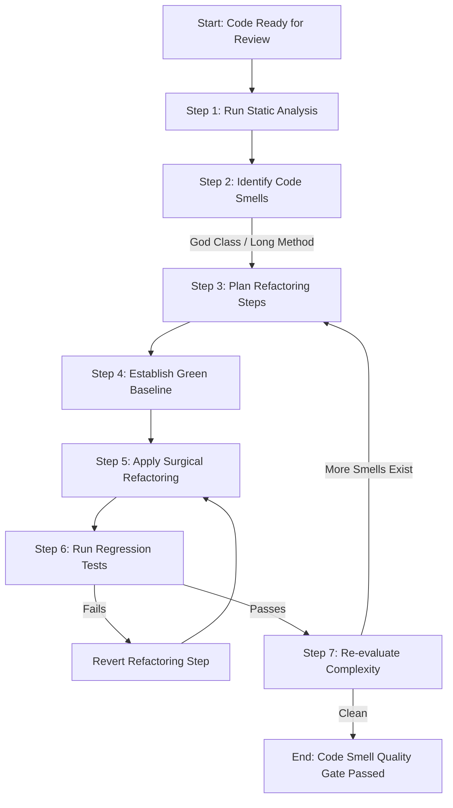

# Workflow: Code Smell Auditing & SOLID Refactoring

**Identifier**: `code-smell-review-workflow`  
**Purpose**: Guide developers and agents through static code analysis, detecting Fowler/Beck code smells, assessing SOLID compliance, and applying risk-free refactoring patterns, utilizing subagent delegation and automated AST analyzers.

---

## 1. Prerequisites
* Project code compiles and runs successfully.
* Existing test coverage is active and passing (do not refactor code that has no test baseline).

---

## 2. Subagent Delegation & Role Boundaries
- **Role Boundary**: Smell detection and audit reports are prepared by `compliance-verifier`; surgical refactoring implementation is delegated to `code-implementer` (or `flutter-implementer`). The Orchestrator never edits code directly.
- **Subagent Delegation across Runners**:
  * **Google Antigravity Runner**:
    ```python
    # For audit
    invoke_subagent(
        name="compliance-verifier",
        prompt="Scan module for code smells, God classes, and high cyclomatic complexity: <path>"
    )
    # For refactoring
    invoke_subagent(
        name="code-implementer",
        prompt="Apply surgical refactoring to eliminate identified code smells while maintaining passing tests: <path>"
    )
    ```
  * **Anthropic Claude Code Runner**:
    ```python
    # For audit
    Agent(
        agent="compliance-verifier",
        prompt="Scan module for code smells, God classes, and high cyclomatic complexity: <path>"
    )
    # For refactoring
    Agent(
        agent="code-implementer",
        prompt="Apply surgical refactoring to eliminate identified code smells while maintaining passing tests: <path>"
    )
    ```
- **Primary Skills**: `code-smells-expert`, `refactoring-code-expert`, `guidelines-karpathy`.

---

## 3. Step-by-Step Workflow



### Step 1: Run Static Analysis & Metrics
* Run the AST-based smell detector from the skills catalog:
  ```bash
  python3 skills/code-smells-expert/scripts/detect_smells.py src/
  ```
* Run additional complexity metrics if necessary (e.g. Radon for Cyclomatic Complexity).

### Step 2: Identify Code Smells
Review the code for structural defects:
1. **Large Classes / God Modules**: Any class file with >300 lines or handling unrelated domains.
2. **Long Methods**: Any function exceeding 30-50 lines or containing nested loops/if-conditions deeper than 3 levels (High Cognitive Complexity).
3. **Duplicated Code**: Blocks of identical or highly similar code across modules.
4. **Shotgun Surgery**: Changes in one feature requiring file tweaks across multiple packages.

### Step 3: Plan Refactoring Steps
* Break the refactoring down into tiny, single-focus steps.

### Step 4: Establish Green Baseline
* Before modifying any line, run the unit test suite covering the target files:
  ```bash
  pytest tests/test_module.py
  ```
* Ensure 100% of tests are passing. *If there are no tests, write unit tests first before refactoring.*

### Step 5: Apply Surgical Refactoring (Karpathy Alignment)
* Execute one single step from your refactoring plan at a time.
* Extract methods or classes without changing any variable names or interface contracts.
* Remove old imports, unused parameters, and redundant helper variables.

### Step 6: Run Regression Tests
* Run the test suite immediately after each refactoring step:
  ```bash
  pytest tests/test_module.py
  ```
* If tests fail, immediately revert the changes using `git checkout` or `git restore`, isolate what broke, and try again with a smaller step.

### Step 7: Re-evaluate Complexity
* Re-run `detect_smells.py`. Confirm that Cyclomatic Complexity score is in the A/B range (Score < 10 per function).

---

## 4. Quality Gate & Verification

Before finalizing the refactor, verify:
- [ ] No changes have been made to public API contracts or external class interfaces.
- [ ] Linter reports 0 errors and code formatter is applied.
- [ ] 100% of tests pass, confirming 0 behavioral regressions.
- [ ] Zero lazy placeholders or stub comments introduced.
