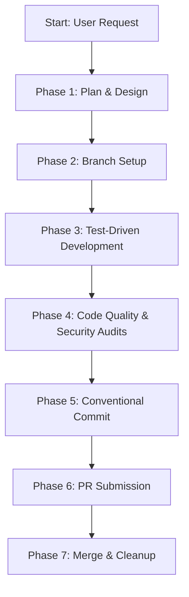

# Workflow: End-to-End Feature Development Cycle

**Identifier**: `feature-development-workflow`  
**Purpose**: Playbook for executing the complete software development lifecycle (SDLC) for new features, incorporating Google Antigravity (AGY) and Anthropic Claude Code runners, subagent delegation, and graph engineering practices.

---

## 1. Step-by-Step Lifecycle



---

## Subagent Delegation & Inviolable Role Boundaries

Across all SDLC phases, strict role boundaries are enforced:
- **Lead Orchestrators (`senior-dev-orchestrator`, `flutter-feature-orchestrator`)**:
  * Author and maintain `PLAN.md` and the Graph Engineering execution state machine.
  * **Strictly prohibited from writing or editing production application code directly.**
  * Must delegate implementation, testing, and audits to specialized worker subagents.
- **Subagent Delegation Syntax**:
  * **Google Antigravity Runner**:
    ```python
    invoke_subagent(name="<agent-name>", prompt="<explicit-task-prompt>")
    ```
  * **Anthropic Claude Code Runner**:
    ```python
    Agent(agent="<agent-name>", prompt="<explicit-task-prompt>")
    ```

---

## Phase 1: Plan & Design

1. **Understand Requirements & Align**:
   - If design decisions or parameters require clarification, run `/grill-me` or delegate to `product-analyst`:
     * Antigravity: `invoke_subagent(name="product-analyst", prompt="Clarify requirements and draft PRD...")`
     * Claude Code: `Agent(agent="product-analyst", prompt="Clarify requirements and draft PRD...")`
2. **Draft the Implementation Plan (`PLAN.md`)**:
   - The Orchestrator authors `PLAN.md` establishing the atomic checklist.
   - For complex architectural decisions, delegate to `architect-engineer`:
     * Antigravity: `invoke_subagent(name="architect-engineer", prompt="Evaluate architecture and draft ADR...")`
     * Claude Code: `Agent(agent="architect-engineer", prompt="Evaluate architecture and draft ADR...")`
3. **Reference Workspace Context**: Attach relevant schemas, design documents, and rules.
4. **Draft Verification Plan**: Explicitly define what test files will be added and what commands will verify success.

---

## Phase 2: Branch Setup

1. **Synchronize Main**: Pull the latest changes from the master/develop branch:
   ```bash
   git checkout main
   git pull origin main
   ```
2. **Create Feature Branch**: Create a feature branch named semantically:
   ```bash
   git checkout -b feature/issue-id-short-description
   ```

---

## Phase 3: Test-Driven Development (TDD) via Subagents

Follow the Red-Green-Refactor sequence. The Lead Orchestrator delegates all code writing:
1. **Delegate Implementation to Code Implementer**:
   * Antigravity: `invoke_subagent(name="code-implementer", prompt="Implement feature using strict TDD...")`
   * Claude Code: `Agent(agent="code-implementer", prompt="Implement feature using strict TDD...")`
   *(For Flutter, use `flutter-implementer`)*
2. **Write Unit Tests (Red)**: Write unit tests covering happy path inputs, invalid payloads, and boundary limits. Verify failures:
   ```bash
   pytest tests/test_new_feature.py  # Verify failures
   ```
3. **Write Minimum Implementation (Green)**: Write minimal production code required to make tests pass. Verify success:
   ```bash
   pytest tests/test_new_feature.py  # Verify success
   ```
4. **Refactor Code (Refactor)**: Clean up duplicate logic, long functions, or bad variable names while keeping tests green.

---

## Phase 4: Code Quality, Testing & Security Audits

1. **Delegate Verification to QA Tester**:
   * Antigravity: `invoke_subagent(name="qa-tester", prompt="Run full test suite and confirm exit code 0...")`
   * Claude Code: `Agent(agent="qa-tester", prompt="Run full test suite and confirm exit code 0...")`
2. **Format & Lint**: Format the codebase and check static analysis:
   ```bash
   ruff format . && ruff check .
   ```
3. **Delegate Compliance & Security Audit**:
   * Antigravity: `invoke_subagent(name="compliance-verifier", prompt="Audit security, secrets, and lint gates...")`
   * Claude Code: `Agent(agent="compliance-verifier", prompt="Audit security, secrets, and lint gates...")`
   Requires an explicit `APPROVED` verdict.

---

## Phase 5: Conventional Commit (Branch Safety Gates)

1. **Selectively Stage**: Check `git status` and stage only files related to the feature.
2. **Commit Semantically**: Format commit messages matching Conventional Commits (`feat: ...`, `fix: ...`).
3. **Branch Protection**: Deterministic hooks (`gitflow-branch-gate.js`) will block direct commits to `main` or `develop`.

---

## Phase 6: Pull Request Description & Submission

1. **Rebase feature branch**: Update against main:
   ```bash
   git fetch origin
   git rebase origin/main
   ```
2. **Push to GitHub**:
   ```bash
   git push origin feature/issue-id-short-description
   ```
3. **Open Pull Request**: Author detailed PR description using the template, documenting test commands and verification evidence.

---

## Phase 7: Merge & Cleanup

1. **CI/CD Quality Gate**: Ensure all automated build, lint, and test checks pass.
2. **Merge PR**: Squash and merge into `main` (or `develop`).
3. **Cleanup Branch**:
   ```bash
   git branch -d feature/issue-id-short-description
   git push origin --delete feature/issue-id-short-description
   ```
