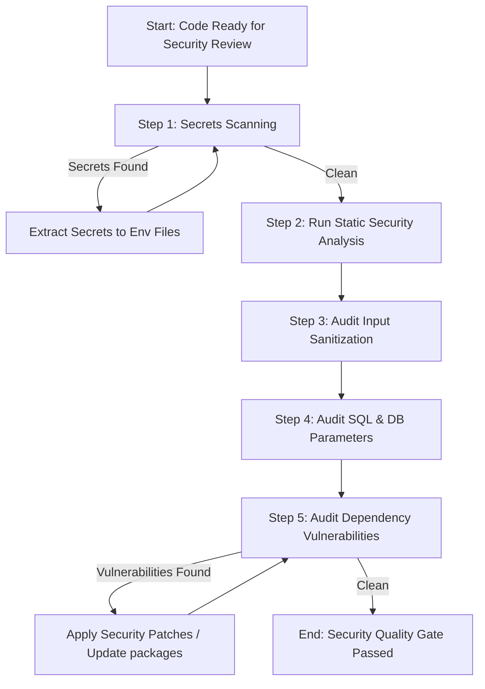

# Workflow: Secure Code Review & Secrets Auditing

**Identifier**: `secure-code-review-workflow`  
**Purpose**: Step-by-step playbook to perform security vulnerability audits, dependency scans, input sanitization checks, and credentials scanning to safeguard projects against OWASP vulnerabilities, utilizing subagent delegation and security validators.

---

## 1. Prerequisites
* Project environment variables and security scanner packages are installed (e.g., `bandit` for Python, `audit` tools, secret scanners).
* Pre-existing knowledge of secure design patterns.

---

## 2. Subagent Delegation & Role Boundaries
- **Role Boundary**: The Lead Orchestrator delegates security audits, secret scanning, and SAST validation to `compliance-verifier`.
- **Subagent Delegation across Runners**:
  * **Google Antigravity Runner**:
    ```python
    invoke_subagent(
        name="compliance-verifier",
        prompt="Execute comprehensive security audit, secret scanning, and OWASP review for: <scope>"
    )
    ```
  * **Anthropic Claude Code Runner**:
    ```python
    Agent(
        agent="compliance-verifier",
        prompt="Execute comprehensive security audit, secret scanning, and OWASP review for: <scope>"
    )
    ```
- **Primary Skills**: `security-audit`, `compliance-verifier`, `build-and-ci-gates`.

---

## 3. Step-by-Step Workflow



### Step 1: Secrets Scanning
* Scan all changed files and commit histories for hardcoded keys, API tokens, passwords, database URLs, and certificates:
  ```bash
  python3 skills/security-audit/scripts/secret_scanner.py src/
  ```
* **Resolution**: Extract all hardcoded values to a `.env` file (ignored by Git) and fetch them via standard environment configuration (e.g., `os.getenv()`, `process.env`).

### Step 2: Run Static Security Analysis (SAST)
* Execute language-specific static analysis security tools to detect dangerous functions, insecure crypto libraries, or unsafe file operations:
  ```bash
  bandit -r src/
  ```
* Review the report and fix high-severity warnings (e.g., replacing `eval()`, setting proper file permissions, upgrading insecure random number generators).

### Step 3: Audit Input Sanitization (XSS & Path Traversal)
* Check all endpoints and methods that accept user input:
  1. Verify inputs are mapped to strict data schemas (e.g., Pydantic models with type definitions).
  2. Scan for raw string concats on file system paths (`os.path.join` with unsanitized parameters) to prevent Path Traversal.
  3. Ensure user inputs are escaped or sanitized before being rendered in HTML outputs.

### Step 4: Audit SQL & Database Queries (SQLi & Firestore Security Rules)
* **Relational DBs**: Confirm that SQL query strings are constructed *only* using parameterized placeholders (e.g. `%s`, `:param`, `?`). Ensure raw database execution functions receive data as parameters, never as formatted strings.
* **Firestore DBs**: If your project integrates with Firestore:
  1. Review `firestore.rules` for overly permissive statements before deploying.
  2. Validate security rules using firebase CLI tools if available.

### Step 5: Audit Dependency Vulnerabilities
* Perform scans on external packages to identify libraries with known CVEs:
  ```bash
  # Node.js
  npm audit
  # Python
  pip-audit || safety check
  ```
* Upgrade package dependencies to safe version patches.

---

## 4. Quality Gate & Verification

The secure code workflow is complete when:
- [ ] Secrets scanner returns 0 findings on staged commit files.
- [ ] SAST analyzer (e.g. Bandit) returns 0 High/Medium severity alerts.
- [ ] All database access points use parameterized queries.
- [ ] Package vulnerability scanner reports 0 critical vulnerabilities.
- [ ] Explicit compliance audit verdict issued.
